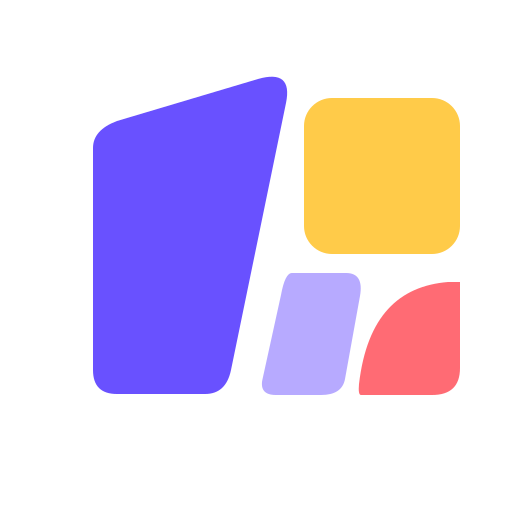
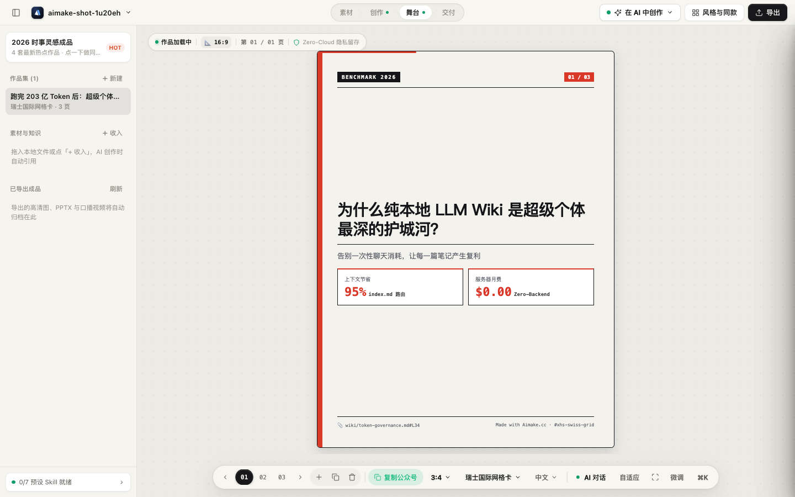
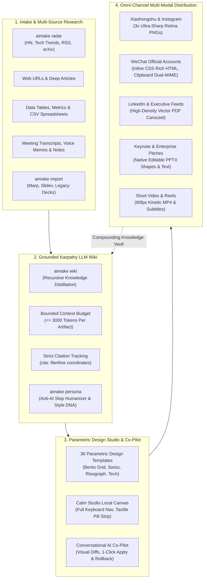
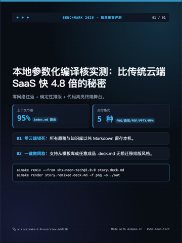
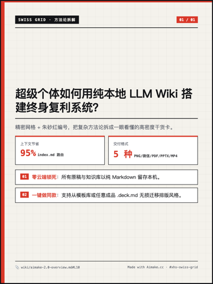
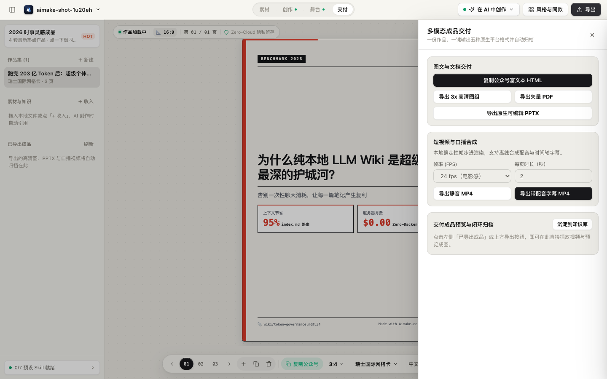
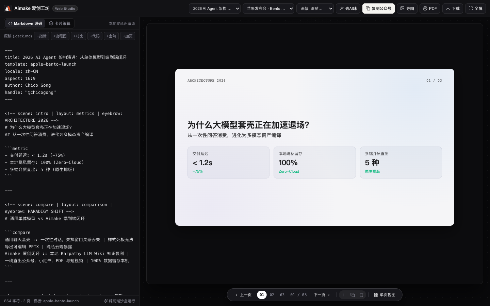

# Aimake Studio — Local-First Multimodal Creator Studio & CLI

<p align="center">
  <a href="https://aimake.cc"></a>
</p>

<p align="center">
  <strong>Create once in Markdown. Ship 5 native deliverables with 36 parametric design templates, offline Mermaid SVG diagrams, 7 workspace-preset AI skills, and a built-in AI Co-Pilot — 100% locally.</strong>
</p>

<p align="center">
  <a href="https://github.com/chicogong/aimake-creator/actions/workflows/ci.yml"></a>
  <a href="https://www.npmjs.com/package/aimake-studio"></a>
  <a href="./LICENSE"></a>
  <a href="https://nodejs.org"></a>
  <a href="https://aimake.cc"></a>
  <a href="https://github.com/chicogong/aimake-creator/projects"></a>
  <a href="https://aimake.cc/playground/"></a>
  <a href="#"></a>
  <a href="#"></a>
</p>

<p align="center">
  English · <a href="./README.zh-CN.md">简体中文</a> · <a href="./README.ja.md">日本語</a> · <a href="./README.ko.md">한국어</a>
</p>

<p align="center">
  
  <br />
  <em>Aimake Studio: Local-first WYSIWYG canvas with glassmorphism status bar, bidirectional keyboard navigation & tactile slide dock</em>
</p>

---

## ⚡️ Install & Run in 10 Seconds

```bash
# Launch the interactive @clack/prompts onboarding wizard
npx aimake-studio

# Or install globally (registers both `aimake` and `aimake-studio` commands)
npm install -g aimake-studio
aimake wizard
```

Try the instant zero-install browser sandbox: **[https://aimake.cc/playground/](https://aimake.cc/playground/)**

---

## 🏛️ Ecosystem & Architecture Hierarchy

Aimake follows a structured three-tier architecture (see [docs/ARCHITECTURE.md](./docs/ARCHITECTURE.md) and [docs/brand-kit/BRAND_GUIDELINES.md](./docs/brand-kit/BRAND_GUIDELINES.md)):

| Tier | Entity Name | Role & Responsibility | Key Assets & Access |
| :--- | :--- | :--- | :--- |
| **Mother Brand** | **Aimake** | Local-First multimodal creative infrastructure brand | Core design tokens & local-first philosophy |
| **Flagship Product** | **Aimake Studio** | **Primary Tool**: Web canvas, CLI, desktop app, 36 templates, 5+1 deliverables | This repository (`products/aimake`), npm `aimake-studio@2.0.0`, [aimake.cc](https://aimake.cc) |
| **Core Engine** | **Aimake Engine** | **Headless Runtime**: Video rendering kernel, Whisper word-level alignment, Plan/Run receipts | `aimake-labs/aimake-studio`, npm `@aimake/engine`, bin `aimake-engine` |
| **Maintenance Matrix** | **Aimake Universe** | **LTS Assets**: 6 educational interdisciplinary planets for families and kids | `aimake-labs/*`, persistent live subdomains (zero 404s) |

---

## 🌟 Why Aimake?

Existing presentation and content generation tools suffer from vendor lock-in, bloated Electron memory footprints, generic AI hallucinations ("AI slop"), and opaque cloud telemetry. 

**Aimake** rethinks digital publishing for AI agents and solopreneurs:

- **Plain Markdown as Single Source of Truth**: Author simple, standard `.deck.md` files with YAML frontmatter.
- **1 Source → 5 Native Formats**: One file renders into Retina 3x PNG cards, WeChat inline-CSS HTML, LinkedIn 4:5 vector PDF, native editable PowerPoint PPTX (shapes, tables, textboxes), and 60fps MP4 video with synchronized subtitles.
- **100% Local-First & Zero Telemetry**: Every operation runs on your machine. No telemetry, no cloud accounts required, and zero global `~/` or `~/.claude` pollution.
- **Unified 36-Template Design Engine**: Handcrafted parametric typography, golden ratios, strict CJK line breaking (`keep-all` / `strict`), and full dark/light dual theme switching.
- **Deep Conversational AI Co-Pilot**: Interactive chat with prompt suggestion chips, toggleable side-by-side & inline diff cards, 1-click apply & snapshot rollback, and pre-wired CLI launch recipes.

---

## 🔄 The Creative Flywheel: Beyond Just Markdown

Aimake is **not** just another Markdown-to-slide converter. It is an **End-to-End Multimodal Knowledge Distillation & Omni-Channel Distribution Engine**. 

True high-leverage content creation rarely starts with a blank slide. It begins with raw sparks—a sudden inspiration, an automated industry research scan, a spreadsheet of benchmark numbers, or historical project archives. Aimake transforms this fragmented intake into grounded, authoritative visual assets distributed across five native media formats:



### The 4 Flywheel Stages:
1. **Intake & Multi-Source Research (`aimake radar` & `aimake import` & `aimake intake`)**:
   - Ingest raw inspiration from RSS feeds, HackerNews tech trends, arXiv abstracts, or competitor announcements.
   - Import structured tables (CSV financial figures, benchmark numbers) and unstructured notes (voice transcripts, interview memos, Obsidian vaults).
   - Effortlessly migrate existing slide decks from Marp and Slidev into Aimake format via `aimake import`.
2. **Grounded Local Knowledge Base (`aimake wiki` & `aimake persona` & `aimake distill`)**:
   - Compiles research into a local Karpathy-inspired LLM Wiki with bounded token budgets ($\le 3000$ tokens per index) to guarantee speed and context precision.
   - Enforces strict `cite: [source#L12-L34]` coordinates on every factual card, eliminating hallucinations.
   - Runs the Anti-AI Humanizer across 4 locales (EN, ZH, JA, KO) to prune synthetic clichés and preserve distinct personal voice.
3. **Parametric Studio & Conversational Co-Pilot (`aimake studio` & `aimake create` & `aimake deck`)**:
   - Instantly applies 36 handcrafted design systems without manual Figma/Canva pixel pushing.
   - Co-pilot chat features prompt suggestion chips, toggleable side-by-side diff cards, and non-destructive snapshot rollback.
4. **Omni-Channel Multi-Modal Distribution (`aimake render` & `aimake publish`)**:
   - Compiles one single `.deck.md` into 5 native deliverables (PNG, WeChat HTML, PDF, PPTX, MP4).
   - Cross-posts ready-to-publish drafts to WeChat Official Accounts, Zhihu, Juejin, Xiaohongshu, and Wechatsync bundles.
   - Completed presentations compound back into `wiki/published.md`, continually growing your creative asset vault.

---

## 🧩 Architecture: Decoupling CLI, Skills, and MCP

Aimake follows a strict separation of concerns: **Deterministic Execution sink to the Core CLI / Cognitive Reasoning bubble up to Agent Skills / External Connectivity converge on standard MCP**:

```
                ┌─────────────────────────────────────────────────┐
                │          AI Agents & IDE Hosts (Claude, Cursor, AGY)│
                └───────────────────────┬─────────────────────────┘
                                        │ (JSON-RPC)
                                        ▼
             ┌────────────────────────────────────────────────────────┐
             │  MCP Service Layer (src/mcp/mcp-server.ts - 16 tools)  │
             │  aimake_publish_content, aimake_pipeline_inspect ...   │
             └──────────────────────────┬─────────────────────────────┘
                                        │
           ┌────────────────────────────┴─────────────────────────────┐
           ▼                                                          ▼
┌───────────────────────────┐                            ┌───────────────────────────┐
│     Agent Skills Layer    │                            │     Core CLI Engine       │
│ (skills/workspace-presets)│                            │        (src/cli.ts)       │
├───────────────────────────┤                            ├───────────────────────────┤
│ ① aimake-intake           │ ── Prompt guidance/intent ─►│ ① aimake intake <sources> │
│ ② aimake-wiki-synth       │ ── Recursive distillation ─►│ ② aimake distill [topic]  │
│ ③ aimake-deck-composer    │ ── Visual layout & diffs ──►│ ③ aimake create / studio   │
│ ④ aimake-deliver-narrator │ ── Narration / copy hooks ─►│ ④ aimake render / publish │
└───────────────────────────┘                            ├───────────────────────────┤
                                                         │ 🔄 aimake pipeline status │
                                                         └───────────────────────────┘
```

### 1. Intake
- **Core CLI**: `aimake intake <sources...>` handles high-throughput file I/O, local PDF/Office text extraction, multi-source scraping, and SHA-256 fingerprinting.
  - **X (Twitter) Posts & Threads**: Zero-auth ingestion via global edge API (`api.fxtwitter.com`) extracting tweet text, author info, engagement metrics (likes, retweets, views), high-res media, and quote tweets with 0 API keys; paired with Jina Reader for expanded threads.
  - **WeChat Articles (`mp.weixin.qq.com`)**: Bypasses anti-hotlinking by normalizing dynamic `data-src` images into standard Markdown image syntax.
  - **Data Spreadsheets (CSV/TSV/Excel)**: Parses row/column structure and auto-extracts high-contrast numerical metrics into Bento-ready ````metric` blocks.
  - **Video/Voice Transcripts (VTT/SRT)**: Strips microsecond timestamp clutter and clusters speech into coherent paragraphs anchored by time coordinates (`[01:23]`).
  - **Ecosystem Survey**: See [docs/INTAKE_ECOSYSTEM_RESEARCH.md](./docs/INTAKE_ECOSYSTEM_RESEARCH.md) for full benchmarks and open-source tooling comparisons.
- **Agent Skill**: `aimake-intake` analyzes messy notes, strips UI boilerplate, and preserves key figures, data points, and provenance.

### 2. Distill
- **Core CLI**: `aimake distill [topic]` validates token budgets ($\le 3000$ tokens per index), scaffolds `briefs/<slug>.brief.md`, and maintains graph reference index.
- **Agent Skill**: `aimake-wiki-synth` & `aimake-humanizer` perform Chain-of-Thought synthesis, 4-locale tone de-slop humanization, and bind strict `cite:` file#line coordinates.

### 3. Create
- **Core CLI**: `aimake create [prompt]` & `aimake studio` start the local Calm Studio canvas, compile offline Mermaid SVGs, stream SSE updates, and manage snapshot rollbacks.
- **Agent Skill**: `aimake-deck-composer` & `aimake-brief-architect` orchestrate multi-turn conversational edits, audience-targeted template selection, and visual diff reviews.

### 4. Publish
- **Core CLI**: `aimake render` compiles the 5 native formats (PNG, PPTX, PDF, MP4, WeChat HTML) and `aimake publish` packages cross-posting bundles for WeChat, Zhihu, Juejin, Xiaohongshu, and Wechatsync, compounding into `wiki/published.md`.
- **Agent Skill**: `aimake-deliver-narrator` generates platform-specific hook copy, spoken narration scripts, and distribution tag strategies.

---

## 📸 Product Features & Visual Showcase

### 1. 2026 Trending Styles & Benchmark Decks

Aimake ships with ready-to-use 2026 trending design systems:

<p align="center">
  
  
</p>
<p align="center">
  
  
</p>

- **Apple Bento Launch (`apple-bento-launch`)**: Obsidian cards, tabular metrics, subtle lighting, and modular tiles for product keynotes.
- **DeepSeek-R1 OpenWeights Benchmark (`xhs-neon-tech`)**: High-contrast dark geek visual system for technical benchmarks, code blocks, and model comparisons.
- **Minimalist Swiss Grid (`xhs-swiss-grid`)**: High information density, hairline dividers, vermilion accent markers, and authoritative editorial layout.
- **Physical AI & Embodied Intelligence (`poster-risograph`)**: Retro dual-tone coral red × cobalt blue Risograph print aesthetic for tech fliers and posters.

---

### 2. Multi-Modal Deliverable Drawer & Web Playground

<p align="center">
  
  
</p>

- **Multi-Modal Export Drawer**: 1-click generation of ultra-sharp 3x PNGs, compliant dual MIME WeChat clipboard payload (`text/html` + `text/plain`), vector PDF, native editable PPTX, and frame-deterministic MP4.
- **Web Playground (`aimake.cc/playground/`)**: Instant browser-only editor with Markdown source toggle, real-time live preview, and zero server uploads.

---

## 🚀 CLI Cheatsheet

```bash
# 1. Inspect environment & browse templates
aimake doctor                                    # Verify system health, Node.js, and media binaries
aimake templates                                 # List all 36 design templates & aspect ratios
aimake market list                               # Inspect downloadable template packs

# 2. End-to-End 4-Stage Creative Flywheel
aimake workspace init ./my-space                 # Scaffold workspace with 7 preset skills (0 symlinks)
aimake pipeline                                  # Inspect flywheel status & recommended next step
aimake intake https://example.com/rep.html       # ① Intake: Ingest web, PDF, or notes into sources/ & wiki
aimake distill "2026 AI Agent Revolution"       # ② Distill: Recursively distill facts (<=3000 tokens) & brief
aimake create "2026 AI Agent Revolution"        # ③ Create: Conversationally draft storyboard slides
aimake publish ./decks/agent.deck.md             # ④ Publish: Cross-post to WeChat, Zhihu, Juejin, XHS & pack

# 3. Automated Trend Research & Knowledge Base
aimake radar --topic "embodied-ai"               # Scan HackerNews, arXiv & tech feeds for fresh angles
aimake wiki init ./vault                         # Initialize a Karpathy-style local LLM Wiki
aimake wiki distill ./vault/sources -o ./vault   # Recursively distill articles/tables into bounded notes
aimake persona extract ./my-writings             # Extract personal tone DNA & calibrate Anti-AI Humanizer

# 4. Launch Local Calm Studio
aimake studio --demo                             # Launch instant demo workspace
aimake studio ./my-space/decks/story.deck.md     # Launch Studio on a specific deck

# 5. Migrate Existing Decks
aimake import ./legacy-slides.md -o ./deck.md    # Convert Marp / Slidev / Markdown slides

# 6. One-Click Native Multi-Format Rendering
aimake render ./deck.md -f png -o ./out/cards    # 3x Ultra-sharp Retina PNG cards (XHS / IG)
aimake render ./deck.md -f wechat -o ./out.html  # WeChat official account inline-styled HTML
aimake render ./deck.md -f pdf -o ./out/deck.pdf # High-density vector PDF (LinkedIn Carousel)
aimake render ./deck.md -t ppt-executive-16x9 -f pptx -o ./out/deck.pptx   # Native editable PPTX
aimake render ./deck.md -t video-kinetic-reel -f mp4 -o ./out/reel.mp4     # 60fps kinetic MP4
```

> **Note on optional dependencies**: `aimake-studio` keeps CLI install size under 3.5 MB by leaving heavy headless browsers and FFmpeg binaries optional. When rendering PNG, PDF, or MP4, Aimake automatically uses your existing system Chrome/Chromium/Playwright and FFmpeg, or you can run `npm i playwright @ffmpeg-installer/ffmpeg`.

---

## 🎨 36 Parametric Templates Matrix

Aimake features 36 meticulously engineered design systems covering all key creator channels:

| Category | Templates | Aspect Ratios | Visual Style |
|:---|:---|:---|:---|
| **2026 Trending** | `apple-bento-launch`, `xhs-neon-tech`, `xhs-swiss-grid`, `poster-risograph` | `16:9`, `3:4`, `4:5` | Apple Bento grid cards, DeepSeek benchmark dark mode, Swiss typography, Risograph print |
| **Social Media & Feeds** | `xhs-bold-headline`, `xhs-apple-notes`, `xhs-morandi-cream`, `xhs-liquid-glass`, `xhs-quote-card`, `xhs-pro-vs-con` | `3:4`, `1:1` | Xiaohongshu viral headlines, Apple Notes memo, Morandi editorial, liquid glassmorphism |
| **Global Publishing** | `linkedin-exec-carousel`, `ig-cardnews-kr`, `ja-note-editorial`, `en-substack-digest`, `en-founder-whiteboard` | `4:5`, `1:1` | LinkedIn founder carousels, Korean Instagram 카드뉴스 (`keep-all`), Japanese Note 余白 (`strict`), Substack digests |
| **Keynote & Executive** | `ppt-executive-16x9`, `ppt-tech-architecture`, `ppt-linear-dark`, `ppt-bauhaus-bold`, `ppt-consulting-matrix` | `16:9` | Clean corporate decks, system architectures, Linear dark theme, Bauhaus geometric, 2x2 matrix |
| **WeChat Longform** | `wechat-deep-report`, `wechat-editorial-article`, `wechat-frontpage-news`, `wechat-greenbook`, `wechat-minimal-brief` | Responsive | Inline-CSS rich text, dual MIME clipboard payload, mobile typography |
| **Education & Diagrams**| `edu-flashcard-kids`, `edu-lesson-guide`, `x-zukai-quad` | `3:4`, `1:1` | Visual study flashcards, syllabus guides, Japanese 4-quadrant 図解 diagrams |
| **Kinetic Video** | `video-kinetic-reel`, `video-podcast-wave`, `video-cinema-talk` | `9:16`, `16:9` | High-tempo kinetic reels, podcast audiograms, cinematic 16:9 documentaries |

Every template complies with the **Aimake Design Contract**:
- Full **Dark / Light dual theme switching** (`:root[data-theme="dark/light"]` and `theme: dark/light` in frontmatter).
- Consistent CSS variables (`--bg`, `--surface`, `--ink`, `--muted`, `--accent`, `--border`, `--card-shadow`, `--code-bg`).
- Built-in offline **Mermaid SVG rendering** and syntax highlighting via Highlight.js.
- Standalone `sample.deck.md` included for every template.

---

## 🖥️ Aimake Studio: Calm Visual Workspace

Running `aimake studio` launches a local, distraction-free visual environment:

- **Seamless Keyboard Navigation**: 
  - `←` / `→` / `Space`: Previous / Next slide
  - `PageUp` / `PageDown`: Fast slide browsing
  - `F`: Toggle full-screen presenter mode
  - `Esc`: Exit presenter mode or close open modals / drawers
  - `⌘K`: Quick command palette (appearance switching, template jumping, export actions)
- **Tactile Slide Dock**: Auto-scrolling filmstrip pill bar with 1-click **Add (+)**, **Duplicate**, and **Delete** actions.
- **Glassmorphism Status Bar**: Real-time status displaying deck title, aspect ratio badge, slide counter, and **Zero-Cloud Local Privacy Shield**.
- **Instant Export Feedback**: One-click WeChat HTML copy with dual MIME payload (`text/html` + `text/plain`) and 3x PNG export with animated feedback.

---

## 🤖 Conversational AI Co-Pilot & 1-Click External Recipes

Aimake bridges the gap between raw LLMs and deterministic visual layouts:

1. **Quick Action Chips**: Instant 1-click suggestions in the Studio chat pane:
   - `提炼金句卡片` (Quote Card Extraction)
   - `转为 Bento 风格` (Transform into Apple Bento Grid)
   - `生成演讲大纲` (Generate Presentation Outline)
   - `翻译为双语` (Bilingual Localization)
   - `去 AI 味` (Anti-AI Slop Humanizer)
2. **Side-by-Side & Inline Diff Cards**: Preview AI suggestions before saving. Accept with **一键应用 (Apply)** or roll back safely with **还原 (Revert)**.
3. **1-Click External AI Recipes**: Generate ready-to-run CLI commands packed with structured workspace context:
   - **Claude Code CLI**: `claude -p '...'`
   - **OpenAI Codex CLI**: `codex exec --skip-git-repo-check '...'`
   - **Google Antigravity (AGY)**: `agy -p '...'`
   - **Tencent CodeBuddy CLI**: `codebuddy -p '...'`

---

## 🔌 Platform Ecosystem & AI Hosts (WorkBuddy / Claude / Cursor / Codex / AGY)

Aimake is architected with a **"Single Core, Universal Ecosystem"** strategy, providing standard plugin manifests and MCP connectivity for major AI hosts:

### 1. Tencent WorkBuddy (CodeBuddy) Enterprise Integration
- **Pre-packaged manifests**: Located in [`integrations/workbuddy/`](./integrations/workbuddy/)
  - `connector-meta.json`: Standard WorkBuddy Connector metadata & bilingual descriptions
  - `mcp.json`: stdio MCP server declaration `{"command": "npx", "args": ["-y", "aimake", "mcp"]}`
  - `expert/aimake-producer.md`: Pre-configured "Aimake Producer" expert role
- **Installation**: Import the `integrations/workbuddy/` directory into WorkBuddy / CodeBuddy plugin settings or enterprise repository to invoke all 16 Aimake MCP tools directly in chat.

### 2. Claude Desktop & Claude Code
- **Official Plugin Manifests**: Top-level [`plugin.json`](./plugin.json) and [`.claude-plugin/plugin.json`](./.claude-plugin/plugin.json)
- **Claude Desktop MCP Configuration**: In `~/Library/Application Support/Claude/claude_desktop_config.json`:
  ```json
  {
    "mcpServers": {
      "aimake": {
        "command": "npx",
        "args": ["-y", "aimake", "mcp"]
      }
    }
  }
  ```

### 3. Cursor & VSCode
- In Cursor **Settings -> Features -> MCP**, add a new server:
  - **Name**: `aimake`
  - **Type**: `command`
  - **Command**: `npx -y aimake mcp`
- Call all 16 MCP tools (such as `aimake_publish_content`, `aimake_pipeline_inspect`, `aimake_wiki_ingest`) directly from Cursor Composer.

### 4. OpenAI Codex CLI & Google Antigravity (AGY)
- **Universal Skill Standard**: [`skills/aimake/SKILL.md`](./skills/aimake/SKILL.md) adheres to the standard Agent Skill YAML frontmatter contract.
- **1-Click Launch Recipes**: Studio provides pre-filled commands with workspace context:
  - Codex: `codex exec --skip-git-repo-check '...'`
  - AGY: `agy -p '...'`

---

## 📁 Repository Structure

```
products/aimake/
├── src/
│   ├── cli.ts                   # Universal CLI entrypoint (aimake & aimake-studio)
│   ├── index.ts                 # Programmatic TypeScript API exports
│   ├── studio/                  # Calm Studio server, UI markup, styles & script
│   ├── renderer/                # HTML compiler, PPTX generator, Puppeteer/Playwright media renderer
│   ├── workspace/               # Local workspace management & AI agent connectors
│   └── templates/               # Built-in template registry & schema validators
├── templates/                   # 36 parametric design templates (HTML, CSS, manifests, samples)
├── examples/                    # Showcase decks (Bento, DeepSeek benchmarks, Swiss grid, Risograph)
├── skills/                      # 7 workspace preset AI skills (zero symlinks, zero ~/ pollution)
├── scripts/                     # Validation, build, test, and release verification scripts
└── tests/                       # Vitest unit suites & Playwright E2E suites
```

---

## 🛡️ Verification & Quality Assurance

Aimake enforces rigorous automated quality gates:

```bash
# Run the full release verification pipeline
pnpm verify
```

- **Type Safety**: Full `tsc --noEmit` pass with zero errors.
- **Unit & Integration Tests**: 8 Vitest suites (`61/61 tests`) passing in ~2.7s.
- **E2E Playwright Tests**: 6 end-to-end tests validating Studio chat, live diff/rollback, 0-symlink skills, 5-format exports, and macOS desktop launch.
- **Zero Secrets / Leaks Audit**: `audit:secrets` scans 237 source files to guarantee 0 credential or private path leaks.
- **Template & Skills Audit**: `audit:skills` guarantees all 36 templates conform to dark/light theme contracts.
- **Isolated Package Verification**: `pack:check` validates an unpacked size of ~3.2 MB and executes cleanly from `/tmp`.

---

## 🏛️ Prior Art & Open-Source Inspirations

Aimake stands on the shoulders of remarkable open-source projects, design philosophies, and developer tooling:

- **[Marp](https://marp.app/) & [Slidev](https://sli.dev/)**: Pioneered Markdown-driven slide presentations. Aimake honors this lineage while expanding beyond single-slide decks into omni-channel multimodal formats (PNG, WeChat, PDF, editable PPTX, and kinetic MP4) and strict local-first design contracts.
- **[Reveal.js](https://revealjs.com/)**: Laid the technical groundwork for modern web-based presentations.
- **[Andrej Karpathy's LLM Wiki Concept](https://gist.github.com/karpathy)**: Inspired Aimake's local wiki distillation engine (`aimake wiki`)—enforcing bounded token contexts ($\le 3000$ tokens) and verifiable citation coordinates to anchor AI generation in fact.
- **[Obsidian](https://obsidian.md/)**: Exemplified the compounding value of local-first Markdown vaults and durable, user-owned knowledge.
- **Apple Keynote & Bento Grid**: The gold standard in visual restraint, modular grid hierarchy, and keynote storytelling.
- **[Linear](https://linear.app/) & [Vercel Geist](https://vercel.com/font)**: Inspired Aimake Calm Studio's dark aesthetic, micro-interactions, and relentless typography discipline.
- **CLI AI Agent Ecosystem**: Seamless integration with [Claude Code](https://github.com/anthropics/claude-code), [OpenAI Codex](https://github.com/openai/codex), [Google Antigravity (AGY)](https://github.com/google), and [Tencent CodeBuddy](https://github.com/tencent).
- **Underlying Rendering Engines**: [Mermaid.js](https://mermaid.js.org/) for offline SVG diagrams, [Highlight.js](https://highlightjs.org/) for code syntax, and [PptxGenJS](https://gitbrent.github.io/PptxGenJS/) for native PowerPoint generation.

---

## 📄 Documentation & Policies

- [Architecture & Acceptance Report](./docs/ACCEPTANCE-1.0.md)
- [Aimake 2.0 Calm Workspace Design](./docs/AIMAKE_2_0_CALM_WORKSPACE_DESIGN.md)
- [Multi-Platform Intake & Open-Source Ecosystem Research](./docs/INTAKE_ECOSYSTEM_RESEARCH.md)
- [Omni-Channel Launch & Promotion Media Kit](./docs/LAUNCH_AND_PROMOTION_KIT.md)
- [Evolution Roadmap](./docs/ROADMAP-2.0.md)
- [Contributing Guide](./CONTRIBUTING.md)
- [Code of Conduct](./CODE_OF_CONDUCT.md)
- [Security & Local-First Privacy Policy](./SECURITY.md)
- [Third-Party Notices & Licenses](./THIRD_PARTY_NOTICES.md)

---

## 🤝 Contributing & Community

Contributions are warmly welcomed! Please feel free to submit issues, open pull requests, or propose new design templates.

1. Review our [Contributing Guide](./CONTRIBUTING.md) and [Code of Conduct](./CODE_OF_CONDUCT.md).
2. Fork the repository and create your feature branch: `git checkout -b feature/my-new-template`.
3. Verify test suites and audits pass: `pnpm verify`.
4. Commit your changes: `git commit -am 'feat: add my new template'`.
5. Push to your branch and submit a Pull Request.

---

## 📜 License

[MIT License](./LICENSE) © 2026 Aimake Labs / Chico Gong.
