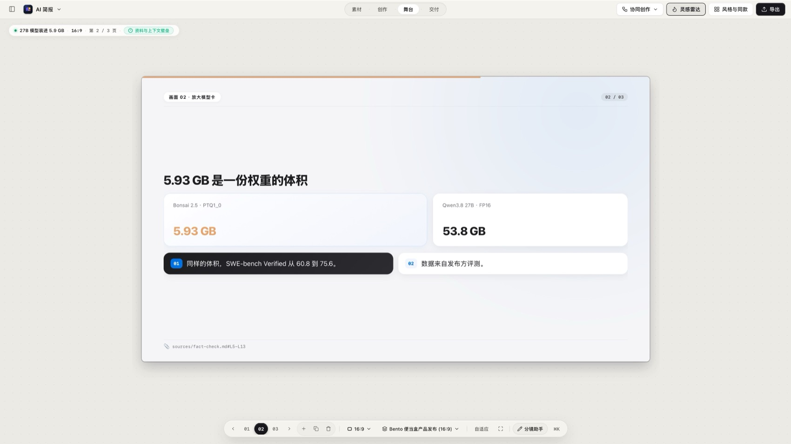
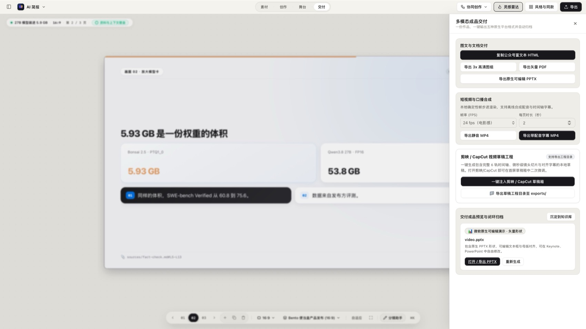

# Aimake Studio

A local workspace for turning research, notes, and Markdown into slide decks, social cards, and publishing files. Edit a `.deck.md` in the macOS app or your text editor, then export it in the format you need.

**English** · [简体中文](./README.zh-CN.md) · [日本語](./README.ja.md) · [한국어](./README.ko.md)

[Download for macOS](https://github.com/chicogong/aimake-creator/releases/latest) · [Try the web playground](https://aimake.cc/playground/) · [Documentation](./docs/DOCS_INDEX.md) · [Discussions](https://github.com/chicogong/aimake-creator/discussions)



*A November 2026 AI news brief in the native macOS app, captured from a source build. [Read the story and reuse the drafts](./examples/news-bonsai-27b/).*

## Get started

**macOS app.** Download the DMG or ZIP from [Releases](https://github.com/chicogong/aimake-creator/releases/latest), then open Aimake. The app uses Node.js 22 or newer on your Mac. Create a workspace in a folder you can write to, or open one with a `.deck.md` file. See [desktop export dependencies](#export-formats) and the [packaging issue](https://github.com/chicogong/aimake-creator/issues/53) if an export fails.

**CLI.** With Node.js 22 or newer, install from [npm](https://www.npmjs.com/package/aimake-studio) and open the bundled demo.

```bash
npm install -g aimake-studio
aimake doctor
aimake studio --demo
```

**Open Bench example.** The repository includes a four-slide report, a 3:4 borrowing card, source notes, and a cover image. Build from source to try the illustrated Bento cover shown here. [Example and reuse instructions](./examples/open-bench/README.md).

The [desk-lighting creator kit](./examples/desk-lighting/) includes a video cover and storyboard, a 3:4 social guide, a 4:5 document carousel, and reusable image assets.

## From source material to a deliverable

| Stage | What you can do |
| --- | --- |
| Collect | Import files or supported URLs into a workspace with `aimake intake`. Run `aimake radar` on demand for results from connectors including Hacker News, GitHub, and RSS. Track the reliability of live results in [#28](https://github.com/chicogong/aimake-creator/issues/28). |
| Distill | Turn source material into a brief with `aimake distill`. Check the brief against its sources before drafting. |
| Create | Start from one of 36 templates, edit slides on the stage or in Markdown, and add metrics, tables, code, or Mermaid diagrams. AI-assisted editing is optional and uses the model provider or local agent you configure. |
| Deliver | Export files from the app, or use `aimake publish` to build local bundles for WeChat, Zhihu, Juejin, and Xiaohongshu. Verified platform drafts and scheduled collection are tracked in the [distribution and intake plan](https://github.com/chicogong/aimake-creator/discussions/58). |



*The native delivery panel after exporting the news storyboard to an editable PowerPoint file.*

### Export formats

| Format | Use | Runtime |
| --- | --- | --- |
| PNG | High-resolution social cards and slide images | Playwright and Chromium |
| PDF | Documents and carousels | Playwright and Chromium |
| PPTX | Editable text and shapes for PowerPoint | Node.js. Mermaid diagram images also use Playwright and Chromium. |
| WeChat HTML | Copy formatted content to the WeChat editor | Node.js |
| MP4 | A rendered slide video | Playwright, Chromium, and FFmpeg |
| CapCut draft | A local draft project to continue editing | Playwright and Chromium |

With a deck in the current directory, these commands produce a PPTX and local handoff bundles.

```bash
aimake render ./my-deck.deck.md -f pptx -o ./my-deck.pptx
aimake publish ./my-deck.deck.md --target wechat,zhihu,juejin,xiaohongshu
```

## Agent integrations

Run `aimake mcp` as a stdio server for a compatible host, or use the [Aimake agent skill](./skills/aimake/SKILL.md) in a local coding agent. Studio can also launch OpenCode from a workspace with its context. Review the current [OpenCode write behavior](https://github.com/chicogong/aimake-creator/issues/41) before using it on a deck.

## Build and contribute

```bash
pnpm install --frozen-lockfile
pnpm verify
```

- Learn about the CLI, renderer, and agent integrations. [Architecture](./docs/ARCHITECTURE.md) · [Document index](./docs/DOCS_INDEX.md)
- Contribute a template, sample, or reproducible fix. [Contributing guide](./CONTRIBUTING.md) · [Issue tracker](https://github.com/chicogong/aimake-creator/issues)
- Follow work on the desktop app and publishing workflows. [Project board](https://github.com/users/chicogong/projects/3) · [Desktop feedback](https://github.com/chicogong/aimake-creator/discussions/47) · [Current development](https://github.com/chicogong/aimake-creator/discussions/63)
- Read about data collection, dependencies, and project policies. [Intake research](./docs/INTAKE_ECOSYSTEM_RESEARCH.md) · [Third-party notices](./THIRD_PARTY_NOTICES.md) · [Security](./SECURITY.md) · [Code of conduct](./CODE_OF_CONDUCT.md)

[MIT License](./LICENSE) © 2026 Aimake Labs / Chico Gong.
