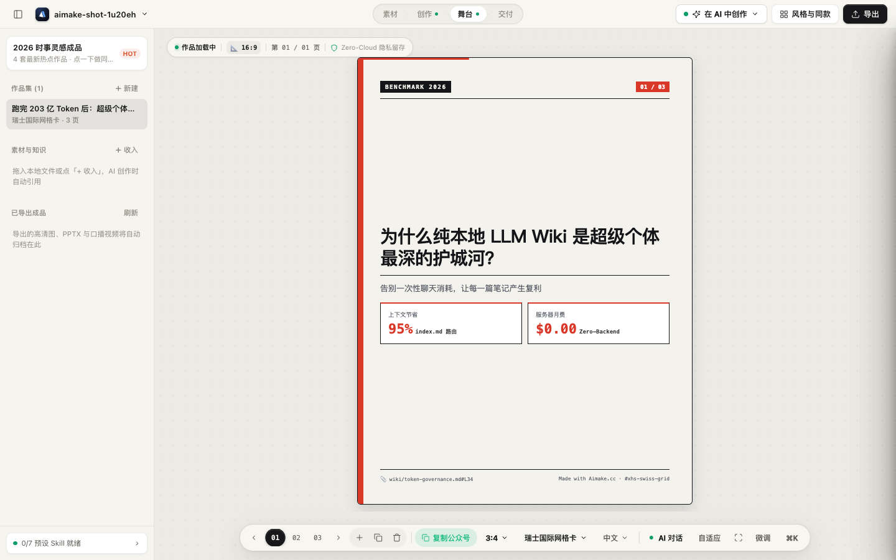
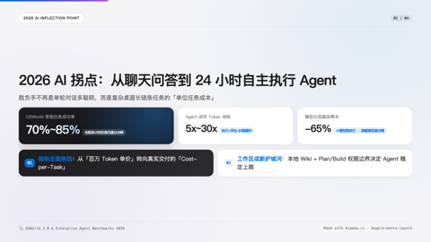
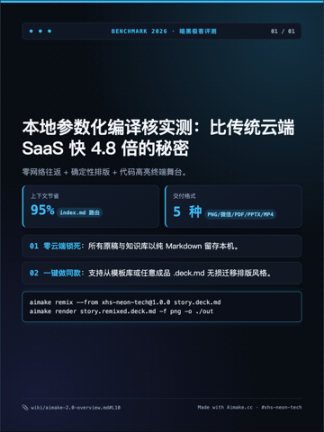
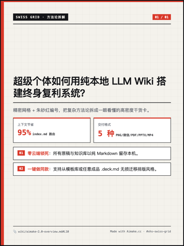
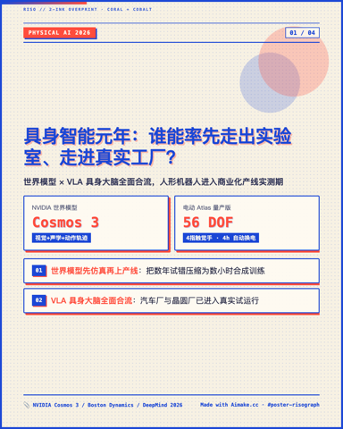
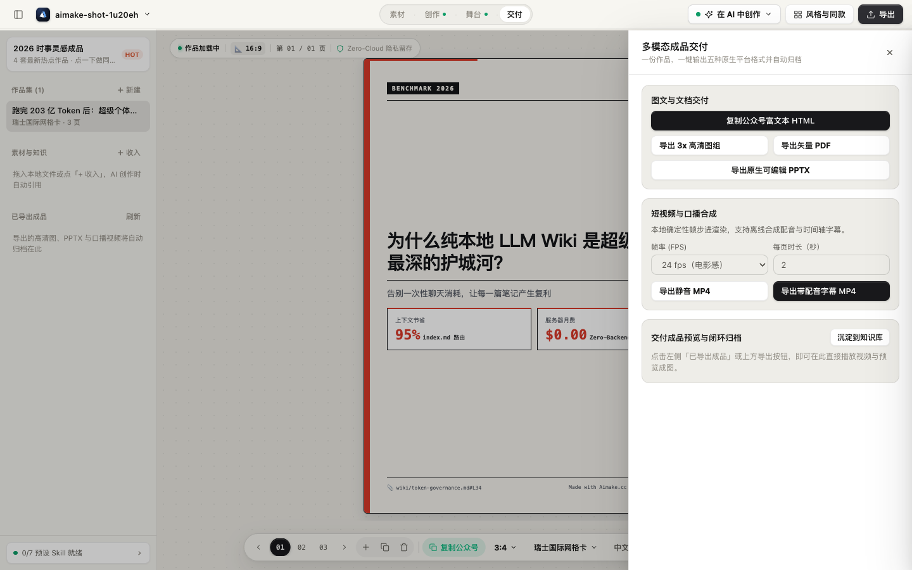
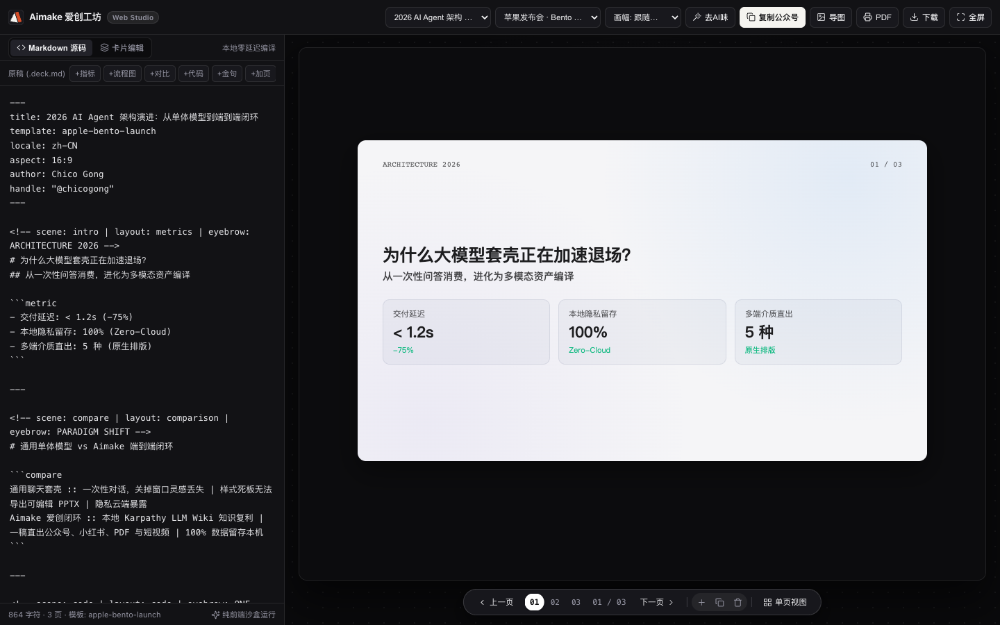

# Aimake（爱创）— 纯本地多模态创作工作室与 CLI

<p align="center">
  <a href="https://aimake.cc"></a>
</p>

<p align="center">
  <strong>一份 Markdown 原稿，100% 纯本地直出 5 种原生交付格式。内置 36 套商业级参数化设计模板、Mermaid 离线矢量流程图、Highlight.js 代码高亮、7 大工作区闭环 AI Skill 与内置 AI Co-Pilot 副驾驶。</strong>
</p>

<p align="center">
  <a href="https://www.npmjs.com/package/aimake-studio"></a>
  <a href="./LICENSE"></a>
  <a href="https://nodejs.org"></a>
  <a href="https://aimake.cc/playground/"></a>
  <a href="#"></a>
  <a href="#"></a>
</p>

<p align="center">
  <a href="./README.md">English</a> · <strong>简体中文</strong> · <a href="./README.ja.md">日本語</a> · <a href="./README.ko.md">한국어</a>
</p>

<p align="center">
  
  <br />
  <em>Aimake Studio：纯本地所见即所得画板，悬浮毛玻璃状态条、双向全键盘漫游与触感幻灯片胶囊 Dock</em>
</p>

---

## ⚡️ 10 秒上手 CLI 与交互向导

```bash
# 直接拉起 @clack/prompts 交互式创作向导（无需繁琐配置）
npx aimake-studio

# 或全局安装（同时注册 `aimake` 与 `aimake-studio` 命令）
npm install -g aimake-studio
aimake wizard
```

免安装在线体验浏览器沙盒：**[https://aimake.cc/playground/](https://aimake.cc/playground/)**

---

## 🌟 为什么选择 Aimake？

市面上的演示工具与 AI 生成产品往往存在诸多痛点：云端排队绑死、内存膨胀卡顿、千篇一律的空洞 AI 营销套话（AI Slop）、格式导出无法二次编辑、隐私数据上传云端等。

**Aimake 为超级个体、独立创作者与 AI Agent 重新定义内容研发与交付流程：**

- **纯 Markdown 作为唯一事实源**：以结构轻盈、版本受控的 `.deck.md` 为核心，告别复杂的排版软件工程文件。
- **一稿五出 · 原生格式直出**：一份原稿直接渲染出 **3x 视网膜超清图组**（小红书/朋友圈/IG）、**公众号内联样式富文本 HTML**（直粘微信后台）、**高密度矢量 PDF**（LinkedIn 轮播）、**原生可编辑 PPTX**（文本框/形状可再调整）以及 **60fps 口播字幕短视频**。
- **100% 纯本地运行 · 零云端隐私回传**：所有解析、排版、AI 改稿与导出全部在本地计算机执行。绝不回传数据，绝不创建全局软链接，绝不触碰或污染系统 `~/` 与 `~/.claude` 目录。
- **36 套参数化商业设计系统**：严格遵守 CJK 排版准则（日文 `strict` 禁则、韩文 `keep-all` 语节断行），每一套模板均完整支持**深色 / 浅色双主题无缝切换**。
- **深层 AI Copilot 对话改稿副驾驶**：内置 Quick Action 意图胶囊、并排与内联双重视图 Diff 对比、一键应用与快照跨会话回滚，并为 Claude Code、OpenAI Codex、Google Antigravity (AGY)、Tencent CodeBuddy 提供即跑命令配方。

---

## 📸 核心产品功能与视觉实测

### 1. 2026 趋势美学与前沿评测范例

Aimake 开箱即带 2026 年最具穿透力的商业设计体系：

<p align="center">
  
  
</p>
<p align="center">
  
  
</p>

- **苹果发布会 Bento 便当盒 (`apple-bento-launch`)**：曜石黑卡片、非对称瓷砖、微妙影棚光晕与超大对比数字，尽显发布会旗舰张力。
- **DeepSeek 开源权重实测卡 (`xhs-neon-tech`)**：暗黑极客代码与跑分卡，专为硬核模型对比、Token 成本核算与命令行部署打造。
- **瑞士国际主义极简网格 (`xhs-swiss-grid`)**：极高信息密度、极细发丝分界线与朱砂红索引标，构建无法被忽视的技术权威感。
- **物理具身智能复古海报 (`poster-risograph`)**：Risograph 珊瑚红 × 钴蓝双色叠印艺术质感，专为前沿科技研报与沙龙海报设计。

---

### 2. 多模态交付抽屉与免安装 Web 工坊

<p align="center">
  
  
</p>

- **多模态交付抽屉**：一键导出 3x 视网膜超清图组、一键写入微信公众号（`text/html` + `text/plain` 双格式后台直粘）、生成矢量 PDF、可编辑 PPTX 以及带时间轴字幕与配音的 60fps MP4。
- **Web 在线工坊 (`aimake.cc/playground/`)**：纯前端静态沙盒，左侧支持 Markdown 源码与可视化卡片无缝切换，完全在浏览器本地编译预览。

---

## 🚀 常用命令速查

```bash
# 1. 环境自检与模板浏览
aimake doctor                                    # 检测系统环境、Node.js 与媒体工具就绪状态
aimake templates                                 # 查看 36 套内置设计风格及其适用画幅
aimake market list                               # 查看在线扩展风格包与预设套件

# 2. 闭环工作区搭建与对话创作
aimake workspace init ./my-space                 # 初始化自包含工作区（实体预设 7 大 Skill，零软链接）
aimake deck create "2026 AI Agent 大变革"        # 基于本地提示词快速起草全套幻灯片
aimake deck edit ./my-space/decks/story.deck.md  # 终端命令行多轮交互修改指定幻灯片

# 3. 启动本地沉浸式工作室 (Calm Studio)
aimake studio --demo                             # 快速打开预设示例工作区
aimake studio ./my-space/decks/story.deck.md     # 针对指定作品启动本地可视化创作舞台

# 4. 迁移现有演示文档
aimake import ./legacy-slides.md -o ./deck.md    # 将 Marp / Slidev / 通用 Markdown 转为规范 .deck.md

# 5. 一键多模态原生交付
aimake render ./deck.md -f png -o ./out/cards    # 导出 3x 超高清图组（小红书 3:4 / 方形 1:1）
aimake render ./deck.md -f wechat -o ./out.html  # 导出微信公众号富文本（内联 CSS，一键直粘）
aimake render ./deck.md -f pdf -o ./out/deck.pdf # 导出高清晰度矢量 PDF（LinkedIn 4:5 轮播）
aimake render ./deck.md -t ppt-executive-16x9 -f pptx -o ./out/deck.pptx   # 导出原生可编辑 PPTX
aimake render ./deck.md -t video-kinetic-reel -f mp4 -o ./out/reel.mp4     # 导出 60fps 动效短视频
```

> **轻量化安装说明**：`aimake-studio` 安装包精简至 3.5 MB 以内，默认不绑定笨重的无头浏览器与 FFmpeg 二进制。渲染 PNG、PDF 或 MP4 时，Aimake 会自动复用本机已有的 Chrome/Chromium/Playwright 与 FFmpeg，亦可随时按需安装可选对等依赖：`npm i playwright @ffmpeg-installer/ffmpeg`。

---

## 🎨 36 套参数化模板矩阵

Aimake 体系化覆盖了从主流社交平台、商业路演到出海全球化的全场景排版需求：

| 分类体系 | 代表模板 | 画幅比例 | 视觉美学核心与适用场景 |
|:---|:---|:---|:---|
| **2026 热点趋势** | `apple-bento-launch`<br>`xhs-neon-tech`<br>`xhs-swiss-grid`<br>`poster-risograph` | `16:9`<br>`3:4`<br>`4:5` | 苹果发布会 Bento 便当盒瓷砖网格、DeepSeek 开源权重评测跑分黑客风、瑞士国际主义理性网格、Risograph 复古孔版叠印海报 |
| **爆款社交媒体** | `xhs-bold-headline`<br>`xhs-apple-notes`<br>`xhs-morandi-cream`<br>`xhs-liquid-glass`<br>`xhs-quote-card`<br>`xhs-pro-vs-con` | `3:4`<br>`1:1` | 黄黑大字报、苹果备忘录拟物、莫兰迪高级奶油质感、拟态液态玻璃、独立金句卡、双栏优缺点 PK 对比 |
| **出海全球化专栏** | `linkedin-exec-carousel`<br>`ig-cardnews-kr`<br>`ja-note-editorial`<br>`en-substack-digest`<br>`en-founder-whiteboard` | `4:5`<br>`1:1` | 领英创始人滑动卡、韩国 IG 现代几何卡片新闻（严格支持 `keep-all`）、日本 Note 余白美学（严格日文禁则）、Substack 纽约客专栏卡、科技极客白板蓝图 |
| **路演汇报与 PPT** | `ppt-executive-16x9`<br>`ppt-tech-architecture`<br>`ppt-linear-dark`<br>`ppt-bauhaus-bold`<br>`ppt-consulting-matrix` | `16:9` | 商业计划书主视觉、技术系统架构蓝图、Linear 工程师暗黑风、包豪斯重构设计、麦肯锡 2x2 咨询矩阵 |
| **公众号长文专栏** | `wechat-deep-report`<br>`wechat-editorial-article`<br>`wechat-frontpage-news`<br>`wechat-greenbook`<br>`wechat-minimal-brief` | 自适应 | 深度行业分析白皮书、人文专栏特稿、头条新闻大字报、绿色商业绿皮书、极简工作汇报 |
| **教学互动与图解** | `edu-flashcard-kids`<br>`edu-lesson-guide`<br>`x-zukai-quad` | `3:4`<br>`1:1` | 儿童双语认知与生字识字卡、黑板绿课堂导学讲义、X 日本四象限「図解」思考模型卡 |
| **动效口播视频** | `video-kinetic-reel`<br>`video-podcast-wave`<br>`video-cinema-talk` | `9:16`<br>`16:9` | 竖屏快节奏动效字幕短视频、播客电台音频波形卡、电影感 16:9 纪录片访谈 |

**统一模板规范（Aimake Design Contract）**：
- 全模板支持**深色 / 浅色双外观**（页面 `:root[data-theme="dark/light"]` 与 frontmatter `theme: dark/light`）。
- 统一规范 CSS 变量（`--bg`, `--surface`, `--ink`, `--muted`, `--accent`, `--border`, `--card-shadow`, `--code-bg`）。
- 全模板内置离线矢量 **Mermaid 图表** 与 Highlight.js 多语言代码语法高亮。
- 每一个模板均配有独立的 `sample.deck.md` 范例卡片。

---

## 🖥️ 沉浸式 Studio 工作室体验

执行 `aimake studio` 即可启动本地沉浸式无干扰画板：

- **全键盘流畅漫游**：
  - `←` / `→` / `Space`：上一页 / 下一页切换
  - `PageUp` / `PageDown`：快速翻页
  - `F`：切换全屏演说家模式（Presenter Mode）
  - `Esc`：一键退出全屏演示或关闭弹窗面板
  - `⌘K`：呼出指令浮层（快速切换浅色/深色外观、切换作品、执行导出）
- **触感底部胶囊栏（Filmstrip）**：当前焦点页平滑自动居中，支持一键在当前位置**新增 (+)**、**复制**与**删除**幻灯片。
- **毛玻璃画布状态条**：实时清晰显示当前作品名、画幅比例胶囊、页码状态，以及纯本地运行的 **Zero-Cloud 隐私盾牌标识**。
- **即时交付动效反馈**：微信公众号富文本复制具备标准的 `text/html` + `text/plain` 双格式写入后台，PNG 导出具备即时 Loading 旋转与成功打勾动效。

---

## 🤖 AI Copilot 对话改稿与主流 AI 启动配方

Aimake 在底层打通了非确定性的大语言模型与确定性的高保真排版：

1. **Quick Action 意图推荐胶囊**：在 Studio 对话面板中提供高频一键操作：
   - 💬 **提炼金句卡片**：自动提炼核心洞察，生成独立高质感金句卡。
   - 🍱 **转为 Bento 风格**：重排为苹果 Bento 便当盒多栏卡片网格。
   - 📋 **生成演讲大纲**：梳理各节议程、预估用时与核心结论。
   - 🌐 **翻译为双语**：保持地道术语与原格式的中英双语对照。
   - ✨ **去 AI 味精修**：针对中英日韩 4 语种消除空洞排比与营销腔。
2. **前后 Diff 对比卡片**：AI 改稿后生成直观的并排（Side-by-side）与内联（Inline）差异对比，支持**一键应用（Apply）**或安全**还原（Revert）**。
3. **主流 AI 终端 1-Click 配方**：为外部 AI 工具自动生成内置工作区完整上下文与提示词的即跑指令：
   - **Claude Code CLI**：`claude -p '...'`
   - **OpenAI Codex CLI**：`codex exec --skip-git-repo-check '...'`
   - **Google Antigravity (AGY)**：`agy -p '...'`
   - **Tencent CodeBuddy CLI**：`codebuddy -p '...'`

---

## 📁 仓库代码架构

```
products/aimake/
├── src/
│   ├── cli.ts                   # Universal CLI 核心入口 (aimake & aimake-studio)
│   ├── index.ts                 # Programmatic TypeScript API 导出
│   ├── studio/                  # Calm Studio 服务器、UI 模板、样式与交互脚本
│   ├── renderer/                # HTML 编译器、PPTX 生成器与多模态渲染流水线
│   ├── workspace/               # 本地工作区管理与外部 AI 运行时连接器
│   └── templates/               # 内置 36 套模板元数据注册与架构验证
├── templates/                   # 36 套商业设计模板（HTML、CSS、manifest、sample）
├── examples/                    # 示例作品库（Bento 便当盒、DeepSeek 评测、瑞士网格、海报）
├── skills/                      # 7 大工作区闭环预设 Skill（零软链接，零全局污染）
├── scripts/                     # 自动化审计、构建与发版验证脚本
└── tests/                       # Vitest 单元/集成测试与 Playwright E2E 测试集
```

---

## 🛡️ 质量保障与自动化流水线

Aimake 严格执行工程级质量闸门：

```bash
# 执行完整发版前综合验收流水线
pnpm verify
```

- **类型健全**：`tsc --noEmit` 静态类型检查 0 错误。
- **单元与集成测试**：8 个测试套件、**61/61 个测试全部通过**（运行时间仅约 2.7 秒）。
- **Playwright E2E 端到端**：6 大真实端到端场景全绿（涵盖 API 对话、Diff 回滚、零软链接、画廊同款制作与交付导出）。
- **零隐私泄露审计**：`audit:secrets` 扫描 237 个源文件，确保 0 密钥、0 私有路径泄露。
- **模板与技能审计**：`audit:skills` 确保所有 36 套模板均符合结构规范与双色外观契约。
- **发布包完整性验证**：`pack:check` 验证 npm 打包体积约为 3.2 MB，并在隔离 `/tmp` 目录验证 CLI 启动与执行无缺损。

---

## 📄 文档索引

- [1.0 架构与验收测试报告](./docs/ACCEPTANCE-1.0.md)
- [Aimake 2.0 沉浸式工作区设计白皮书](./docs/AIMAKE_2_0_CALM_WORKSPACE_DESIGN.md)
- [演进路线图](./docs/ROADMAP-2.0.md)
- [第三方开源协议声明](./THIRD_PARTY_NOTICES.md)

---

## 🤝 参与贡献

我们热烈欢迎开源社区参与贡献！无论是提交 Issue、发起 Pull Request 还是为 Aimake 贡献新的视觉模板：

1. Fork 本仓库
2. 创建特性分支：`git checkout -b feature/my-new-template`
3. 确保测试全部通过：`pnpm verify`
4. 提交更改：`git commit -am 'feat: add my new template'`
5. 推送到分支：`git push origin feature/my-new-template`
6. 创建 Pull Request

---

## 📜 开源协议

[MIT License](./LICENSE) © 2026 Aimake Labs / Chico Gong.
