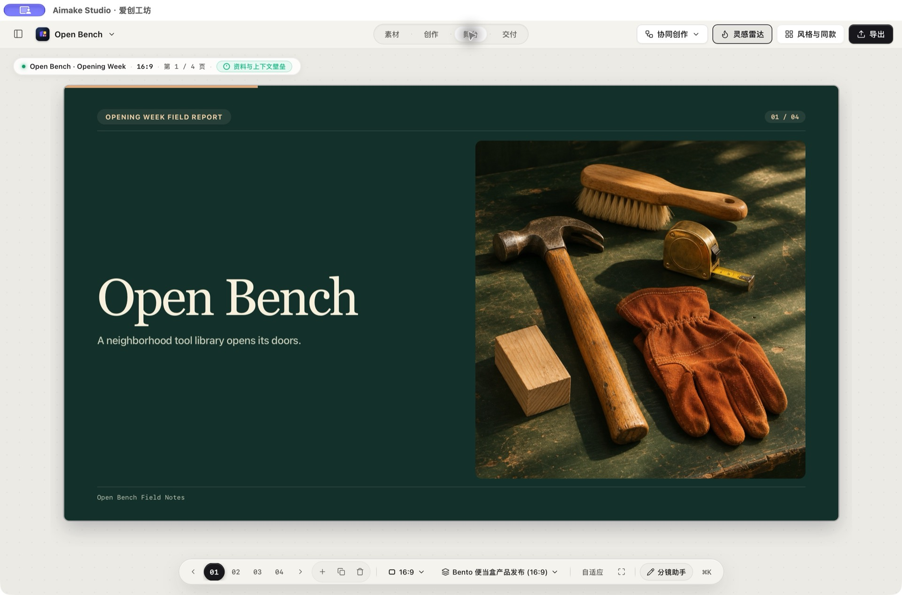
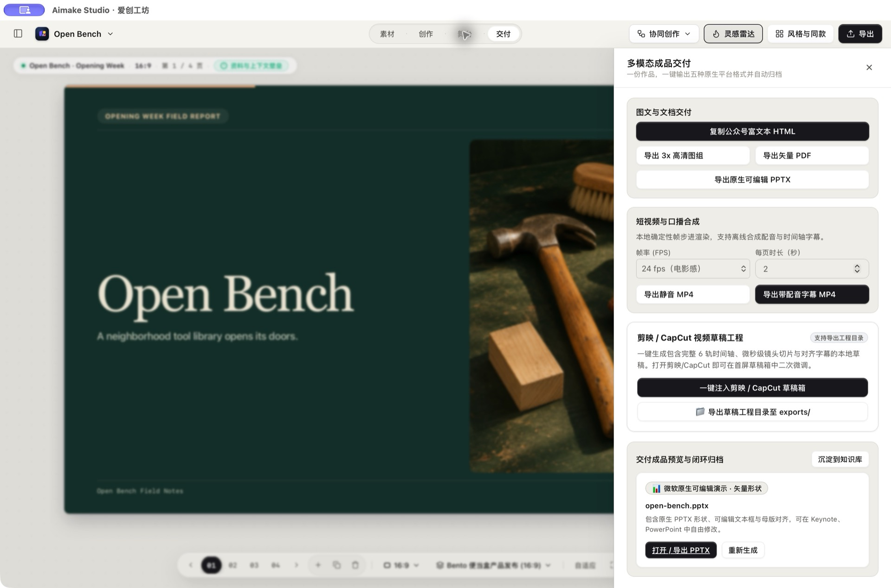

# Aimake Studio 爱创工坊

把调研资料、笔记和 Markdown 做成演示文稿、社交卡片和可交付的文件。在 macOS 桌面端或熟悉的编辑器里修改同一份 `.deck.md`，再按用途导出。

[English](./README.md) · **简体中文** · [日本語](./README.ja.md) · [한국어](./README.ko.md)

[下载 macOS 版](https://github.com/chicogong/aimake-creator/releases/latest) · [在线工坊](https://aimake.cc/playground/) · [文档](./docs/DOCS_INDEX.md) · [讨论区](https://github.com/chicogong/aimake-creator/discussions)



*Open Bench 是一个虚构社区工具图书馆的开业周报告。画面来自源码构建的 macOS 原生 App。[打开可编辑样稿](./examples/open-bench/)。*

## 开始使用

**macOS 桌面端。** 从 [Releases](https://github.com/chicogong/aimake-creator/releases/latest) 下载 DMG 或 ZIP 后打开 Aimake。桌面端使用本机 Node.js 22 或更高版本。先选择有写入权限的文件夹作为工作区，再创建或打开 `.deck.md` 作品。遇到导出失败，可以查看[导出依赖](#导出格式)和[安装包问题](https://github.com/chicogong/aimake-creator/issues/53)。

**命令行。** 有 Node.js 22 或更高版本后，从 [npm](https://www.npmjs.com/package/aimake-studio) 安装并打开内置演示。

```bash
npm install -g aimake-studio
aimake doctor
aimake studio --demo
```

**Open Bench 样稿。** 仓库里有四页报告、3:4 借用卡、引用笔记和原创封面图。要复现上图的 Bento 插图版式，可从源码构建并打开样稿。[样稿与复用说明](./examples/open-bench/README.md)。

[台灯布光创作包](./examples/desk-lighting/)包含视频封面与分镜、3:4 小红书图文、4:5 LinkedIn 文档和可替换图片素材。

## 从资料到成品

| 阶段 | 现在可以做什么 |
| --- | --- |
| 采集 | 用 `aimake intake` 把本地文件和受支持的链接收进工作区。用 `aimake radar` 按需查询 Hacker News、GitHub、RSS 等来源，实时数据可靠性见 [#28](https://github.com/chicogong/aimake-creator/issues/28)。 |
| 萃取 | 用 `aimake distill` 整理资料和简报，写作前可以回查原始来源。 |
| 创作 | 从 36 套模板选版式，在舞台或 Markdown 中修改内容，加入指标、表格、代码和 Mermaid 图解。AI 改稿可选，接入你配置的模型服务或本机代理。 |
| 交付 | 从桌面端导出，或用 `aimake publish` 为微信、知乎、掘金和小红书生成本地交付包。平台草稿回执和定时采集进度见[采集与分发方案](https://github.com/chicogong/aimake-creator/discussions/58)。 |



*在原生桌面端导出后，交付面板可以打开刚生成的可编辑 PPTX。*

### 导出格式

| 格式 | 用途 | 运行依赖 |
| --- | --- | --- |
| PNG | 高清卡片、幻灯片图片 | Playwright 和 Chromium |
| PDF | 文档、轮播图 | Playwright 和 Chromium |
| PPTX | PowerPoint 可编辑文本和形状 | Node.js。Mermaid 图解转为图片还需要 Playwright 和 Chromium。 |
| 微信 HTML | 复制排版后粘贴至公众号编辑器 | Node.js |
| MP4 | 幻灯片视频 | Playwright、Chromium、FFmpeg |
| 剪映 / CapCut 草稿 | 导出到本地后继续剪辑 | Playwright 和 Chromium |

在作品目录里，可以生成 PPTX 与各平台的本地交付包。

```bash
aimake render ./my-deck.deck.md -f pptx -o ./my-deck.pptx
aimake publish ./my-deck.deck.md --target wechat,zhihu,juejin,xiaohongshu
```

## 接入 AI 工具

可用 `aimake mcp` 为支持 stdio 的宿主启动服务，或在本机代理中使用 [Aimake 技能](./skills/aimake/SKILL.md)。工作台也可以携带工作区上下文启动 OpenCode，改稿前可查看[当前写入行为](https://github.com/chicogong/aimake-creator/issues/41)。

## 构建与贡献

```bash
pnpm install --frozen-lockfile
pnpm verify
```

- 了解命令行、渲染引擎和 AI 接入。[架构](./docs/ARCHITECTURE.md) · [文档索引](./docs/DOCS_INDEX.md)
- 贡献模板、样稿或可复现的问题。[贡献指南](./CONTRIBUTING.md) · [Issue 列表](https://github.com/chicogong/aimake-creator/issues)
- 跟进桌面端、采集和发布工作。[项目看板](https://github.com/users/chicogong/projects/3) · [桌面端体验讨论](https://github.com/chicogong/aimake-creator/discussions/47) · [当前进展](https://github.com/chicogong/aimake-creator/discussions/63)
- 查看资料采集、依赖和项目规范。[采集调研](./docs/INTAKE_ECOSYSTEM_RESEARCH.md) · [第三方声明](./THIRD_PARTY_NOTICES.md) · [安全](./SECURITY.md) · [行为准则](./CODE_OF_CONDUCT.md)

[MIT 许可证](./LICENSE) © 2026 Aimake Labs / Chico Gong.
