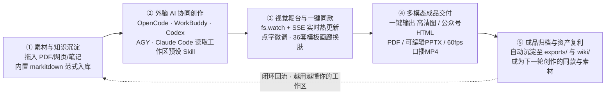
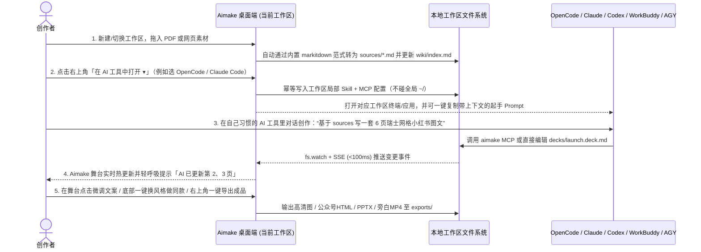

# Aimake 2.0 深度 Review 与重设计蓝图：端到端创作闭环平台（工作区实体预设 Skill + 冷静视觉舞台）

> [!NOTE]
> **关联权威设计代币规范**：四端统一的视觉色彩、字号与组件设计语言已固化至 [`docs/design/UI_DESIGN_SYSTEM.md`](./design/UI_DESIGN_SYSTEM.md)（本蓝图聚焦 Calm Studio 信息架构与工作区预设 Skill 体系）。

> [!IMPORTANT]
> 本文档是对当前 Aimake 1.0 桌面端与产品形态的**诚实复盘与 v2 重构设计方案**。核心升级为两大支柱：
> 1. **端到端一路闭环（End-to-End Creator Pipeline）**：在一个工作区内跑通 **「① 收集素材与沉淀知识 → ② 唤起最强 AI 协同创作 → ③ 沉浸视觉舞台微调与一键同款 → ④ 多模态成品交付与资产回流」** 全链路，不再东拼西凑工具；
> 2. **工作区实体预设 Skill（零软链接、零全局污染）**：新建/接入工作区时，直接把预设 Skill 与 MCP 配置以**独立实体文件**写入当前工作区目录，绝不创建全局软链接、绝不污染本机其他项目目录。

---

## 一、产品形态定位：端到端创作闭环平台

你提出的两个关键判断——**「外脑 AI 创作 + Aimake 展示/微调/跑流程」** 与 **「强调端到端创作平台、一路闭环，且在工作区实体预设 Skill 避免污染全局」**——共同拼出了 Aimake 2.0 最锋利的产品定位：

### 端到端创作闭环平台的核心定位
- **如果只做“聊天套壳”**：永远拼不过 OpenCode、WorkBuddy、Codex、Antigravity (AGY)、Claude Code 的前沿模型和 Agent 能力。
- **如果只做“被动预览器”**：价值太薄，用户看完还得手动导资料、手动配音、手动找历史成品、手动给下次创作喂上下文。
- **高壁垒的专业形态 = 「端到端内容生产流水线 + 开放外脑插槽」**：
  - **一路闭环**：从你丢进来的第一份原始 PDF/网页/语音/灵感开始，到沉淀工作区知识库、交给 OpenCode/Claude/Codex/WorkBuddy/AGY 创作并去 AI 味、在 Aimake 视觉舞台即时微调与一键同款、导出图文/公众号/PDF/PPTX/口播视频、再到成品自动归档回流为下一次创作的参考样本——**全流程在一个工作区里首尾相接、一气呵成**。

### Aimake 2.0 端到端闭环架构（End-to-End Closed-Loop Pipeline）



> [!TIP]
> **一句话定位**：Aimake 2.0 是面向超级个体与团队的 **本地优先「端到端多模态创作闭环平台」**——它用**工作区实体预设 Skill** 赋予你手头任意 AI 工具（OpenCode / WorkBuddy / Codex / AGY / Claude Code）专业创作手脚，再由 Aimake 桌面端承接**实时舞台、直觉微调、一键同款与五维交付**，实现从灵感到成品的一路闭环。

---

## 二、现状诚实诊断：为什么当前桌面端 UI 让人觉得“杂乱、心智成本高”？

结合我们刚跑出来的真实桌面端截图，可以直观看到 5 个核心病灶：

（注：1.0 真实截屏复盘见评审记录：Canvas 视图将 22 套纯文字黑框模板、5 个导出按钮与裸露源码编辑器挤在同一屏；Marketplace 视图满屏深灰线框与英文代码版本号标签，缺少可视化画报封面预览。）

| 序号 | 现状问题（来自 `src/studio/studio-ui.ts` 真实界面） | 为什么会推高用户理解心智成本 |
| :--- | :--- | :--- |
| **1** | **5 个后端模块切页 + 双层顶部条（共占 86px）**<br>`Wiki ⌘1 · Canvas ⌘2 · Market ⌘3 · Media ⌘4 · AI Bridge ⌘5` 外加一条常驻 `status-strip` | 直接暴露软件的**工程模块划分**，打断了创作者的任务心流；用户打开软件第一秒就要做 5 选 1 的选择题。 |
| **2** | **“舞台”与“代码后台”硬塞在同屏**<br>Canvas 右栏同时放着 5 个导出按钮 + 一整块黑色 `SOURCE (.DECK.MD)` 源码文本框 + `Save Markdown Source` 按钮 | 创作者只想看排版、微调文字、换风格和导出；把 YAML frontmatter 和 Markdown 源码常驻在主界面，视觉压迫感极强。 |
| **3** | **视觉模板却用纯文字列表展示**<br>左栏 22 套模板全是纯文字黑框（`edu-flashcard-kids · 3:4`），市场页满屏 `pack-solopreneur-cn@1.0.0` / `xiaohongshu` / `zukai` 胶囊 | 选模板是**纯视觉直觉行为**，没有真实缩略图预览的模板列表就像在看 npm 包依赖表，完全无法一眼感知风格差异。 |
| **4** | **中英混杂 + 工程指标常驻视觉中心**<br>`TARGET LOCALE`、`ONE-DECK DELIVERABLES`、`1080 × 1440 · 3:4`、`3 slides · Local-First` 琥珀色徽章 | 大量英文全大写工程标签和彩色状态徽章分散视线，界面视觉偏向调试工具（DevTools），缺少创作工作室（Studio）的沉浸感。 |
| **5** | **缺乏「工作区（Workspace）」一等公民概念**<br>启动后只绑定单个临时 `.deck.md`，无法在一个容器里同时管好“同一个产品的素材、笔记、多套作品与导出记录” | 真实创作是围绕「项目/工作区」展开的（如“新产品发布工作区”“小红书周更工作区”），没有工作区就无法顺畅地与 OpenCode / Claude Code 协同。 |

---

## 三、对标全球优秀开源项目与标杆软件（跳出本地视角）

本次重设计系统吸收全球一线开源项目与 macOS 标杆软件的成熟范式：

| 维度 | 对标的全球优秀开源 / 标杆项目 | 我们真正吸收的设计精髓 | 在 Aimake 2.0 中的具体落点 |
| :--- | :--- | :--- | :--- |
| **实时视觉舞台** | **[Slidev](https://github.com/slidevjs/slidev)**（Markdown 演示引擎）<br>**[Presenton](https://github.com/presenton/presenton)**（开源 AI 演示生成器） | Markdown 是单一真源，但用户眼睛看到的是**毫秒级热更新的精致舞台**；支持所见即所得局部微调与结构化换版式。 | 底层保留 `.deck.md` 开放格式，前端彻底升级为 **Live Stage**：AI 改文件 `<100ms` 局部无闪烁刷新，点击画布即编辑、换模板零丢内容。 |
| **本地优先工作区** | **[AFFiNE](https://github.com/toeverything/AFFiNE)**<br>**[Excalidraw](https://github.com/excalidraw/excalidraw)** | Local-First 工作区隔离；界面遵循**“90% 留给画布，10% 留给悬浮微工具条”**的克制原则，减少常驻边栏。 | 引入「工作区（Workspace）」为最高级容器；画布成为绝对主角，模板库、检查器、源码全部采用**渐进式按需浮层**。 |
| **Calm Studio 视觉语言** | **Screen Studio · Linear · Apple Keynote** | 摒弃花哨的多彩边框与高饱和胶囊；依靠**微对比中性灰阶**（3 层明度阶梯）、克制的排版层级、`⌘K` 全局命令面板与隐藏式操作（hover/selection 浮现）建立高级感。 | 砍掉双层顶栏和多余线框；单层 44px 极简顶栏 + `⌘K` 命令面板 + 全中文/多语种统一 UI 文案，做到“打开即静心创作”。 |
| **开放 Skill 与插件生态** | **[agentskills.io](https://agentskills.io)**（开放 `SKILL.md` 标准）<br>**[microsoft/markitdown](https://github.com/microsoft/markitdown)**<br>**[blader/humanizer](https://github.com/blader/humanizer)**<br>**[JimLiu/baoyu-skills](https://github.com/JimLiu/baoyu-skills)** | 1. 渐进式披露 `SKILL.md`（先载入元数据，按需加载细则，极省 Token）；<br>2. `markitdown` 式全格式文档转 Markdown；<br>3. `humanizer` 式去 AI 腔精修；<br>4. `baoyu-skills` 式社媒/长文信息图采集。 | 在 Aimake 内置 **6 大开箱即用 Skill & Plugin Pack**，既能被 Aimake 流程直接调用，又能一键按工作区装配给 5 大 AI 工具。 |
| **多 AI 工具原生联动** | **OpenCode `@opencode/plugin` + `opencode.json`**<br>**[SEP-1865 MCP Apps](https://modelcontextprotocol.io)**（`ui://` 交互式沙盒组件） | 1. AI 宿主不再只吐冷冰冰的 JSON：通过 **MCP Apps (`ui://aimake/preview`)**，在 Claude / OpenCode / Codex 对话流里就能直接渲染可交互预览卡片；<br>2. 通过工作区级配置实现零全局污染隔离。 | 内置 `aimake-mcp-bridge` 支持 **MCP Apps 实时预览卡** + **OpenCode 生命周期插件**；一键在工作区内生成局部配置，不触碰全局 `~/`。 |

---

## 四、「工作区（Workspace）」一等公民架构设计

在 Aimake 2.0 中，创作者围绕 **工作区（Workspace）** 开展完整产品/内容创作。例如你可以同时拥有：`新品发布会工作区`、`个人IP小红书专栏`、`海外增长内容矩阵`、`课程教研备课区`。

### 1. 标准工作区目录契约（实体预设 Skill · 零软链接 · 零全局污染 · 最小化零冗余）

经过逐一核实 5 大主流 AI 工具在工作区根目录（`cwd = <WorkspaceFolder>`）启动时的**原生自动发现机制**，我们发现一个非常漂亮的收敛事实：**OpenCode、Antigravity (AGY)、Codex、WorkBuddy 全部原生支持直接扫描工作区根目录的 `.agents/skills/` + `AGENTS.md`！**

| AI 工具 | 在工作区根目录启动时**自动扫描的 Skill 目录** | 自动加载的 **指令与 MCP 配置** | 启动即自动加载？ | 是否需要全局 `~/` 配置？ |
| :--- | :--- | :--- | :--- | :--- |
| **OpenCode** | **`.agents/skills/`**、`.opencode/skills/`、`.claude/skills/` | `AGENTS.md` + `opencode.json` | ✅ 自动（渐进式披露） | ❌ 完全不需要 |
| **Antigravity (AGY)** | **`.agents/skills/`**（最高优先级 Workspace 发现） | `AGENTS.md` + `.agents/mcp_config.json` | ✅ 自动（渐进式披露） | ❌ 完全不需要 |
| **OpenAI Codex** | **`.agents/skills/`**、`.codex/skills/` | `AGENTS.md` + `.codex/config.toml` | ✅ 自动（渐进式披露） | ❌ 完全不需要 |
| **WorkBuddy** | **`.agents/skills/`**、`.workbuddy/skills/`、`.claude/skills/` | `AGENTS.md` + `.workbuddy/mcp.json` | ✅ 自动（渐进式披露） | ❌ 完全不需要 |
| **Claude Code** | **`.claude/skills/`**（唯一需独立扫描路径） | `CLAUDE.md` + `.mcp.json` | ✅ 自动（首次信任弹窗后） | ❌ 完全不需要 |

因此，Aimake 新建/初始化工作区时**根本不需要傻乎乎地复制 5 份重复 Skill**，只需极其干净的**「一主一辅实体预设」**：

```text
My-Launch-Workspace/                     # 任意本地文件夹即可成为一个 Aimake 端到端创作工作区
├── .aimake/
│   ├── workspace.json                   # 工作区元数据（名称、场景预设、默认语言、已启用 Skill 版本）
│   ├── skill-manifest.json              # 预设 Skill SHA-256 指纹清单（升级不覆盖你的手工定制）
│   ├── brand-kit.json                   # 品牌资产（Logo、作者署名、字号偏好、常用模板收藏）
│   └── run-history.json                 # 导出历史与修订快照（RunLease / DraftRevision）
├── sources/                             # ① 素材箱：拖入 PDF / Docx / 图片 / 网页链接 / 录音
├── wiki/                                # ① 知识沉淀：工作区专属知识库（index.md + 实体卡片 + published.md）
├── briefs/                              # ② 创作简报：先定纲再动笔（受众/钩子/页数/选定风格）
├── decks/                               # ②③ 作品集：该工作区下的多套图文 / PPT / 长文 / 短视频分镜
│   ├── 01-launch-xiaohongshu.deck.md
│   ├── 02-investor-keynote.deck.md
│   └── 03-60s-product-reel.deck.md
├── exports/                             # ④⑤ 交付归档：PNG / 公众号HTML / PDF / PPTX / MP4（可一键复用）
│
│   # ---- 以下全部为「实体文件预设（Materialized Local Copies）」，零软链接、绝不触碰本机 ~/ 全局目录 ----
├── AGENTS.md                            # 4 端通用工作区规则（品牌语气、目录状态机、闭环纪律）
├── CLAUDE.md                            # 轻量 3 行入口（引用 AGENTS.md，供 Claude Code 读取）
├── .agents/skills/                      # 【主实体源】OpenCode / AGY / Codex / WorkBuddy / Cursor 启动即自动加载！
│   ├── aimake-workspace-pilot/SKILL.md
│   ├── aimake-intake/SKILL.md
│   ├── aimake-wiki-synth/SKILL.md
│   ├── aimake-brief-architect/SKILL.md
│   ├── aimake-deck-composer/SKILL.md
│   ├── aimake-humanizer/SKILL.md
│   └── aimake-deliver-narrator/SKILL.md
├── .claude/skills/                      # 【仅按需实体同步】供 Claude Code 在本工作区自动加载
├── opencode.json                        # OpenCode 工作区 MCP + 实时同步插件声明（几 KB 纯 JSON）
├── .mcp.json                            # Claude Code 工作区 MCP 声明
├── .codex/config.toml                   # Codex 工作区 MCP 声明
└── .workbuddy/mcp.json                  # WorkBuddy 工作区 MCP 声明
```

> [!IMPORTANT]
> **为什么这种「工作区实体预设 Skill + 启动即落位该工作区」是当下最优解？**
> 1. **绝对零全局污染**：完全不写 `~/.agents`、`~/.claude`、`~/.codex`、`~/.config/opencode`、`~/.workbuddy`；你去写代码或做其他项目时，其他文件夹干干净净、完全不会误触发 Aimake 的内容创作 Skill。
> 2. **打开即自动加载，零手动折腾**：在 Aimake 点击「在 AI 中创作 → OpenCode / WorkBuddy / Codex / AGY / Claude Code」时，Aimake **直接把启动工作目录（`cwd`）定位到当前工作区文件夹**，AI 工具启动瞬间通过渐进式披露自动读入这组 Skill（只占极少元数据 Token，用到哪步才加载哪步正文）。
> 3. **工作区级个性定制，互不串味**：你可以在「小红书工作区」里微调 `aimake-humanizer/SKILL.md` 的网感语气，在「高管汇报工作区」里保持咨询报告风，物理隔离、互不干扰。
> 4. **完全自包含 & 安全可升级**：没有会断链的符号链接，整个工作区可直接 Git 版本化或打包发给团队；通过 `.aimake/skill-manifest.json` 校验哈希，升级 Aimake 时仅自动更新未手工修改的预设 Skill，绝不覆盖你的定制内容。

### 2. 工作区与 AI 工具的“无缝握手”工作流



---

## 五、Calm Studio 极简 UI 重构方案（做减法，把 85% 空间还给作品）

我们彻底废除现有的 5 个工程标签页（`Wiki / Canvas / Market / Media / AI Bridge`）和双层状态栏，将桌面端重构为 **「单舞台核心 + 3 个渐进式按需抽屉」**。

### 1. 主界面布局线框（端到端闭环微流 + 85% 沉浸视觉舞台）

```text
┌────────────────────────────────────────────────────────────────────────────────────────┐
│ [◉ 新品发布会工作区 ▾]   ① 素材 · ② 创作 · ● ③ 舞台 · ④ 交付        [在 AI 中创作 ▾] [一键同款] [导出 ▾] │  ← 44px 单层极简顶栏（含克制的端到端闭环微流）
├──────────────────┬─────────────────────────────────────────────────────────────────────┤
│  工作区 (⌘\)      │                                                                     │
│                  │                         ┌───────────────────────────┐               │
│  ▼ 作品集 (3)     │                         │                           │               │
│   ● 小红书首发图文 │                         │                           │               │
│     投资人 16:9PPT│                         │      当前页高清视觉舞台     │               │
│     60秒发布会短片 │                         │   (所见即所得 · 点字即改)   │               │
│                  │                         │   (AI 修改实时热更新)      │               │
│  ▼ 素材与知识 (6) │                         │                           │               │
│     产品白皮书.pdf │                         │                           │               │
│     竞品调研笔记   │                         └───────────────────────────┘               │
│     + 拖入新素材  │                                                                     │
│                  │            ┌───────────────────────────────────────────────┐         │
│  ▼ 已导出 (4)     │            │  [01]  [02]  [03]  [+]  │  风格: 瑞士网格 ▾  │  [微调] │  ← 底部极简悬浮胶片条
│     PNG图组 10:42 │            └───────────────────────────────────────────────┘         │
│     MP4口播 10:30 │                                                                     │
├──────────────────┴─────────────────────────────────────────────────────────────────────┤
│  提示：按下 ⌘K 呼出全局命令面板（切风格 / 源码编辑 / 知识库检索 / 预设 Skill 管理 / 配音字幕）  │  ← 仅在需要时淡显，极度克制
└────────────────────────────────────────────────────────────────────────────────────────┘
```

> [!TIP]
> 顶栏中间的 **`① 素材 · ② 创作 · ● ③ 舞台 · ④ 交付`** 是一条**极轻的端到端闭环进度锚点**：点击「① 素材」聚焦左侧素材入库与知识沉淀、点击「② 创作」唤起已预设好 Skill 的 AI 工具协同写作、默认停留在「③ 舞台」沉浸微调与一键同款、点击「④ 交付」展开多模态导出与归档复盘——让创作者一眼看懂从 0 到 1 的完整闭环。

### 2. 原来杂乱的 5 个页面，全部“优雅收纳”到哪里去了？

| 原 1.0 杂乱入口 | 在 2.0 Calm Studio 中的归宿 | 为什么体验大幅变好 |
| :--- | :--- | :--- |
| **`Canvas ⌘2` 三栏大杂烩** | **默认唯一主视图（85% 沉浸画布舞台）**；右侧导出与源码不再常驻 | 打开就是作品本身，像 Keynote / Screen Studio 一样安静、高级。 |
| **`Market ⌘3` 工程列表页** | 顶部「**一键同款**」或底部「**风格 ▾**」呼出的**可视化封面画廊抽屉**（每套模板展示真实渲染高清缩略图 + 分类筛选 + 悬停即预览换肤） | 所见即所得挑风格，1 秒点击即可把当前作品变成同款，彻底消灭 `pack-...@1.0.0` 工程噪点。 |
| **`Wiki ⌘1` 知识库后台** | 收纳进左侧栏的「**素材与知识**」（拖入文件即可自动入库；点击某条知识可浮层查看引用溯源与卡片详情） | 对创作者而言就是“这个工作区的参考资料”，不用先学什么是 `LWC Vault` 或 `indexTokens`。 |
| **`Media ⌘4` 视频配音表单** | 仅当当前作品是视频/口播或点击「**微调 / 导出视频**」时，从右侧平滑滑出的**上下文配音与字幕面板** | 做图文或 PPT 时完全不打扰你；做短视频时自然出现配音、语速、字幕预览与 MP4 导出。 |
| **`AI Bridge ⌘5` 聊天克隆页** | **直接删除冗余聊天框**！升级为顶栏右上角「**在 AI 中创作 ▾**」弹出菜单：一键检测本机已装的 **OpenCode / WorkBuddy / Codex / AGY / Claude Code**，一键写入工作区 Skill+MCP，一键打开对应工具或复制带上下文的任务指令 | 专注作为强 AI 工具的高保真“视觉外挂”；菜单里同时显示当前工作区的 **实时同步连接状态**。 |
| **`SOURCE (.DECK.MD)` 源码框** | 默认隐藏！极客按 `⌘E` 或在 `⌘K` 中选择「编辑源码」可从右侧/底部滑出专业分屏编辑器 | 创作者不被代码吓到，开发者/极客照样毫秒级直改源码。 |

### 3. 视觉与交互克制铁律（Calm Studio Design System）
1. **默认外观与电脑系统自动同步**：原生响应 macOS `prefers-color-scheme`（以及 `NSAppearance` 窗口毛玻璃标题栏），白天浅色纸感、夜间深灰暗房自动无感切换；同时在 `⌘K` 中保留 `跟随系统 / 浅色 / 深色` 手动覆盖选项。
2. **彻底统一语言**：界面支持全中文（默认）、英文、日文、韩文整套切换，**禁止同一个界面里出现英文全大写标签和中文内容混排**。
3. **微对比中性层级**：浅色与深色模式均严格控制为 3 个克制的中性灰阶层级，大幅减少 1px 实线网格边框，用留白和微弱景深阴影区分画布与边栏。
4. **单一强调色 + `⌘K` 命令面板（Linear 范式）**：整个工作台只保留一个克制的主行动色，移除满屏五颜六色的状态胶囊；所有进阶功能（源码编辑、预设 Skill 管理、知识库健康度、外观覆盖）通过 `⌘K` 键盘秒达。

---

## 六、工作区预设 Skill 体系深度设计（吸收全球标杆开源项目思想）

### 1. 同类顶尖开源项目的“工作区预设 Skill”思想拆解

我们在设计这套预设 Skill 体系时，重点吸收了 4 个在全球开发者社区最成熟的开源工作区编排范式：

| 开源标杆项目 | 核心思想 | Aimake 2.0 吸收与落地方式 |
| :--- | :--- | :--- |
| **[GitHub Spec Kit (`github/spec-kit`)](https://github.com/github/spec-kit)** | **文件夹即状态机（Artifact-Driven Pipeline）**：把阶段产物固化进 `.specify/`，让 AI 每步有明确前置文档与输出契约 | 把内容创作闭环固化为 **`sources/ → wiki/ → briefs/ → decks/ → exports/`** 五段文件夹状态机；AI 一进工作区就知道当前做到哪一步、缺什么文件。 |
| **[Superpowers (`obra/superpowers`)](https://github.com/obra/superpowers)** | **小颗粒流程纪律 + 门禁校验（Verification Gates）**：拆解为“先策划、再执行、再自检”的原子 Skill | 拆出独立的 **`aimake-brief-architect`（先定纲）** 与 **`aimake-humanizer`（去 AI 味 + 排版防溢出门禁）**，强制把低质量初稿挡在交付之前。 |
| **[BMAD-METHOD (`bmad-code-org/BMAD-METHOD`)](https://github.com/bmad-code-org/BMAD-METHOD)** | **按场景一键注入工作区预设包**：针对不同业务场景预配好角色分工、交接规范与工作流 | 新建工作区时可选 **4 大场景预设**（`自媒体爆款增长` / `高管战略 PPT` / `产品发布全案` / `课程教研备课`），自动注入对应品牌规范与模板组合。 |
| **[agentskills.io / skills.sh](https://agentskills.io)** | **三层渐进式披露（`SKILL.md` + `scripts/` + `references/`）**：启动只载入几十 Token 摘要，触发时再读全文与模板速查表 | 7 个预设 Skill 全部遵循 `agentskills.io` 规范，每个 Skill 保持极简 `frontmatter + 执行步骤 + 门禁检查表`，并将 36 套模板语法放进按需读取的 `references/templates.md`，极大节省 AI 上下文 Token。 |

### 2. 工作区默认预设的 7 大闭环 Skill 详设

每一个由 Aimake 创建或初始化的工作区，都会自动在 `.agents/skills/`（及按需 `.claude/skills/`）中实体预置以下 **7 个原子化闭环 Skill**，构成完整的端到端创作流水线：

| 序号 | 预设 Skill 名称 | 触发场景 / 职责定位 | 读取输入 → 产出文件 | 关键质量门禁（Gate） |
| :--- | :--- | :--- | :--- | :--- |
| **0** | **`aimake-workspace-pilot`** | **闭环总控路由**（当用户说“基于这些资料做一套小红书/PPT/短视频”时自动唤醒） | 扫描工作区 `sources/` `wiki/` `briefs/` `decks/` → 按需串联 1→6 号 Skill | 不跳步、不瞎编；清楚告知用户当前处于闭环哪一环。 |
| **1** | **`aimake-intake`** | **全格式素材入库**（借鉴 `markitdown` + `baoyu-skills`） | 读取 `sources/` 内 PDF/DOCX/网页/长帖/笔记 → 输出标准化 Markdown + 来源元信息 | 保留原始数字、日期与来源 URL，不丢失关键事实。 |
| **2** | **`aimake-wiki-synth`** | **知识卡片沉淀与溯源**（借鉴 `llm-wiki`） | 读取 `sources/*.md` → 提炼观点/数据/案例写入 `wiki/*.md` 并更新轻量 `wiki/index.md` | 每条核心数据必须保留可溯源坐标（`cite: wiki/...#Lxx`）。 |
| **3** | **`aimake-brief-architect`** | **爆款结构与分镜策划**（借鉴 `superpowers` 先定纲纪律） | 读取 `wiki/index.md` + `brand-kit.json` → 输出 `briefs/<slug>.brief.md` | 锁定目标平台、受众痛点、封面钩子、总页数与首选风格（从 36 套模板择优）。 |
| **4** | **`aimake-deck-composer`** | **分镜编排与一键同款**（借鉴 `Slidev` / `Presenton`） | 读取 `briefs/` 或已有 `.deck.md` → 编译/重构为 `decks/<slug>.deck.md` 并调用 MCP 刷新舞台 | 严格遵守 Aimake YAML 1.2 frontmatter 与版式语法；支持跨平台跨风格「一键做同款」。 |
| **5** | **`aimake-humanizer`** | **四语种去 AI 味与视觉密度质检**（借鉴 `blader/humanizer`） | 审校 `decks/<slug>.deck.md` → 精修写回并生成自检摘要 | 清除“总而言之/值得注意的是/不仅…而且…”等中英日韩 AI 腔；校验每页字数防溢出。 |
| **6** | **`aimake-deliver-narrator`** | **口播编排、五维交付与资产回流** | 读取定稿 `.deck.md` → 补充口播旁白、调用 Aimake 导出至 `exports/`，摘要回写 `wiki/published.md` | 验证成品生成成功，并自动归档至工作区完成复利闭环。 |

### 3. 配套插件层（零侵入、随工作区生效）
- **SEP-1865 MCP Apps (`ui://aimake/preview`)**：在支持的 AI 聊天流中直接展示当前 `.deck.md` 的高清交互式预览卡片，点一下即唤起 Aimake 桌面端聚焦该页。
- **OpenCode 原生工作区插件（`opencode.json` + `.opencode/plugin/`）**：在 OpenCode 编辑或调用 Aimake 工具完成后，自动触发桌面端舞台高亮对应页码，真正实现“一边在 OpenCode 对话、一边看 Aimake 舞台实时变魔术”。

> [!NOTE]
> **关于闭源边界与开源合规**：借鉴开源生态的协议规范（`agentskills.io`、`SEP-1865 MCP Apps`、`@opencode/plugin`）与独立设计的流程思想，严格遵守 MIT/Apache-2.0 第三方依赖归属声明（维护 `THIRD_PARTY_NOTICES.md`），确保 Aimake 核心渲染引擎、桌面端与商业模板资产保持闭源私有（Private Repo）。

---

## 七、下一轮重构实施路线图（R1 → R4）

确认后我们将按以下 4 个阶段稳健推进，**保留 1.0 已验证的全部底层能力（5 种导出、36 套模板、知识库、语音视频引擎、CLI、MCP）零回退**：

### R1 · 端到端工作区引擎 + 7 大实体预设 Skill + 实时热更新闭环
- 新增 `src/workspace/workspace-manager.ts`：多工作区创建（含 4 大场景预设）、打开、切换、最近列表、标准状态机目录初始化（`sources/` · `wiki/` · `briefs/` · `decks/` · `exports/` · `.aimake/`）及 `.aimake/skill-manifest.json` 哈希指纹管理。
- 新增 `src/workspace/agent-connector.ts`：检测本机已安装的 **OpenCode / WorkBuddy / Codex / AGY / Claude Code**，在当前工作区以**一主（`.agents/skills/` + `AGENTS.md`）一辅（按需 `.claude/skills/`）**实体预设写入 Skill 与 MCP 配置（**零软链接、零全局目录修改**），支持以当前工作区为 `cwd` 一键拉起对应 AI 工具自动加载。
- 升级 `src/studio/studio-server.ts`：新增 `fs.watch` + **SSE (`/api/events`)** 实时文件变更推送，外部 AI 工具修改工作区 `.deck.md` / `sources/` / `briefs/` 时桌面端 `<100ms` 无闪烁热更新并高亮变更页。

### R2 · Calm Studio 极简桌面端 UI 重构（默认跟随系统外观）
- 模块化重构 `src/studio/studio-ui.ts`（拆分 CSS tokens / 舞台视图 / 抽屉组件）：
  - 原生同步电脑深浅色外观（`prefers-color-scheme` + macOS 标题栏融合，支持手动覆盖）；
  - 废除 5 个顶栏工程标签与双层状态条 → 升级为 **44px 单层顶栏（含轻量化 `① 素材 · ② 创作 · ③ 舞台 · ④ 交付` 闭环锚点）+ 85% 沉浸画布舞台 + 可折叠左侧工作区栏 + 底部悬浮胶片条**；
  - 模板选择与一键同款升级为**带真实渲染高清缩略图的可视化画廊抽屉**；
  - 上下文右侧检查器（配音/字幕/导出）、`⌘E` 源码抽屉、`⌘K` 全局命令面板与预设 Skill 管理弹窗全部按需浮现；
  - 全中文（支持四语种整体切换）克制视觉语言，彻底清除中英混排和多余工程徽章。

### R3 · 7 大闭环预设 Skill 落地 + MCP Apps + OpenCode 同步插件
- 编写并内置全套 7 个遵循 `agentskills.io` 标准的预设 Skill（含按需读取的 `references/templates.md` 速查表与门禁规则）。
- 增强 `src/mcp/mcp-server.ts`：补全工作区级工具（查看工作区闭环进度、入库素材、切换作品、高亮舞台页码）与 **SEP-1865 MCP Apps (`ui://aimake/preview`)** 资源声明。
- 新增 `integrations/opencode-plugin/`：面向 OpenCode 的工作区实时同步插件。

### R4 · 全量回归 + OpenCode 真实工作区联动验收 + 重打包 `Aimake.app`
- 跑通完整回归测试（TypeScript + Vitest + Secrets 审计 + Playwright 桌面端全流程 E2E，验证浅色/深色系统跟随切换与零控制台报错）。
- **核心联动验收（用真实 `opencode` 独立执行）**：新建隔离工作区 → 由 Aimake 实体预设 `.agents/skills/` + `opencode.json`（确认本机 `~/` 零改动、零软链接）→ 在该工作区目录启动真实 `opencode` 验证自动发现并调用预设 Skill 修改 `.deck.md` → 验证 Aimake 桌面端通过 SSE 实时热更新舞台 → 截图核验新 UI 的 Calm Studio 质感 → 重新构建并签名 `dist-desktop/Aimake.app`。

---

## 八、准备就绪

所有设计细节（**默认跟随系统深浅色外观**、**端到端创作闭环平台**、**工作区实体预设 7 大闭环 Skill 零软链接零全局污染**、**5 大 AI 工具原生工作区自动加载**）均已收敛完毕。

如果确认无误，请直接点击 **Proceed** 或回复「开工」，我将立即按 **R1 → R4** 路线图并行推进重构与验收。
