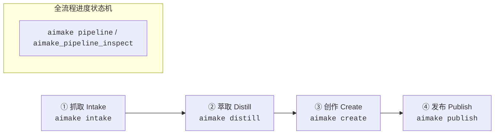

# Aimake Studio · 架构与工程规范 (Architecture & Engineering Guide)

本文档阐述 **Aimake Studio（爱创工坊）** 的完整系统架构、代码分层、目录拓扑以及与生态项目的协作边界。

---

## 1. 品牌与生态三层体系

Aimake 采用 **“母品牌收口、旗舰工坊主推、核心引擎幕后、历史生态维护”** 的清晰结构：

```
                    ┌──────────────────────────────┐
                    │      Aimake（爱创）母品牌      │
                    │   面向超级个体的创作基础设施   │
                    └──────────────┬───────────────┘
                                   │
       ┌───────────────────────────┼───────────────────────────┐
       ▼                           ▼                           ▼
【旗舰主产品 · 对外门户】       【底层核心引擎 · 幕后】        【历史资产 · LTS维护态】
 Aimake Studio (爱创工坊)       Aimake Engine (核心引擎)       Aimake Universe (星球矩阵)
 ───────────────────────        ───────────────────────        ──────────────────────────
 • 目录: products/aimake        • 目录: aimake-labs/           • 目录: aimake-labs/
 • 仓库: chicogong/aimake-      • 仓库: chicogong/aimake-      • 各星球: kids/math/brain
   creator (保持原名)             studio                         planet 等
 • npm: aimake-studio@2.0.0     • npm: @aimake/engine          • 状态: Maintenance (LTS)
 • 命令: aimake                 • 命令: aimake-engine          • 线上域名稳定访问
 • 门面: aimake.cc              • 定位: Headless 音视频渲染内核   (不加新功能，零破坏)
 • 看板: GitHub Project #3        与 Recipe 运行时
```

---

## 2. 旗舰工坊源码拓扑 (products/aimake)

```
products/aimake/
├── assets/                     # 生产环境静态资产
│   └── brand/                  # 官方品牌视觉包 (Codex Creator Canvas 规范)
│       ├── backgrounds/        # 极光微光 (aurora)、点阵坐标背景
│       ├── decorations/        # 轨道环、彩色纸屑装饰
│       ├── hero/               # 3D 透明高精度首屏素材 (webp / png)
│       ├── icons/              # Favicon、PWA manifest、Apple Touch Icon
│       ├── illustrations/      # 核心特性矢量插画 (一稿多格式、AI 助理、画布)
│       ├── logos/              # 矢量 Logo、标徽、暗/亮 App 图标全套
│       ├── social/             # GitHub 1280x640 / OG 1200x630 分享卡片
│       ├── tokens/             # 设计代币 (tokens.css, components.css)
│       └── ui-icons/           # 14 枚 currentColor 线性 UI SVG 图标
├── desktop/                    # Swift macOS 原生壳与系统托盘菜单
├── dist/                       # tsup 打包产出的 CLI 与 SDK (ESM + DTS)
├── dist-desktop/               # 原生 macOS DMG 安装包产物
├── dist-site/                  # 官网静态产物 (HTML/Sitemap/CNAME/Playground)
├── docs/                       # 架构设计、品牌指南与研究文档
│   ├── brand-kit/              # 品牌全套设计指南与概念稿
│   └── ARCHITECTURE.md         # 本工程架构规范
├── examples/                   # 官方真实示例故事板 (.deck.md)
├── scripts/                    # 运维与发布脚本 (DMG 打包、机密审计等)
├── skills/                     # MCP 协议端与 AI 助手工作区配置
├── src/                        # 核心 TypeScript 源码
│   ├── chat/                   # Studio 内嵌 AI 助手与离线编辑指令派发
│   ├── cli.ts                  # 全局 CLI 命令行总入口 (aimake)
│   ├── desktop/                # OpenCode / Swift 桥接层
│   ├── importers/              # Markdown / PPTX / HTML 逆向解析器
│   ├── renderer/               # 5+1 全介质渲染器 (PNG/PDF/PPTX/MP4/HTML)
│   ├── scrapers/               # 多平台抓取器 (WeChat/X/Bilibili/知乎/即刻)
│   ├── site/                   # 官方静态站与 Playground 免安装沙盒构建器
│   ├── studio/                 # 本地实时编辑器 (Koa/SSE 热重载服务)
│   └── wiki/                   # Karpathy 知识库 Vault 与 LWC 索引桥接
├── templates/                  # 36 套专业级排版设计模板 (含 CSS/HTML)
└── tests/                      # 单元测试 (Vitest) 与端到端自动化测试 (Playwright)
```

---

## 3. 四阶创作飞轮流水线 (4-Stage Creative Flywheel)

系统通过统一 CLI 命令和 MCP 工具贯彻超级个体的创作闭环：



1. **Stage ① 抓取 (Intake)**: 抓取外部 URL 或文档，转换为带元数据的标准 Markdown 并持久化至 `sources/`。
2. **Stage ② 萃取 (Distill)**: 提炼形成 ≤3000 Tokens 的结构化知识卡片并生成 `briefs/<slug>.brief.md`。
3. **Stage ③ 创作 (Create)**: 基于选题与模板，人机协作生成声明式故事板文件 `<slug>.deck.md`。
4. **Stage ④ 发布 (Publish)**: 一键向全平台分发（支持 CDP 自动化及离线富文本导出），记录发布日志。

---

## 4. 交付介质渲染管线 (5+1 Deliverables)

从一份声明式的 `deck.md` 故事板文件，确定性编译为五种专业交付介质：

| 介质格式 | 渲染核心 | 特性与保障 |
| :--- | :--- | :--- |
| **Retina PNG** | Puppeteer Chromium | 2x / 3x 像素密度，支持长图拼合与逐页切图 |
| **微信富文本** | Inline CSS 编译器 | 完全内联样式，兼容微信公众号编辑排版限制 |
| **矢量 PDF** | Chromium Print PDF | 高清矢量文字，支持打印与离线分发 |
| **可编辑 PPTX** | PptxGenJS | 真实的文本框、形状与色彩变量，支持 PowerPoint/Keynote 二次编辑 |
| **60fps MP4** | Remotion + FFmpeg | 逐帧时间线编排，支持本地离线 Edge TTS / Whisper 词级字幕对齐 |
| **免安装沙盒** | Web Playground | 纯前端 WebAssembly/Canvas 模拟，零环境依赖即开即用 |

---

## 5. Local-First 与隐私防线

- **零数据上报**：除用户显式配置的大模型 API Endpoint（如 DeepSeek/OpenAI/Ollama），绝不向任何外部遥测服务器发送请求。
- **本地状态持久化**：所有的草稿、知识库、导出产物均以纯文本 Markdown 和标准媒体格式存储在本地文件系统中。
- **密钥安全防线**：内置 `pnpm audit:secrets`，在提交前全面扫描源码、防止任何密钥与敏感路径泄露。
