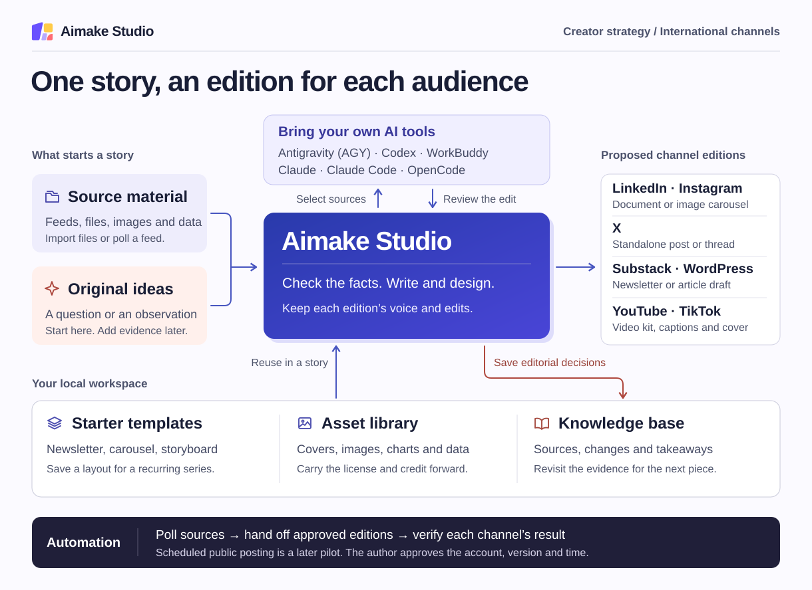

# Aimake Studio for international creators

[简体中文 · 国内平台路线](./CREATOR_STRATEGY.zh-CN.md)

Bring sources and original ideas into a local workspace, shape them into a story, then edit an edition for each audience. A LinkedIn reader might want the finding and the chart. A newsletter subscriber might want the method and its limitations. Studio should keep the underlying facts in sync while letting the author change each edition’s opening, visuals and tone.

## What an author would do

Imagine a reader asks, “Will this model fit on my 8 GB laptop?” The writer saves the question, then adds the model card, their own memory trace and a screenshot. In Studio they separate the download size from the memory used during inference. Their LinkedIn document opens with the answer for the tested configuration. The Instagram carousel puts the two measurements side by side. The Substack edition explains the test setup and links to the evidence. When the writer corrects a number, Studio should flag each affected edition and preserve the commentary written for that audience.

| Part of the workspace | Proposed creator experience | Starting point in Aimake |
| --- | --- | --- |
| Sources and ideas | Start with a question, a file or several sources. Subscribe to selected feeds, show the original URL and last successful fetch, and deduplicate entries after a restart. Keep the author’s observations alongside the evidence. | [Intake](../src/intake/index.ts) and [feed scheduler](../src/radar/feed-scheduler.ts) |
| Optional AI collaboration | Give a selected excerpt and a specific job to Antigravity (AGY), WorkBuddy, Claude, Codex, Claude Code or OpenCode. Preview the returned change and accept just the paragraph or graphic that helps. Test the round trip for each installed tool. | [Desktop launch routes](../desktop/macos/AimakeApp.swift) and [workspace connectors](../src/workspace/agent-connector.ts) |
| Templates and assets | Start with a document carousel, newsletter layout or video storyboard. Carry the license and credit with a photo when replacing a cover or cropping a card. | [LinkedIn template](../templates/linkedin-exec-carousel), [newsletter template](../templates/en-substack-digest) and [sample materials](../examples/sources) |
| Local knowledge base | At sign-off, save the cited facts, approved assets and a short note about what changed. On the next assignment, retrieve the earlier source and check whether its claim still holds. | [Local wiki](../src/wiki/wiki-engine.ts) and [knowledge review](../src/wiki/lwc-core/proposal.ts) |

## Seven channels, seven handoffs

**Available today.** Aimake renders local files such as PDFs, PNGs and MP4s. The bundled [English carousel](../examples/en-founder-carousel.deck.md) rendered locally as a two-page PDF and two 2160 × 2700 PNGs. The named publishing targets currently cover WeChat, Zhihu, Juejin and Xiaohongshu. The international routes below are proposals. The platform references establish what to test with an authorized account. [Current publisher targets](../src/publisher/types.ts)

| Channel | Edition to prepare | First handoff and acceptance check |
| --- | --- | --- |
| **LinkedIn** | A portrait PDF document with a takeaway on page one and separate post copy. | Start with the PDF and caption for manual upload. Check page order and legibility in the composer. A later approved publishing integration should retain the post ID and read back the document post. [LinkedIn Documents API](https://learn.microsoft.com/en-us/linkedin/marketing/community-management/shares/documents-api) |
| **Instagram** | Ordered portrait cards with one visual idea per card, a cover and a caption. | Start with numbered files. Check the cover crop and swipe order on a phone. A later professional-account publishing pilot must verify the resulting media before recording a public post. [Meta’s Instagram API](https://www.postman.com/meta/instagram/documentation/6yqw8pt/instagram-api) |
| **X** | A concise standalone post, or a thread with one point per post and source links where readers need them. | Supply ordered, copyable text and image attachments. For an authorized API trial, retain each returned post ID and verify reply order before retrying an interrupted thread. [X Create Post](https://docs.x.com/x-api/posts/create-post) |
| **Substack** | A newsletter edition with a subject line, opening paragraph, inline figures and source notes. | Hand off editable copy and assets. The writer saves the post in their publication and may share a private preview with an editor. Label that link as a preview. [Substack draft previews](https://support.substack.com/hc/en-us/articles/360038433692-How-do-I-share-a-preview-of-my-post-with-others) |
| **WordPress** | A full article with headings, image credits and a featured image. | Pilot a native draft on an author-controlled site. Save the returned post ID, read its draft status, then reopen it in the correct site’s editor. A retry should resolve to the same post. [WordPress Posts API](https://developer.wordpress.org/rest-api/reference/posts/) |
| **YouTube / Shorts** | A video cut with a title, description, captions and cover artwork. | Start with a local video kit. Later, confirm that an authorized private upload belongs to the expected channel and has finished processing. Scheduling is a separate step with privacy and prior-publication conditions. [YouTube video resource](https://developers.google.com/youtube/data/reference/rest/v3/videos) |
| **TikTok** | A vertical cut with captions and a cover selected for a phone screen. | Start with the video kit. Pilot Upload to TikTok as a creator-inbox handoff. The author opens the notification and completes the edit in TikTok. Direct Post needs its own authorization and verification. [TikTok Content Posting API](https://developers.tiktok.com/products/content-posting-api/) |

## Rollout and evidence

1. **Test two local editions.** Give five creators one real assignment each. Use LinkedIn and Instagram first because one visual story can exercise both PDF pagination and image order. Time the work from the first source or idea to two editions the author would use. Record the edits that had to be made twice.
2. **Verify a saved draft.** Start with WordPress, where an author-controlled test site can expose the post ID and stored draft status. Close the editor, reopen the draft from its receipt, compare text and images, then retry the same version. Keep the account, site and draft ID on the receipt.
3. **Expand by channel.** Use the handoffs above to select the next pilot from actual creator demand. Show what the destination confirmed: a local file, a reopened draft, an inbox delivery, a private upload or a public post. Retry only the unfinished channel.
4. **Pilot automation separately.** A feed refresh can add new material. A signed-off edition can be sent for review. Scheduled public posting is a later opt-in feature for individually validated channels. Bind approval to the account, version, time and time zone, allow cancellation and verify the public result before marking it published.

Follow up a week later. Ask each creator to show the next piece, which source or layout they reused, and where they still had to leave Studio. Those observations, plus per-channel reopen results, should guide the next connector and template. [Engineering roadmap](./ROADMAP-2.0.md)
