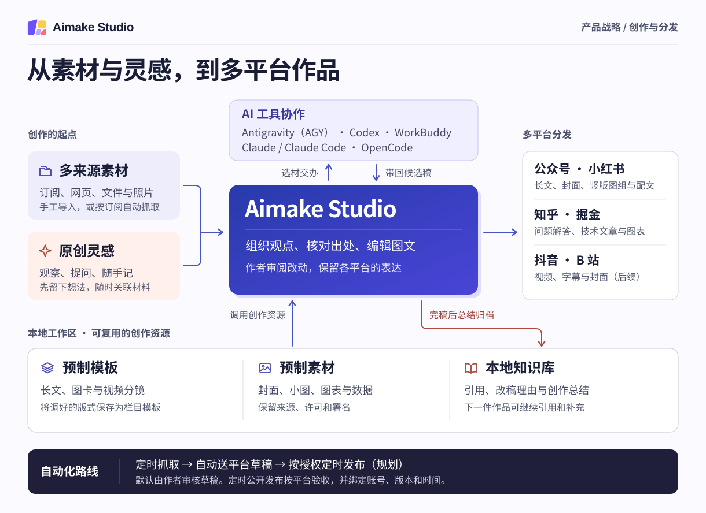

# Aimake 产品战略 · 让科技创作者从一条新闻做到下一期

建议先服务每周持续更新的独立科技作者。作者今天拿到一条新闻，在桌面核对出处、改成自己的稿子，得到公众号富文本和一组适合手机阅读的图卡。启用草稿交付后，作者能在自己的平台账号重开稿件、检查并手动发布。下次写同一话题时，上一期的来源、版式和修改都能接着用。

## 从一篇真实作品出发

黑五 AI 比价样稿问了一个读者会遇到的问题。同一商品标价 199 和 219，算上运费究竟哪个更便宜？样稿用一组标明为示例的价格演算。这个问题适合做图卡首屏，算式适合做第二屏，产品发布和调查数据保留各自的出处。公众号可展开适用条件和调查口径。两份成品共享事实，作者分别决定开头、篇幅和结尾。此前桌面试用已导出四张竖图和本地公众号富文本；平台账号内的保存与重开仍待验证。[作品与试用记录](https://github.com/chicogong/aimake-creator/discussions/47#discussioncomment-19941026)

## 现在能从哪里起步

以下是截至 2026-11-27 的依据，主分支代码、安装包试用和平台账号验收分别记录。

| 环节 | 已有依据 | 下一项验证 |
| --- | --- | --- |
| 找新闻 | 主分支预设 Hacker News 每 30 分钟、Google News 科技 RSS 每 60 分钟到期，并在 Studio 启动时检查到期订阅。 | 保持桌面开启跨过两个周期，再测试退出、睡眠与恢复。逐项记录实际抓取时间、重复条目、失败原因和原文是否可读。[订阅实现](https://github.com/chicogong/aimake-creator/blob/b24af2618c329c02b37e18ff1addc6271b701355/src/radar/feed-scheduler.ts) · [启动与手动刷新](https://github.com/chicogong/aimake-creator/blob/b24af2618c329c02b37e18ff1addc6271b701355/src/studio/studio-server.ts#L2359-L2360) · [桌面定时刷新 #68](https://github.com/chicogong/aimake-creator/issues/68) |
| 写与改 | Studio 已有从素材建稿的入口。引用核验和跨工作区保存已有修复记录。 | 请新作者从原文定位一个数字，接受或拒绝一次 AI 修改，再改稿、重开、重导出。核对另一篇作品的文件与作者手改内容。[从选中素材创作 #44](https://github.com/chicogong/aimake-creator/issues/44) · [修改确认 #41](https://github.com/chicogong/aimake-creator/issues/41) · [导出隔离 #39](https://github.com/chicogong/aimake-creator/issues/39) |
| 交给平台 | 本地可以生成各平台文件。当前公众号浏览器适配器在打开后台时就可能返回 `draft_saved`，知乎与掘金也缺少独立重开核对。 | 在目标账号里按草稿标识重新读取标题、正文和图片，由作者通过回执重开。验收前，界面分别标明「本地包已生成」「编辑器已打开」「草稿已核验」。[浏览器适配器](https://github.com/chicogong/aimake-creator/blob/b24af2618c329c02b37e18ff1addc6271b701355/src/publisher/browser-publisher.ts) · [草稿交付 #4](https://github.com/chicogong/aimake-creator/issues/4) |

## 建议投入顺序

| 阶段 | 优先交付 | 可以进入下一阶段的依据 |
| --- | --- | --- |
| **先完成第一期** | 支持贴一条原文链接或从订阅选题，保留关键事实与出处；用可视化编辑器做一份原稿。先打磨「新闻快讯」和「数字对比」两种版式，输出公众号图文、小红书 3:4 图组和配文。CLI 和 OpenCode 共用本地文件，新作者从桌面即可完成。 | 用公开安装包在新工作区独立走完全程；手机上读得清，数字能回查，作者能换图、退回 AI 修改，连续导出两篇能分别找回。[首用路径 #74](https://github.com/chicogong/aimake-creator/issues/74) · [素材库 #64](https://github.com/chicogong/aimake-creator/issues/64) · [安装包验收 #37](https://github.com/chicogong/aimake-creator/issues/37) |
| **再交付第一份平台草稿** | 公众号先行。回执包含目标账号、文章标题、草稿标识及可用入口；只有草稿箱入口时，让作者按标题定位。登录失效时保留本地成品和待办。 | 在已启用的测试账号保存后关闭页面，从回执重开并核对图文。同一作品版本重试一次仍定位到同一篇，最终发布由作者确认。[多平台实施方案](https://github.com/chicogong/aimake-creator/discussions/58) |
| **再让第二期更容易** | 把用户选用的来源、经许可的图片及署名、版式和人工改稿留在本地。原稿数字变化时提醒哪些平台稿要更新，保留平台专属措辞。然后按需求依次验证知乎、掘金；小红书图文先交付有序套图和配文。 | 同一作者能复用上期素材完成新选题。每增加一个草稿渠道，都用同一篇稿验收重开、重试和部分失败恢复。[知识库与风格 #11](https://github.com/chicogong/aimake-creator/issues/11) · [平台与回执设计](https://github.com/chicogong/aimake-creator/discussions/58) |

## 让作品带来下一位作者

把一期公开样稿放到 README 和作品库，让读者能看手机成品、查原始来源，再到桌面换成自己的新闻。社区模板也按这个流程验收，每份贡献附一个真实选题、可替换的小图、图片许可和手机效果。优先按“这条新闻对谁有影响”“两个数字怎么比”组织模板，便于不同作者复用。随着实际使用增加，再决定哪些来源值得维护、哪些渠道值得接入。[社区模板 #2](https://github.com/chicogong/aimake-creator/issues/2) · [精选作品 #69](https://github.com/chicogong/aimake-creator/issues/69) · [来源贡献 #73](https://github.com/chicogong/aimake-creator/issues/73)

## 更远的产品机会

当作者连续更新同一个栏目，Aimake 有机会成为这个栏目的本地编辑台。比如下月再报道同一产品，作者可以调出上次发布时的数字和出处，核对这次真正改了什么，然后沿用已调好的图卡和用语。能否形成长期优势，取决于作者做下一期时省下哪些重复劳动，又能沿用哪些编辑判断。[本地知识库与作者风格](https://github.com/chicogong/aimake-creator/issues/11)

把后续投资系在实际需求上。多名作者持续更新、却反复花时间值守抓取或重送草稿时，再验证可选的托管调度服务及付费意愿；出现多人共编同一期的需求时，再试编辑交接和审核。短视频优先从作者已经发布的选题改编，用成片是否被采用决定投入。核心的本地编辑、资料和导出继续向单人创作者开放。[开源路线图](./ROADMAP-2.0.md) · [视频素材提案 #14](https://github.com/chicogong/aimake-creator/issues/14)

## 怎样判断值得继续投入

建议先邀请 5 位本来就写科技内容的作者，各带一条当日新闻，当场观察首期，七天后再问有没有做第二期。以下是试点口径，基线由首轮观察建立。记录可由作者自愿提供，保存在本地。

| 观察项 | 记录方式 | 如何影响优先级 |
| --- | --- | --- |
| 首份可用成品耗时 | 从放入原文到作者确认愿意使用的首份成品，报告完成数、各次用时与卡住的步骤。 | 若多人卡在找出处或换图，下一轮先修该步骤。 |
| 草稿重开成功率 | 正确账号中重开且标题、正文、图片相符的作品版本数 ÷ 请求交付的作品版本数；按平台报告，重试按同一版本计。 | 任一版本误报已保存，先修回执，再扩该渠道。 |
| 七天内完成第二期的作者数 | 以参与首轮的 5 人为分母，记录独立完成第二个真实选题的人数，并问复用了什么、放弃在哪一步。 | 若首期能做完却无人复用，先核对选题频率与手工返工，再决定扩平台、短视频或团队协作。 |

工程里程碑继续由[版本路线图](./ROADMAP-2.0.md)维护。每次试点的作品、安装版本和验收结果可挂到[产品看板](https://github.com/users/chicogong/projects/3)对应任务。
