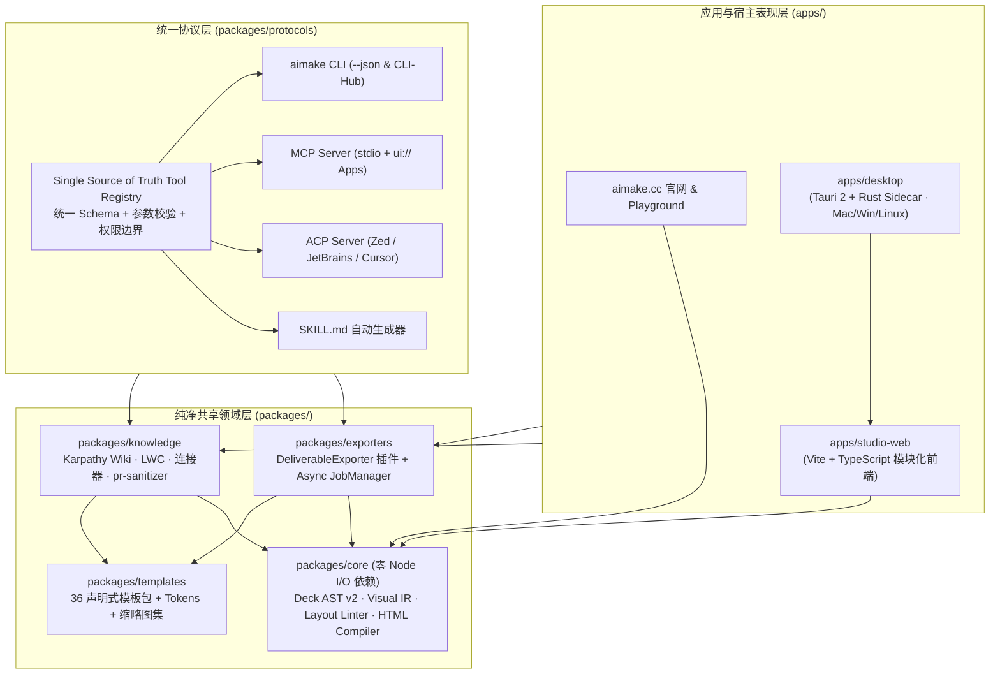

# Aimake Studio · 顶流专业开源项目北极星蓝图 (`NORTH_STAR_TOP_TIER_BLUEPRINT.md`)

> **定位基准**：对标 **Linear / Figma / Raycast / Screen Studio / Obsidian / Slidev / Remotion** 顶级工艺水准  
> **实证来源**：基于真实截屏视觉审查（[`docs/assets/studio-canvas.png`](./assets/studio-canvas.png)、`test-results/live-screenshots/06`–`07`）与核心引擎代码核验（`html-compiler.ts`、`exporter-pptx.ts`、`deck-parser.ts`、`calm-ui/markup.ts`）  
> **配套文档**：[`PRODUCT_AUDIT_AND_ARCHITECTURE_2026.md`](./PRODUCT_AUDIT_AND_ARCHITECTURE_2026.md) · [`UI_DESIGN_SYSTEM.md`](./design/UI_DESIGN_SYSTEM.md) · [`BACKLOG_AND_AGENT_TASKS.md`](./BACKLOG_AND_AGENT_TASKS.md)

---

## 一、 从“能跑通的极客工具”跃升为“顶流专业产品”的四重标准

真正的世界级开源生产力产品（如 Obsidian、Linear、Slidev、Remotion），在以下四个维度呈现统一的高标水准：
1. **UI 与视觉工艺**：第一眼令人惊艳的审美克制、零状态同步撕裂、双端像素级一致与 60fps 微交互反馈；
2. **核心产品护城河**：超越“模板填空”的丰富 DSL 表达力、无损高保真导出媒介与可持续沉淀的个人资产飞轮；
3. **可扩展系统架构**：纯净共享核心（Pure ESM Core）、可插拔导出与协议矩阵、以及严格门禁化的异步运行时；
4. **开源社区信任感**：零门槛 30 秒真实网页试玩、全链路视觉回归守护与可验证的真机发布收据。

---

## 二、 视觉与交互工艺层面：根治实拍截屏暴露的四大破绽

通过直接核验实时界面截图，以下真实视觉与交互问题必须作为优先工艺标尺解决：

| 截屏实证来源 | 定位到的真实视觉/交互缺陷 | 顶流级改造方案 |
| :--- | :--- | :--- |
| **[`studio-canvas.png`](./assets/studio-canvas.png)** | **1. 顶部悬浮状态胶囊状态滞后且与底栏重复**<br>左侧浮动胶囊持续显示 `作品加载中 \| 16:9 \| 第 01 / 01 页` 与粗犷 Emoji `📐`，但画布已经实际渲染为 `3:4` 第 `01 / 03` 页，造成双端信息打架。 | 修复初始化/切换竞态确保实时同步；删除顶部重复胶囊中的静态占比字样与 Emoji，改为极简面包屑+纯矢量图标，只在鼠标悬停画布边缘时浮现轻量尺寸指示器。 |
| **[`studio-canvas.png`](./assets/studio-canvas.png)** | **2. 底部 Dock 单行塞入 14 个交互控件，视觉过载**<br>底栏同时混放翻页、增删复制、一键公众号、比例、模板、语言、AI对话、缩放、全屏、微调、`⌘K`。 | 对标 **Linear / Figma 分层克制法则**：底栏严格收缩为 **5–6 枚高雅控件**（`页码胶片条 + 比例/风格 + 缩放/全屏`）；`复制公众号` / `微调` / `AI 对话` 上浮归位至右侧上下文检查器与顶部主操作栏。 |
| **`06-playground-deepseek-sample.png`** vs **`studio-canvas.png`** | **3. Playground 与 Studio 双端渲染引擎分裂 + 指标换行错乱**<br>同为 `xhs-swiss-grid` 模板：Studio 为强特征暖棉纸白+左侧朱红竖条，Web Playground 却呈现浅绿卡片风格；且 `< 120ms` 被强行拆成两行，标签出现 `缩比` / `险` 等中文孤字。 | **双端彻底共用同一个纯前端编译核心 (`packages/core`)**，保证 Playground 100% 还原桌面成品外观；所有 KPI 数字与标签强制启用 `white-space: nowrap`、`clamp()` 流体字号适配与 `text-wrap: balance`。 |
| **`07-playground-template-drawer.png`** | **4. 官网 Playground 36 套模板抽屉仅有纯文字卡片**<br>抽屉内仅显示标题、比例胶囊与文字描述，用户无法直观感知配色与版式差异。 | 引入预构建的 **36 套真实缩略图预览图 + 3 色阶小色板条 + 悬停预览换肤**，使选模板成为直观的所见即所得体验。 |

### 交互微打磨附加标准
- **零延迟首屏预热**：消除加载态白屏或 stale badge 闪烁；
- **全键盘无鼠标心流**：`⌘K` 唤起命令面板、`↑/↓` 切换页面、`⌘Z / ⇧⌘Z` 多步撤销/重做、胶片药丸指针拖拽重排；
- **超界热力预警（Overflow Guardrail）**：单页文本接近溢出边缘时，Calm Studio 右下角平滑浮现微弱橙色角标并提供「一键精简字数 / 自动调字号」修复动作；
- **阻尼微动效（Spring Motion）**：抽屉与浮层采用一致 `240ms` 缓动曲线，并尊重系统 `prefers-reduced-motion`。

---

## 三、 核心产品功能与护城河层面：突破表达上限，铸造六维高保真闭环

### 1. `.deck.md` 表达力跃迁至 **Deck AST v2**
核验 [`src/renderer/deck-parser.ts`](../src/renderer/deck-parser.ts) 发现，当前语法仅识别 `cover/bullets/quote/metrics/comparison/code/mermaid` 6 类固定结构，且 `compare` 严格局限于双栏对比。升级为 **Deck AST v2**：
- **原生图文混排与 `gen://` 媒体槽位**：支持标准化 Markdown 图片语法 ``，支持左右分栏图、背景压暗满出血图与图注水印；
- **原生 GFM 表格与确定性离线 SVG 图表 (` ```chart `)**：直接解析 Markdown 表格并在模板中渲染斑马纹或极简细线表格；新增纯前端/纯节点端 SVG 图表生成器（支持柱状、折线、漏斗、雷达图），无需外网 CDN；
- **自由多栏 Bento 网格、时间线与步骤流（` ```grid ` / ` ```steps ` / ` ```timeline `）**：彻底突破两栏限制，天然适配 `3×2` 产品矩阵、发展路线图与方法论步骤拆解；
- **Excalidraw 概念草图原生嵌入**：支持工作区 `.excalidraw` 文件以高保真手绘矢量嵌入任意幻灯片。

### 2. 「零妥协」多介质编译器升级（Visual IR 共享渲染）
核验 [`src/renderer/exporter-pptx.ts`](../src/renderer/exporter-pptx.ts#L14-L37) 发现：目前仅硬编码了 `Dark` 与 `Light` 两套通用配色、画布尺寸写死 `13.333×7.5`（16:9），且未处理 `slide.diagram`（Mermaid 流程图在导出 PPTX 时直接丢失）与动态防溢出排布。
- **建立共享 Visual IR 层**：将 36 套模板的真实色彩、字体、边距、背景纹样抽离为可序列化视觉 IR Token，供 HTML/PNG 与 PPTX 共同消费；
- **PPTX 高保真原生生成**：按文稿实际 `aspect` 自动映射对应画幅尺寸（16:9 / 3:4 / 4:5）；将 Mermaid/图表/Excalidraw 光栅为 3x 高清透明图嵌入对应坐标区，其余标题/正文/指标卡保持 100% 原生可双击编辑 OOXML 对象与 `addTable`；
- **CapCut 6 轨无缝直开**：落实 `#18` 真高清 PNG 导出 + 本地绝对路径自动重写，真正实现「点一下注入，剪映首屏打开直接剪辑配乐」；
- **个人品牌套件（Workspace Brand Kit）**：集中管理 Logo 矢量、主辅色、署名脚标与字体偏好，自动全局注入全 36 套模板与 6 种导出媒介；
- **智能出版质检器（`aimake lint`）**：自动检查文本密度溢出、`cite:` 溯源锚点真实性、4 语种 AI 套话残余与断行安全，给出 0–100「出版就绪分」。

---

## 四、 工业级系统架构层面：告别巨型单文件，演进为可扩展平台

针对当前存在 10 个超过 1,000 行巨型文件（`build-templates.mjs` 4,990 行、`site-builder.ts` 3,106 行、`calm-ui/script.ts` 2,431 行、`studio-server.ts` 2,098 行等）与协议/渲染实现分裂的问题，规划如下标准分层架构：



### 架构升级四大核心原则
1. **同构纯净渲染内核 (`packages/core`)**：从 AST 解析到模板渲染零 `node:fs`/`node:child_process` 耦合，Browser Playground、Node CLI、macOS/Tauri 桌面端共同执行同一套编译管线，彻底杜绝双端视觉偏差与双份解析代码。
2. **统一工具注册表驱动四端协议 (`packages/protocols`)**：同一份工具元数据与 Zod Schema 自动派生 `CLI 子命令`、`MCP 工具清单`、`ACP 会话工具` 与 `SKILL.md` 文档，根治「CapCut 已进 CLI 却遗漏在 MCP」类的能力不同步问题。
3. **统一异步任务引擎 (`JobManager`)**：覆盖 MP4 合成、TTS 语音克隆、批量截图与 CDP 填充，通过 SSE 持续推送 `{ jobId, stage, progress, eta }`，支持用户一键 `AbortController` 优雅熔断 FFmpeg / Playwright 子进程。
4. **插件化模板与导出扩展协议 (`aimake.plugin.json`)**：让社区设计师无需改动核心仓库代码，通过标准包清单即可发布新设计模板包、自定义导出格式与外部数据源抓取器。

---

## 五、 开源顶流工程与社区信任防线

1. **视觉像素回归门禁（Visual Regression Testing）**：基于 Playwright 在 CI 中维护 36 套模板与 Studio 关键界面的基线截图集，PR 改动渲染核心时自动比对像素差异，守住排版美学零退化。
2. **安装包真实运行校验与公证**：延续 AutoClip 严苛发布纪律，桌面端安装包脱离宿主环境在纯净机器实跑验收，逐步引入 Apple Notarization 与 Windows 签名及 `tauri-plugin-updater` 原生更新通道。
3. **30 秒极速惊艳体验**：官网首屏一键进入真内核驱动的 Playground（带可视化缩略图模板抽屉 + 示例切换 + 即时复制公众号 HTML），降低 90% 初次体验摩擦。

---

## 六、 本蓝图对应的增量执行任务队列

本蓝图新定位的高价值改进已同步转化为 **GitHub Project #3** 正式 Issue 与 [`BACKLOG_AND_AGENT_TASKS.md`](./BACKLOG_AND_AGENT_TASKS.md) 工单：
- **`T-18` (Priority: P1 · Milestone `v2.0.1`)**：修复 Studio 状态胶囊滞后与冗余控件、统一 Playground/Studio 编译渲染引擎、修正指标断行并为 Playground 模板抽屉补齐可视化封面缩略图；
- **`T-19` (Priority: P1 · Milestone `v2.1.0`)**：基于共享 Visual IR 升级 PPTX 原生导出器（继承 36 套模板色板、自适应多画幅、内嵌高保真图表图片与原生 OOXML 表格）；
- **`T-20` (Priority: P1 · Milestone `v2.2.0`)**：建设 **Deck AST v2**（图片/生图槽位、GFM 表格、离线 SVG 图表、多栏网格/步骤流、Excalidraw）与 `aimake lint` 排版溢出质检器。
