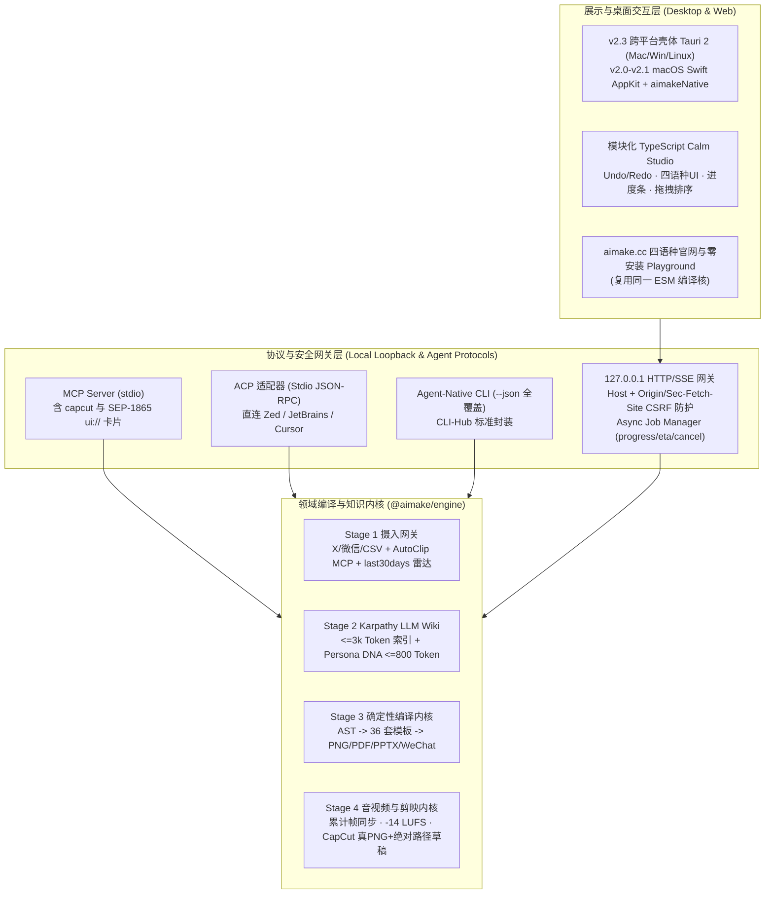

# Aimake Studio · 2026 全栈产品审计、开源对标与架构演进蓝图

> **审计基准日期**：2026-11-24  
> **审计基线版本**：`aimake-studio@2.0.0` (`HEAD 767f2c6`, GitHub `chicogong/aimake-creator`)  
> **归属仓库**：`products/aimake`  
> **关联文档**：[`DOCS_INDEX.md`](./DOCS_INDEX.md) · [`ROADMAP-2.0.md`](./ROADMAP-2.0.md) · [`DEVELOPMENT_WORKFLOW.md`](./guides/DEVELOPMENT_WORKFLOW.md)

---

## 一、 当前产品与工程现状全景快照

Aimake Studio 经过密集迭代，已完成从单一 CLI 原型向**“本地优先多模态创作操作系统（Local-First Creative OS）”**的架构跃迁。当前仓库的客观工程资产分布如下：

| 资产维度 | 客观量化现状 | 核心文件 / 入口 |
| :--- | :--- | :--- |
| **参数化设计系统** | **36 套**四语种商业设计模板（覆盖 3:4 / 9:16 / 16:9 / 4:5 / 1:1） | [`templates/`](../templates) · [`src/templates/index.ts`](../src/templates/index.ts) |
| **多介质编译交付 (5+1)** | PNG 图集 / 微信 100% 内联 HTML / 矢量 PDF / 原生可编辑 `.pptx` / H.264 MP4 / 剪映草稿雏形 | [`src/renderer/`](../src/renderer) |
| **知识底座与工作室** | Karpathy LLM Wiki (`@lwc/core` 移植) + 7 大工作区实体预设 Skill + Calm Studio WebUI | [`src/wiki/`](../src/wiki) · [`src/workspace/`](../src/workspace) · [`src/studio/`](../src/studio) |
| **原生桌面端与官网** | macOS AppKit + `WKWebView` 壳体（`AimakeApp.swift`，1,835 行）+ 四语种静态官网与 Playground | [`desktop/macos/AimakeApp.swift`](../desktop/macos/AimakeApp.swift) · [`src/site/`](../src/site) |
| **Agent 协议集成** | MCP Server（1,246 行）+ `SKILL.md` + `opencode-bridge` + ACP 提案 RFC | [`src/mcp/mcp-server.ts`](../src/mcp/mcp-server.ts) · [`docs/proposals/2026-11-24-rfc-acp-protocol-integration.md`](./proposals/2026-11-24-rfc-acp-protocol-integration.md) |
| **质量与 CI 自动化** | **10 个 Vitest 测试文件（70 用例）** + 3 套 Playwright E2E + **8 条 GitHub Actions** + Project #3 | [`tests/`](../tests) · [`.github/workflows/`](../.github/workflows) |
| **核心代码体量** | 关键实现与构建脚本共约 **27,876 行**（不含 `templates/` 源码产物与测试） | `src/`、`desktop/`、`scripts/` |

---

## 二、 六层严格代码与体验审计（已定位的真实缺陷与技术债）

本节基于对源码的逐行核验，将发现的问题按影响面与严重度拆分为六个层面。

### 第 1 层：安全、隐私与合规治理（P0 / P1）

1. **[P0 已止血] 公开文档曾误入内部运维巡检脚本**：
   - `2026-11-24` 提交 `2cc7e64` 在 [`docs/research/2026-11-24-agent-native-ecosystem-and-tools-research.md`](./research/2026-11-24-agent-native-ecosystem-and-tools-research.md) 中意外带入了内部服务器主机名、内部路径及数仓作业名称。
   - **修复动作**：已在当前工作区彻底清除该段落，并升级 [`scripts/audit-secrets.mjs`](../scripts/audit-secrets.mjs) 正则规则，拦截 `VM-*` 主机名、内网路径与扩展 Token 前缀；同时提示维护者评估对远端提交 `2cc7e64` 的历史清理策略。
2. **[P1 安全加固] 本地回环 HTTP 服务缺少 `Origin` / `Sec-Fetch-Site` CSRF 防护**：
   - 位置：[`src/studio/studio-server.ts`](../src/studio/studio-server.ts#L758-L769)。
   - 现状：服务端通过 `isAllowedHostHeader()` 校验了 `Host` 头以防御 DNS Rebinding，对外部网页发起的跨域 `POST` 请求仍缺乏 `Origin` 与 `Sec-Fetch-Site` 校验。由于 Studio 暴露了写入本地 `.deck.md`（`POST /api/markdown`）及唤起本地终端/Agent 进程（`POST /api/workspace/agents/launch`）的高权限接口，本地浏览器在打开第三方网页时存在跨站请求伪造风险。
   - 建议：对所有非 `GET/HEAD` 的变更型接口强制验证 `Origin` 必须匹配当前 `http://127.0.0.1:${port}` 或 `http://localhost:${port}`（允许无 `Origin` 的 CLI/原生桌面端直连，但拒绝携带第三方网页 `Origin` 或 `Sec-Fetch-Site: cross-site` 的请求）。
3. **[治理清理] 三处开源协议表述冲突**：
   - `package.json`（`line 27`）与 `LICENSE` 明确为 **MIT License**，GitHub 仓库已设为 `PUBLIC`。
   - 原 `AGENTS.md` 声明为 `UNLICENSED` closed-source，`wechat-article-launch.md` 写为 `Apache-2.0`，`ROADMAP-2.0.md` 仍保留闭源许可密钥规划。
   - **修复动作**：本轮审计已统一修正上述三份文档，全面对齐 MIT 开源基线。

---

### 第 2 层：macOS 原生桌面端层（`desktop/macos/AimakeApp.swift`）

1. **[P0 真实 Bug] Swift 与 WebView 通信通道名称不匹配导致原生能力静默失效**：
   - 证据对比：
     - Swift 端（[`AimakeApp.swift`](../desktop/macos/AimakeApp.swift#L386) 与 `#L930`）注册的 `WKScriptMessageHandler` 通道名是 **`aimakeNative`**。
     - Calm Studio 前端（[`src/studio/calm-ui/script.ts`](../src/studio/calm-ui/script.ts#L103) 与 `#L1900`）调用的却是 **`window.webkit.messageHandlers.aimake`**。
   - 后果：用户在原生 `Aimake.app` 桌面端点击「选择文件夹」（新建/打开工作区）以及切换「浅色/深色外观同步」时，前端找不到 `messageHandlers.aimake`，全部回退成普通浏览器弹窗提示或无效空操作。
   - 修复：统一前端调用 `window.__aimakeInvokeNative`（Swift 已在 document start 注入）或统一对齐为 `aimakeNative`，并在 E2E 中补充桥接契约断言。
2. **[P1 交互冲突] AppKit 原生菜单快捷键抢占 Studio 内置热键，且 View 菜单停留在 1.0 时代**：
   - 证据：[`AimakeApp.swift`](../desktop/macos/AimakeApp.swift#L221) 将 `File -> Quick Clip to Wiki` 绑定为 `⌘K`，直接拦截了 Calm Studio 最核心的全局命令面板 `⌘K`。
   - 证据：[`AimakeApp.swift`](../desktop/macos/AimakeApp.swift#L232-L254) 的 `View` 菜单仍绑定旧 1.0 的四页切换（`Wiki ⌘1 / Canvas ⌘2 / Media ⌘3 / AI ⌘4`），与 2.0 Calm Studio 的四步进度锚点与抽屉模型脱节；`Export` 菜单（`#L268-L285`）缺少 CapCut 草稿导出入口。
3. **[P1 分发与跨平台门槛] Ad-Hoc 签名、外部 Node 强依赖与单平台局限**：
   - [`scripts/build-macos-app.mjs`](../scripts/build-macos-app.mjs#L495) 仅执行 `--sign -`（Ad-Hoc 本地签名），缺少 Apple Developer ID 签名与 Notarization 公证，外部分发会触发 macOS Gatekeeper 拦截。
   - [`AimakeApp.swift`](../desktop/macos/AimakeApp.swift#L87-L102) 依赖查找宿主机全局安装的 `node`（`/opt/homebrew/bin/node` 等），纯净新机在未安装 Node.js 时无法启动底层编译器。
   - 当前完全缺乏 Windows / Linux 桌面客户端封装方案。

---

### 第 3 层：多模态导出、CapCut 草稿与音视频渲染引擎（`src/renderer/`）

1. **[P0 真实 Bug] CapCut 草稿导出输出 1x1 空白占位图，且本地安装未重写素材绝对路径**：
   - 证据链：
     - [`src/studio/studio-server.ts`](../src/studio/studio-server.ts#L1650-L1654) 与 [`src/renderer/exporter-media.ts`](../src/renderer/exporter-media.ts#L425-L438) 调用 `buildCapCutDraft(deck, ...)` 时，**均未先渲染并传入 `slideImages` 数组**。
     - 结果导致 [`src/renderer/capcut-draft-builder.ts`](../src/renderer/capcut-draft-builder.ts#L387-L389) 与 `#L505` 自动触发降级逻辑，在草稿目录中写入 `MINIMAL_PNG_BUFFER`——即 **68 字节的 1x1 透明像素图**！在剪映专业版中打开草稿会显示全黑或极小点状占位素材。
     - 当 `installLocal: true` 时（[`capcut-draft-builder.ts`](../src/renderer/capcut-draft-builder.ts#L548)），程序仅将图片复制进系统剪映草稿目录，**原封不动拷贝了指向临时导出的 `draft_content.json`**，未重写 JSON 内的 `materials.videos[i].path` 与 `materials.audios[i].path`，且未在目标目录存在自定义 `audioTrackPath` 时同步拷贝音频文件，导致清理临时导出目录后草稿立刻提示「媒体丢失」。
     - `src/cli.ts:925` 同样存在未触发 PNG 预渲染而直接调用 `exportDeckBundle(..., 'capcut')` 的问题；[`src/mcp/mcp-server.ts`](../src/mcp/mcp-server.ts#L183) 的 `aimake_render_deck` 工具枚举尚未纳入 `'capcut'`；[`tests/`](../tests) 中完全缺乏针对 `capcut-draft-builder` 的单元测试（0 覆盖）。
2. **[P1 音画同步] 逐页独立取整帧数在长视频中引入音画累计漂移与尾部截断**：
   - 证据：[`src/renderer/exporter-media.ts`](../src/renderer/exporter-media.ts#L166-L172) 对每一页分别执行 `Math.round((ms / 1000) * fps)`。在 24fps 下单页最大产生约 20.8ms 舍入误差；当作品扩展到 30-50 页（对应 Issue #13）时，累计偏差可达 300-600ms 以上，配合 `-shortest` 参数（`#L245`）会在音轨略长时直接截断音频末尾或导致字幕滑移。
   - 修复方案：改用**累计时间戳差值法**计算每页帧数——`endFrame = Math.round((cumMs / 1000) * fps); pageFrames = endFrame - prevEndFrame`，从数学上消除累计误差。
3. **[P1 画质、声学底线与性能]**
   - **声学响度对齐**：[`exporter-media.ts`](../src/renderer/exporter-media.ts#L245) 当前使用 `-af loudnorm=I=-16:TP=-1.5:LRA=11`。吸收 AutoClip 实证调研结论，面向小红书/抖音/Shorts 的短视频规范应调整为 `I=-14:TP=-1.0:LRA=11`（可做参数配置）。
   - **字体与图片竞态**：[`exporter-media.ts`](../src/renderer/exporter-media.ts#L208) `await page.setContent(..., { waitUntil: 'load' })` 之后直接开始截帧，建议在截帧前显式等待 `await page.evaluate(() => document.fonts.ready)`，保障外链/本地字体加载稳定。
   - **硬件编码加速**：`line 257` 固定使用软件 `-preset ultrafast`，在 Apple Silicon Mac 上可探测 `h264_videotoolbox`（通过真实试跑测试校验）以大幅提速长视频合成。

---

### 第 4 层：前端 UI 与交互体验（`src/studio/calm-ui/` & `src/site/`）

1. **[核心架构债] 全量客户端 JS 与 CSS 内联为 TS 模板字符串**：
   - [`src/studio/calm-ui/script.ts`](../src/studio/calm-ui/script.ts)（2,431 行）与 [`styles.ts`](../src/studio/calm-ui/styles.ts)（2,181 行）采用纯模板字面量拼接（`` export const CALM_STUDIO_SCRIPT = `...` ``）。
   - 直接后果：
     - **完全绕过 TypeScript 类型检查**：前述 `aimake` vs `aimakeNative` 通道名错误正是在字符串内被静默放过；
     - 缺乏源码级 Source Map、单元测试与组件状态复用，[`src/site/playground-builder.ts`](../src/site/playground-builder.ts)（1,732 行）甚至在客户端字符串里又手写维护了一套独立 Markdown 解析逻辑。
2. **[真实体验断点] 交互与国际化缺口**：
   - **硬编码过时文案**：[`src/studio/calm-ui/markup.ts`](../src/studio/calm-ui/markup.ts#L81) 左侧边栏硬编码了 `每周灵感雷达 · W47`，脱离真实日期与最新雷达条目状态。
   - **Studio 缺少多语种 UI 切换**：官网 `site-builder.ts` 已完整支持 `zh / en / ja / ko` 四语种，而 Studio 主界面所有按钮、提示与抽屉全部硬编码为简体中文。
   - **缺少高频创作微观体验**：画布局部编辑缺少 Undo / Redo 历史栈；幻灯片底栏尚未实现拖拽排序；耗时导出操作（MP4 / 多页 PNG / 语音合成）缺少结构化实时进度条（阶段、百分比、ETA 与取消操作）。

---

### 第 5 层：后端与代码库模块化债务

对照 [`docs/guides/TESTING_AND_ENGINEERING_STANDARDS.md`](./guides/TESTING_AND_ENGINEERING_STANDARDS.md#L80) 明确的「单文件超过 500 行应按单一职责拆解」红线，当前仓库存在 **10 个超过 1,000 行的巨型单文件**：

| 文件路径 | 当前行数 | 超过 500 行基准 | 主要混杂职责与拆解方向 |
| :--- | ---: | ---: | :--- |
| [`scripts/build-templates.mjs`](../scripts/build-templates.mjs) | 4,990 | 10.0× | 36 套模板 CSS/样本生成数据全部堆在构建脚本；拆为 `templates/manifests/*.ts` + 通用生成器 |
| [`src/site/site-builder.ts`](../src/site/site-builder.ts) | 3,106 | 6.2× | 四语种文案字典 + CSS + 落地页 + 模板 SEO 页渲染混居；拆为 `i18n/`、`styles/`、`pages/` |
| [`src/studio/calm-ui/script.ts`](../src/studio/calm-ui/script.ts) | 2,431 | 4.9× | 原生字符串状态机；迁移为独立 TypeScript SPA 模块（`studio-web/`），分组件维护 |
| [`src/studio/calm-ui/styles.ts`](../src/studio/calm-ui/styles.ts) | 2,181 | 4.4× | 原生 CSS 字符串；拆分为 design tokens + layout + drawers 独立 `.css` 资源 |
| [`src/studio/studio-server.ts`](../src/studio/studio-server.ts) | 2,098 | 4.2× | 50+ REST 路由 + SSE + 文件监听 + CapCut/AI 调度全部挤在一个闭包内；按域拆为 Router 模块 |
| [`desktop/macos/AimakeApp.swift`](../desktop/macos/AimakeApp.swift) | 1,835 | 3.7× | 进程托管 + WKWebView 代理 + 菜单栏 + DeepLink + 离线欢迎页；按 Swift 职责拆分 |
| [`src/site/playground-builder.ts`](../src/site/playground-builder.ts) | 1,732 | 3.5× | 重复手写 Markdown 解析器；复用编译态 ESM bundle，彻底消除双份解析实现 |
| [`src/cli.ts`](../src/cli.ts) | 1,664 | 3.3× | 所有子命令注册与执行体耦合；按 `commands/` 目录拆分为独立命令模块 |
| [`src/studio/chat-engine.ts`](../src/studio/chat-engine.ts) | 1,605 | 3.2× | 多模型路由、意图分类、历史快照混居；拆为 `backends/` 与 `revisions/` |
| [`src/mcp/mcp-server.ts`](../src/mcp/mcp-server.ts) | 1,246 | 2.5× | 工具 Schema 声明、执行分发与 JSON-RPC 传输混居；按资源/工具域拆解 |

---

### 第 6 层：项目管理与需求管理现状审计

核查 [`chicogong/aimake-creator`](https://github.com/chicogong/aimake-creator) 仓库现场数据发现以下治理盲区：
1. **里程碑日期全部过期且负载严重失衡**：
   - Milestone #2（`v2.1.0`）`dueOn` 仍停留在 `2026-06-29`，Milestone #3（`v2.2.0`）`dueOn` 为 `2026-09-29`，均早于当前时间（`2026-11-24`）。
   - 全部 **13 个 Open Issue（#1–#5, #9–#16）全部堆积在 Milestone #2**，Milestone #3 挂载 **0 个** Issue。
2. **Project #3 看板状态与实际开发脱节**：
   - Project #3 共 13 条目**100% 停留在 `Todo` 列**。提交 `34eb6fa` 已完成 CapCut 构建器与 Calm UI 导出卡原型，`.github/workflows/desktop.yml` 与 `pages.yml` 已上线运行，对应 Issue `#10` 与 `#5` 状态从未流转至 `In Progress`。
3. **标签缺失与自动化范围不足**：
   - 新提单的 `#14`、`#15`、`#16` 缺少 `area:*` 子系统标签；看板自动化缺乏对安全漏洞（`area: security`）与视频引擎（`area: video`）的细分路由。

---

## 三、 2026 顶尖开源项目对标矩阵与架构吸收决策

| 借鉴领域 | 标杆开源项目 | 核心架构思想 | Aimake 明确落地方案 |
| :--- | :--- | :--- | :--- |
| **UI 与混合画布** | **Slidev · Presenton · AFFiNE · Excalidraw** | Markdown 作为单一真源并驱动实时画布；响应式块级排版自动留白防溢出；上下文右侧检查器默认隐藏；手绘架构草图层增强思考亲和力。 | 保留 `.deck.md` 作为核心存储，升级 Calm Studio 为类型安全的响应式前端模块；引入画布编辑 Undo/Redo、幻灯片缩略图拖拽排序及原生 Excalidraw 块预览支持。 |
| **桌面端框架** | **Tauri 2 vs AppKit/WKWebView vs OpenCut (Rust/GPUI)** | Electron 启动包与内存沉重；OpenCut 采用 Rust GPUI 获取极限多轨硬件加速，但工程复杂度高；**Tauri 2** 包体仅 15–30MB，安全 IPC + 官方签名公证与跨平台更新插件成熟。 | **双步演进**：`v2.1.0` 先修复现有 Swift `AimakeApp.swift` 通信通道与快捷键并内置便携 Node 运行时；`v2.3.0` 评估迁移至 **Tauri 2 + Rust Sidecar**，同步交付 macOS / Windows / Linux 签名与自更新安装包。 |
| **视频生成与切片** | **AutoClip · Remotion · Motion Canvas** | **AutoClip**：基于 158 条样本得出「前 1.5s 视觉峰值 + 具象双行标题 + `-14 LUFS`」规则；异步长任务标准化为 `progress / stage / eta / cancel_job`。 **Remotion**：纯函数帧计算与确定性累计时间轴对齐。 | 将累计帧算法接入 `exporter-media.ts` 消除漂移；升级视频模板顶栏支持具象双行标题与 `-14 LUFS` 响度门禁；在 Calm Studio 所有导出与转写链路落地进度推送与可中断 `cancel_job` 契约。 |
| **Agent-Native 与摄入** | **HKUDS/CLI-Anything · last30days-skill · Ghost-Downloader-3** | **CLI-Anything**：全软件 `--json` 结构化输出 + 状态机 + `SKILL.md` 接入 `clianything.cc`。 **last30days**：真实人类点赞/真金白银预测权重 + YouTube 逐字稿。 **Ghost-Downloader-3**：aria2 RPC + 浏览器 TLS 指纹。 | 统一 `aimake` 全命令 `--json` 契约并注册至 `CLI-Hub`（#16）；升级 `radar-engine.ts` 多源真实互动评分（#15）；通过 MCP 串联 `autoclip-mcp`（#14）与可选 `aria2` RPC 处理保护流媒体。 |

---

## 四、 目标分层架构演进蓝图

---

## 五、 项目管理与需求治理运行机制（PM/RM Operating System）

1. **四阶段动态里程碑体系**（已同步至 GitHub Milestones）：
   - **`v2.0.1` Urgent Fixes & Security Hardening（2026-12-08 截止）**：专注修复本次审计定位的所有 P0 阻塞缺陷（Swift 桥接名称、CapCut 真图渲染与路径重写、回环 CSRF 防护、秘钥规则加固）。
   - **`v2.1.0` Core Stabilization, CapCut Complete, ACP & CLI-Hub（2026-12-31 截止）**：完成 ACP 协议落地（#9）、剪映草稿闭环（#10）、长视频音画防漂移（#13）、ACP/SSE/CapCut 契约测试（#12）与 CLI-Hub 标准化（#16）。
   - **`v2.2.0` On-Device Voice, AutoClip Intake, Engagement Radar & Persona Hub（2027-01-31 截止）**：本地音色克隆（#3）、AutoClip 桥接（#14）、真实热度雷达（#15）与知识风格中枢（#11）。
   - **`v2.3.0` Modular Studio UI, Tauri 2 Desktop & CDP Publisher（2027-03-15 截止）**：前端架构模块化重构、跨平台签名 Tauri 2 桌面端（#5）、无头浏览器草稿推送（#4）与社区模板市场（#2）。
2. **标签规范与自动化提单纪律**：
   - 使用升级后的 `pnpm issue:create --type <feature|bug|test|rfc|security|architecture> --area <subsystem> --priority <p0|p1|p2>` 创建任何需求与缺陷，确保自动带上 `area:*`、`priority:*` 标签、绑定正确里程碑并自动挂载至 **Project #3**。
3. **看板状态流转纪律**：
   - **Todo**：已完成分诊且归入具体 Milestone 的待开发任务。
   - **In Progress**：已有分支、局部代码落地或开发者认领推进的任务（例如已有初版落地的 `#5`、`#10`）。
   - **In Review**：提交 PR（正文含 `Closes #N`），触发 `project-automation.yml` 自动流转并等待 CI Gate 全绿。
   - **Done**：Squash Merge 进入 `main` 且完成对应验收门禁后自动关闭并归档。
4. **发布前强制质量门禁**：
   - 任何涉及引擎、导出器、UI 桥接或安全规则的改动合并前，必须全绿通过 `pnpm verify` 全部 11 项流水线校验。
