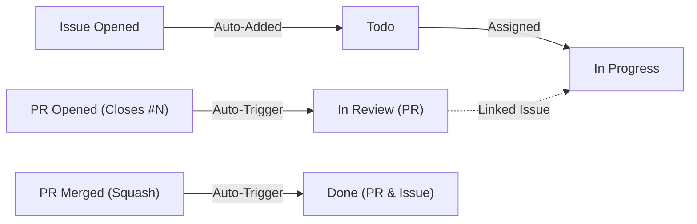

# Aimake Studio · Development & Contribution Workflow

This document defines the development workflow, issue triage, Pull Request lifecycle, automated Kanban board transitions, and quality standards for **Aimake Studio** (`products/aimake`).

It adopts best practices from high-velocity developer tooling and production open-source teams.

---

## 1. Tooling & Ecosystem Overview

| Tool | Purpose | Location / Link |
| :--- | :--- | :--- |
| **Issues** | Feature proposals, bug reports, template RFCs, tasks | [GitHub Issues](https://github.com/chicogong/aimake-creator/issues) |
| **Project Board** | Automated Kanban (Todo → In Progress → In Review → Done) | [Aimake Studio 看板 (Project #3)](https://github.com/users/chicogong/projects/3) |
| **Pull Requests** | Code review, automated quality gate, delivery tracking | [Pull Requests](https://github.com/chicogong/aimake-creator/pulls) |
| **Milestones** | Version roadmap & tracking (`v2.0.1`, `v2.1.0`, `v2.2.0`, `v2.3.0`) | [Milestones](https://github.com/chicogong/aimake-creator/milestones) |
| **Backlog TODO** | Agent-claimable task registry with files, contracts & tests | [`docs/BACKLOG_AND_AGENT_TASKS.md`](../BACKLOG_AND_AGENT_TASKS.md) |
| **Discussions** | Design systems RFC, showcase sharing, Q&A | [Discussions](https://github.com/chicogong/aimake-creator/discussions) |

---

## 2. Issue Lifecycle & Structured Templates

When reporting issues or proposing enhancements, use the structured templates in `.github/ISSUE_TEMPLATE/`:

| Template | Prefix | Labels | Purpose |
| :--- | :--- | :--- | :--- |
| **Bug Report** | `fix: ` | `bug` | Unexpected behavior, rendering bugs, export failures |
| **Feature Proposal** | `feat: ` | `enhancement` | New engine capability, export format, CLI workflow, or MCP tool |
| **Template Request** | `template: ` | `area: templates`, `community: template-submission` | New 3:4, 16:9, 4:5, or 9:16 parametric slide design system |
| **Task / Maintenance** | `chore: ` | `enhancement` | Refactor, dependency bump, CI/CD, documentation, test suite |

### Label Taxonomy

Labels are categorized into four standard dimensions:

1. **Subsystem / Area (`area: <name>`)**:
   - `area: intake`: Material ingestion, web scrapers (X/Twitter, WeChat, CSV, SRT, AutoClip, Radar)
   - `area: distill`: Knowledge distillation, persona, wiki generation
   - `area: create`: Calm Studio canvas, composer, storyboard compiler
   - `area: publish`: Omni-channel exporters (PNG, PPTX, PDF, HTML, WeChat MP CDP)
   - `area: video`: Video synthesis, FFmpeg loudness, timeline sync & CapCut drafts
   - `area: templates`: 36 design templates, CSS tokens, layout systems
   - `area: mcp`: Model Context Protocol server, ACP IDE bridge & AI agent tools
   - `area: desktop`: macOS Swift native app wrapper, runtime bundling & Tauri 2 desktop
   - `area: site`: Official `aimake.cc` 4-language showcase site & live web playground
   - `area: security`: Loopback CSRF guard, secret scanning & privacy auditing
   - `area: ci-cd`: GitHub Actions workflows & automated release pipelines
2. **Priority (`priority: <level>`)**:
   - `priority: p0-urgent`: Critical blocker, regression, or security leak
   - `priority: p1-high`: Important feature for current milestone
   - `priority: p2-normal`: Standard backlog enhancement
3. **Status (`status: <state>`)**:
   - `status: in-progress`: Actively being worked on
   - `status: needs-review`: PR submitted, awaiting review or test verification
4. **Special Flags**:
   - `roadmap`: Pinned 2026 strategic milestones
   - `community: template-submission`: Designer-contributed deck templates
   - `good first issue` / `help wanted`: Suitable for new contributors

---

## 3. Automated Kanban Board & State Transitions

Aimake Studio utilizes **GitHub Project #3** (`Aimake Studio · 旗舰工坊产品研发与经营看板`) with automated state transitions orchestrated by `.github/workflows/project-automation.yml`:



### Column Definitions

| Column | Trigger Event | Description |
| :--- | :--- | :--- |
| **Todo** | Issue or PR opened | Backlog and triaged work scheduled for development |
| **In Progress** | Issue assigned, or branch PR created | Actively being developed |
| **In Review** | PR opened against `main` | Code review and CI Quality Gate verification |
| **Done** | PR merged into `main` | Shipped, verified, and closed |

### Automatic Linkage via PR Description

To enable automatic issue closure and state progression, always reference the issue in your PR body:

```markdown
## Summary
- Implemented Twitter/X and WeChat intake parser
- Added unit tests for zero-auth scraping

Closes #12
```

When this PR merges, **Issue #12** automatically closes and both move to the **Done** column on the Kanban board.

---

## 4. Git, Branching & Worktree Strategy

To keep the git history clean and bisect-friendly, Aimake enforces a **Squash-and-Merge** policy with a single linear history on `main`.

### Git Worktree Workflow (Recommended for Parallel / Multi-Agent Work)

When working on multiple features or bugs concurrently—or when autonomous agents collaborate—use **Git Worktree** instead of switching branches in a shared directory. This guarantees clean working states, prevents file locks, and avoids dirty uncommitted states:

```bash
# 1. Fetch latest origin and create an isolated worktree outside the primary directory
git fetch origin main
git worktree add ../aimake-fix-branch -b fix/my-fix-topic origin/main

# 2. Enter the worktree and install dependencies (pnpm reuses the central content store)
cd ../aimake-fix-branch
pnpm install

# 3. Develop, run tests, and commit
pnpm typecheck
pnpm test
git commit -m "fix(subsystem): describe change affirmatively"

# 4. Push to remote and open a Pull Request
git push -u origin fix/my-fix-topic
gh pr create --title "fix(subsystem): describe change" --body "Closes #IssueNum"

# 5. Clean up after the PR is merged
cd ../aimake
git worktree remove ../aimake-fix-branch
git branch -d fix/my-fix-topic
```

### Standard Branch Naming Conventions

Always branch from the latest `origin/main`:

```bash
git checkout main
git pull origin main
git checkout -b <type>/<short-description>
```

| Prefix | Usage | Example |
| :--- | :--- | :--- |
| `feat/` | New product feature or capability | `feat/wechat-cdp-publisher` |
| `fix/` | Bug fix or regression patch | `fix/pptx-shape-offset` |
| `template/` | New parametric design template | `template/editorial-magazine-3x4` |
| `refactor/` | Code refactoring without behavior changes | `refactor/composer-ast-parser` |
| `chore/` | Build scripts, dependencies, CI/CD | `chore/update-vitest-v3` |
| `docs/` | Documentation, branding, guides | `docs/development-workflow` |

### Commit Message Format

Follow [Conventional Commits](https://www.conventionalcommits.org/):

```
<type>(<scope>): <short description>
```

- Allowed types: `feat`, `fix`, `docs`, `refactor`, `perf`, `test`, `chore`.
- Scopes correspond to subsystem areas: `(cli)`, `(studio)`, `(templates)`, `(publisher)`, `(intake)`, `(mcp)`, `(desktop)`, `(site)`, `(acp)`, `(engine)`.
- Example: `feat(publisher): add headless Chrome CDP publisher for WeChat MP drafts`

---

## 5. Local Development & Verification Preflight

Before committing code or submitting a PR, run the local quality checks:

```bash
# 1. Typecheck TypeScript
pnpm typecheck

# 2. Run unit & integration test suites
pnpm test

# 3. Run Playwright E2E browser tests
pnpm test:e2e

# 4. Run secret & private path audit (Ensures 0 leaks)
pnpm audit:secrets

# 5. Run full preflight verification
pnpm verify
```

### Local-First & Zero-Telemetry Contract

All contributions must adhere to the **Local-First Contract**:
1. **Zero External Tracking**: Never introduce analytics scripts, telemetry beacons, or unauthorized remote phone-home calls.
2. **100% Offline Capability**: Core editing, template rendering, and export to PNG, PPTX, PDF, and HTML must work entirely without an internet connection.
3. **Local Data Sovereignty**: All user workspace files, decks, research sources, and generated media remain in the user's local directory.

---

## 6. Automated Issue Submission (`pnpm issue:create`) & CLI Cheat Sheet

Use the bundled automation helper (`scripts/issue-submit.mjs`) to create properly labeled, milestone-bound issues that automatically link to **GitHub Project #3**:

```bash
pnpm issue:create \
  --type <feature|bug|test|rfc|security|architecture> \
  --area <intake,distill,create,publish,video,templates,mcp,desktop,site,security,ci-cd> \
  --priority <p0|p1|p2> \
  --milestone "v2.0.1 Urgent Fixes & Security Hardening" \
  --title "Short descriptive title" \
  --body "Markdown summary & acceptance criteria"
```

For multi-agent parallel work and claimable backlog specs, read [`docs/BACKLOG_AND_AGENT_TASKS.md`](../BACKLOG_AND_AGENT_TASKS.md) before branching.

For contributors preferring direct `gh` CLI commands:

```bash
# 1. List active issues on Project Board
gh issue list --repo chicogong/aimake-creator

# 2. Open a Pull Request linking the issue
gh pr create \
  --repo chicogong/aimake-creator \
  --title "feat(publisher): add Zhihu column exporter" \
  --body "Closes #15"

# 3. View Project #3 Kanban Board items
gh project item-list 3 --owner chicogong

# 4. Merge PR with squash merge and delete feature branch
gh pr merge <pr-number> --squash --delete-branch
```
