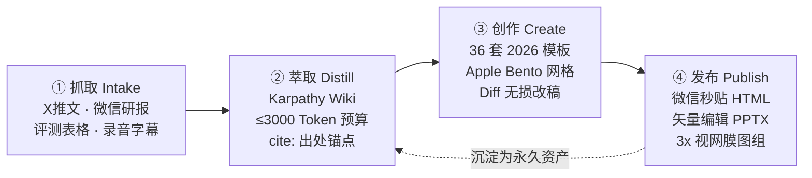

# 跑完超 1000 亿 Token 后：超级个体的纯本地创作飞轮（全套开源）

> **作者**：Chico Gong · Aimake Labs  
> **开源地址**：[https://github.com/chicogong/aimake-creator](https://github.com/chicogong/aimake-creator)  
> **官网与在线工坊**：[https://aimake.cc](https://aimake.cc)  
> **开源协议**：Apache-2.0 · 100% Local-First & Zero-Cloud Telemetry  

---

在过去一年多的高强度内容沉淀与产品工程实践中，我们调度大模型处理了**超过 1000 亿真实的业务与研究 Token**。

如果问我跑完这千亿 Token 后最深刻的体会是什么？

答案既不是“提示词有多么玄学”，也不是“哪个模型的跑分又涨了 2%”，而是：

> **人类创作者的最大内耗，从来不是缺乏灵感，而是从一个零碎的灵感火花，到最终跨平台排版交付之间，那条令人精疲力竭、充满手工搬运的“垃圾时间深渊”。**

更令人无奈的是，市面上铺天盖地的所谓“AI 创作神器”，不仅没有解决这个问题，反而把创作者拖入了更深的泥潭。

今天，我们正式将自用的全套创作系统开源 —— **Aimake（爱创）2.0**。一个 100% 运行在本地的端到端多模态创作工坊与 CLI。

---

## 一、 为什么现有的 AI 创作工具都是“精致的玩具”？

如果你深度使用过市面上的各种 AI PPT、云端排版插件或自媒体生成器，你一定会对以下场景心有戚戚：

### 1. 导出的是无法二次编辑的“拼贴死图”
许多商业 AI 工具生成的 PPT，本质上只是把渲染出的图片贴到 PPT 背景里。一旦领导说“把第三行的数字改一下”，或者客户要求换一个主色调，你无法双击修改任何一个文字框，只能把整个 Prompt 重新发一遍，祈祷 AI 下次生成的结果不要跑偏。

### 2. 泛滥成灾的“AI 翻译腔”与公文套话
“不仅如此”、“值得注意的是”、“在当今快速发展的时代”、“宛如一把双刃剑”……大模型的词表倾向让生成的文章千篇一律，失去了创作者最珍贵的个人语气与锋芒。

### 3. 数据隐私被云端平台全面绑架
你未公开的产品架构草稿、团队核心财务评测表、独家行业调研报告，不得不打包上传到第三方的云端服务器。每月还要被迫支付 20～30 美元的订阅费，断网立刻瘫痪。

### 4. 算力的巨大浪费：逼着大模型算 CSS 像素
让大语言模型去计算“这个卡片应该左移 12px 还是 16px”，就如同用核反应堆来烧开水。排版是一门高度确定性的视觉数学，而大模型擅长的是结构提炼与逻辑推理。把二者混为一谈，是现代 AI 创作工具低效的根源。

---

## 二、 破局之道：确定性计算与认知推理的彻底解耦

Aimake 的架构哲学非常纯粹：**将确定性计算下沉到本地引擎，将认知推理上浮到 AI Agent，将跨工具互联收敛到标准化 MCP 协议。**

```
┌────────────────────────────────────────────────────────┐
│      AI Agents 宿主 (Claude Code, Cursor, WorkBuddy)    │
└───────────────────────────┬────────────────────────────┘
                            │ (标准 JSON-RPC 2.0 协议)
                            ▼
┌────────────────────────────────────────────────────────┐
│     MCP 服务层 (16 大原子工具：抓取、编译、排版、发布)     │
└───────────────────────────┬────────────────────────────┘
                            │
              ┌─────────────┴─────────────┐
              ▼                           ▼
┌───────────────────────────┐ ┌───────────────────────────┐
│     Agent Skills 认知层    │ │     Core CLI 确定性引擎   │
├───────────────────────────┤ ├───────────────────────────┤
│ ① 多源素材意图分类与清洗   │ │ ① 零凭证网络与多模态 I/O  │
│ ② Karpathy Wiki 递归蒸馏  │ │ ② 80ms 确定性多模态转码   │
│ ③ 双语去 AI 味校准 (4语种) │ │ ③ 100% 纯本地离线沙箱     │
│ ④ 交互改稿与并排 Diff 审查│ │ ④ 原生 OOXML 矢量 PPTX   │
└───────────────────────────┘ └───────────────────────────┘
```

这种解耦带来了革命性的体验：
- **速度极致**：不再需要等待大模型逐字吐出排版代码，底层编译引擎 **80 毫秒** 内即可将一份纯 Markdown 编译为 5 种商业介质；
- **真实可控**：PPTX 是原生微软 Office 文本框，微信富文本是 100% 内联样式，卡片图组是视网膜 3x 超清渲染；
- **数据主权**：默认监听 `127.0.0.1`，拔掉网线照常全功能运转，零遥测、零数据外泄。

---

## 三、 四步跑完创作飞轮：从碎片火花到全网首发

在 Aimake 中，每一次创作都是一个闭环的飞轮系统：



### 第 1 步：全域素材零损耗摄入 (`aimake intake`)
创作往往始于收集。Aimake 内置了专为高频渠道定制的免配置提取引擎：
- **X (Twitter) 动态与长推**：基于全球边缘 API，**零 API Key、零登录凭证**，直出推文正文、点赞/转推互动量、作者画像与引用推文；配合 Jina Reader 自动展开连续推文串。
- **微信公众号文章**：自动破解图片防盗链，将微信独特的 `` 懒加载图片正规化为纯净 Markdown 图片。
- **CSV / Excel 业务数据表**：原生解析行列结构，**自动探测高对比度核心数字列**，直接提炼为 Bento 卡片专用的 ````metric` 语法块。
- **会议录音与字幕 (VTT/SRT)**：剥离冗余的微秒时间码与行号，按发言人与 `[01:23]` 时间锚点聚类为语义连贯的段落。

```bash
# 一行命令摄入推特讨论、表格或字幕
aimake intake "https://x.com/karpathy/status/1753123456789012345"
aimake intake ./data/deepseek-benchmark.csv
```

### 第 2 步：Karpathy LLM Wiki 知识复利 (`aimake distill`)
摄入的素材绝不堆积成无意义的“收藏夹坟墓”。
Aimake 深度复刻了 Andrej Karpathy 的 LLM Wiki 架构：
1. **严格的上下文边界**：单篇概念卡片严格控限在 $\le 3000$ Tokens 内，保证大模型注意力聚焦；
2. **严防事实幻觉**：全流程强制绑定 `cite: [source#L12-L34]` 行级信源锚点，在卡片右上角直观溯源；
3. **4 语种去 AI 味校准**：内置中/英/日/韩 Humanizer，实时清洗 120+ 常见 AI 公文废话与套话，保留创作者真实的语气。

### 第 3 步：2026 前沿设计工坊 (`aimake studio`)
告别千篇一律的模板。Aimake 内置了 36 套参数化前沿设计：
- **Apple 极简 Bento 网格**：1px 发丝微边框、`-0.035em` 负字距排印、多层景深与深色暗夜拟态；
- **瑞士平面排印 (Swiss Grid)**：经典网格系统与纯粹版式节奏；
- **对话式实时改稿与 Diff 审查**：在 Studio 画板右侧提出改动要求，系统自动生成并排（Side-by-side）或内联（Inline）差异对比，满意一键应用，改坏一秒快照回滚。

### 第 4 步：一份原稿，直出五种原生交付物 (`aimake render`)
写好一份纯文本 `.deck.md`，无需重复排版，80ms 一键分发：
1. **微信公众号富文本**：100% 内嵌 CSS 样式，剪贴板自动写入 `text/html` + `text/plain` 双格式，在微信后台编辑器直接 `Cmd+V`，排版原汁原味秒呈现；
2. **商业演示 PPTX**：纯 TypeScript 驱动 PptxGenJS，生成微软原生 OOXML 矢量形状与可双击编辑文本框；
3. **小红书 / Instagram**：3:4 视网膜 3x 超清图组；
4. **决策白皮书**：矢量超清 PDF；
5. **动效短视频**：60fps 逐帧精准对齐的 H.264 MP4 视频，自带演讲口播与字幕。

---

## 四、 开放生态：融入你最顺手的 AI 工具

我们坚决反对“再造一个封闭孤岛”。Aimake 的所有能力均以最开放的形式融入主流开发者生态：

- **腾讯 WorkBuddy (CodeBuddy)**：企业微信与内部 IDE 零配置原生插件支持；
- **Claude Desktop & Claude Code**：提供原生 Slash 命令与插件清单；
- **Cursor / VSCode / Google AGY**：标准 stdio MCP 协议，暴露 **16 大原子工具**；
- **零全局污染 (Zero Symlinks)**：工作区 7 大专属 Agent Skills 全部实体化放置在项目内，绝不在全局 `~/.` 目录下创建混乱的软链接。

---

## 五、 开源与 10 秒快速上手

Aimake 采用 **Apache-2.0 协议** 完全开源，且已正式发布 `v2.0.0`。

### 1. 终端交互向导（免配置）
```bash
# 无需克隆仓库，直接运行交互向导
npx aimake wizard

# 或全局安装 CLI 与本地工坊
npm install -g aimake
aimake studio
```

### 2. 在线免安装试玩工坊
如果你想立即体验 36 套模板与排版效果，可以直接访问我们的在线画板沙盒：  
👉 **[https://aimake.cc/playground/](https://aimake.cc/playground/)**

### 3. 项目地址与 Release 下载
- **GitHub 仓库**：[https://github.com/chicogong/aimake-creator](https://github.com/chicogong/aimake-creator)  
- **macOS 原生桌面版**：已在 GitHub Release 提供 `Aimake-macOS-v2.0.0.zip` 下载；
- **官方主页**：[https://aimake.cc](https://aimake.cc)

---

## 写在最后

跑完这千亿 Token，我们最大的感悟是：**大模型不应该是一个高高在上、收取月租的云端看门人，而应该是一套安安静静躺在你本地硬盘里、随时供你调遣的确定性武器。**

愿每一个超级个体，都能拥有属于自己的创作飞轮。

欢迎在 GitHub 上给我们点亮一颗 **Star ⭐️**，一起见证本地优先与多模态创作的未来！
