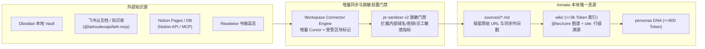

# RFC: 外部知识库连接器集成架构 (`Obsidian · Feishu · Notion · Readwise`)

> **文档状态**：`Proposed`（对应 GitHub Issue [#11](https://github.com/chicogong/aimake-creator/issues/11) · Milestone `v2.2.0`）  
> **归属模块**：`src/wiki/` · `src/intake/` · `src/workspace/` · `src/sanitizer/`  
> **核心理念**：外源作为只读/增量镜像进入工作区 `sources/`，本地 Markdown 与 `@lwc/core` 永远是唯一真源

---

## 一、 架构拓扑与零污染数据流

超级个体创作者的知识资产通常分散在 Obsidian 笔记库、飞书企业文档、Notion 数据库与 Readwise 书摘中。Aimake 通过标准连接器将其无损汇入本地工作区飞轮：

---

## 二、 四大连接器集成规范

### 1. Obsidian 本地 Vault 零拷贝互通（Priority: P1）
- **目录零迁移接入**：用户在新建或接入工作区时可直接绑定既有 Obsidian 目录（读取其 `.obsidian` 配置而不破坏插件生态），支持识别 `[[WikiLink]]` 双链与 YAML Frontmatter。
- **双向视觉产物流通**：Aimake 通过 `aimake_wiki_visuals` 导出的 `.canvas`（JSON Canvas 1.0 规范）、`.excalidraw` 与 `Overview.base` 文件原生兼容 Obsidian，可直接在 Obsidian 白板内打开编辑，再回流触发 Aimake `.deck.md` 重编译。
- **MCP 互补协同**：可与社区标准 `MCPVault` (`@bitbonsai/mcpvault`) 共存，互不抢占文件锁。

### 2. 飞书 / Lark 知识库增量同步（Priority: P1）
- **协议复用**：优先通过配置本机 `@larksuiteoapi/lark-mcp`（Lark OpenAPI MCP）或飞书开放平台读取授权文档树，拉取 Markdown 文本及图片附件至 `sources/feishu/_attachments/`。
- **受管区域保护 (`Managed Regions`)**：同步生成的 Markdown 使用明确起止边界注释：
  `<!-- aimake-sync:feishu doc_id="xxx" rev="12" --> ... <!-- aimake-sync:end -->`，确保用户可在文件外部追加个人批注而在下次增量刷新时保留人工内容。
- **企业内容发布红线拦截**：凡来自飞书镜像目录且即将进入公开渠道 `.deck.md` 的素材，必须强制经过 `pr-sanitizer` v2 检查企业内部域名、未脱敏财务指标与内网链接。

### 3. Notion 与 Readwise 摄入桥接（Priority: P2）
- **Notion**：利用官方 Notion API / MCP 递归拉取指定 Page 或 Database 记录，将 Database Properties 无损映射为标准化 YAML Frontmatter，并记录 `last_edited_time` 游标实现增量同步。
- **Readwise**：通过用户提供的 Readwise Token（仅存于本机环境变量或工作区未跟踪凭证文件，绝不上云），定期增量同步书籍与文章高亮到 `sources/readwise/`，直接转化为「每周灵感卡片」与深度长文引证素材（保留 `cite:` 锚点）。

---

## 三、 安全隐私与工作区存储契约

1. **只拉不推为默认安全策略**：飞书、Notion 连接器默认采用**单向增量只读拉取（Pull-Only into `sources/`）**，保护用户云端主文档不会被误覆盖。
2. **同步元数据隔离**：连接器配置（排除密钥本体）与增量游标统一保存在 `.aimake/connectors.json`，且 `.gitignore` 默认忽略工作区敏感凭证与同步缓存。
