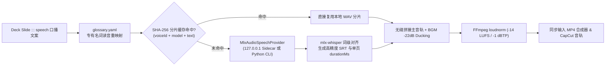

# RFC: 本地端侧语音克隆与 TTS 配音合成引擎 (`Local Voice Cloning & TTS`)

> **文档状态**：`Proposed`（对应 GitHub Issue [#3](https://github.com/chicogong/aimake-creator/issues/3) · Milestone `v2.2.0`）  
> **归属模块**：`src/speech/` · `src/renderer/exporter-media.ts` · `src/renderer/capcut-draft-builder.ts`  
> **调研基线**：`mlx-audio` · `Kokoro-82M` · `Qwen3-TTS` · `CosyVoice 2` · `Fish Speech` · `mlx-whisper`

---

## 一、 设计目标与核心不变量

将 Aimake 从纯静态配音（外部付费 API 或离线测试固件）升级为 **Apple Silicon 原生零云端开销（$0 API spend）播客级配音与声音克隆流水线**，同时延续 `ACCEPTANCE-1.0` 已确立的四项铁律：
1. **逐页 SHA-256 增量缓存复用**：只重新合成内容发生修改的幻灯片旁白（3 页改 1 页只触发 1 次合成）；
2. **词汇发音纠错字典 (`glossary.yaml`)**：支持技术专有名词、英文缩写与多音字的确定性发音映射；
3. **声学统一门禁**：视频主轨固定启用 FFmpeg `loudnorm=I=-14:TP=-1.0:LRA=11`（对齐短视频平台标准）及 `-22dB` 背景音乐自动闪避（Sidechain Ducking）；
4. **清晰许可边界**：Aimake 仅集成 MIT 协议推理桥接层，大模型权重由用户按需从官方源本地拉取，严守模型各自许可协议。

---

## 二、 2026 本地语音模型选型与性能矩阵

基于 Apple Silicon（M1–M4 统一内存架构）与 `mlx-audio` 生态实测选型如下：

| 模型 / 组件 | 参数量级与量化 | 核心优势 | 推荐承担角色 | 协议提示 |
| :--- | :--- | :--- | :--- | :--- |
| **`Kokoro-82M`** | `82M` (超轻量) | 极致推理速度（远超实时 RTF）、24kHz 工作室清晰音质、极低内存占用 | **默认零等待标准口播旁白**（英/日/中基础音色极快预览） | 开放许可（随仓核对权重 tag） |
| **`Qwen3-TTS`** | MLX 8-bit 量化 | 高自然度中英日韩四语种合成、支持 CustomVoice 与 Prompt 风格控制 | **旗舰多语种标准播报与角色音色生成** | Qwen 模型社区商业许可条款 |
| **`CosyVoice 2`** | `0.5B` | 3–5 秒参考音频零样本克隆、跨语种克隆、细粒度情感与停顿指令 | **个人 IP 超级个体真实声纹克隆首选** | Apache-2.0 / 模型条款 |
| **`Fish Speech`** | MLX 4-bit DualAR | 强表现力长文本连贯口播与多情感抑扬顿挫 | **长深度解析视频 / 播客级叙事备用引擎** | 自定义开放商业许可条款 |
| **`mlx-whisper`** | Apple MLX 加速 | 本机 GPU 毫秒级生成高精度词级（word-level）时间戳与 `.srt` | **配音后自动反推精准字幕时间轴与剪映对齐** | MIT License |

---

## 三、 `SpeechProvider` 接入架构与数据流

### 1. 运行时契约扩展（[`src/speech/providers.ts`](../../src/speech/providers.ts)）
- 保持原有 `SpeechProvider` 接口不变，新增两个本地提供者实现：
  1. `mlxAudioSpeechProvider({ host, model: 'kokoro-82m' | 'qwen3-tts' | 'cosyvoice2', refAudioPath })`：对接用户本机 `mlx-audio` FastAPI 服务（默认 `127.0.0.1`）或独立可控子进程。
  2. `glossaryRewrite(text, workspaceGlossaryPath)`：在计算分片缓存哈希与送入合成前执行文本规范化，确保修改术语词典自动触发对应分片重算。
- **用户授权门禁**：若检测到模型尚未下载，CLI 与 Calm Studio 均通过清晰确认框提示下载尺寸与预计磁盘占用，杜绝后台静默拉取数 GB 权重。

---

## 四、 验证计划与验收门禁

1. **单元测试**：在 `tests/speech-and-revision.test.ts` 中新增 `glossary.yaml` 重映射断言、Mock HTTP `mlxAudioSpeechProvider` 分片哈希复用断言（3 页改 1 页仅请求 1 次）。
2. **真机集成测试**：在 Apple Silicon 环境执行真实音频合成，使用 `ffprobe` 校验输出音轨符合 `-14 LUFS ±1.5` 与无静音尾帧截断，并与 `capcut-draft-builder.ts` 对齐音画微秒总时长。
