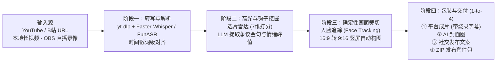
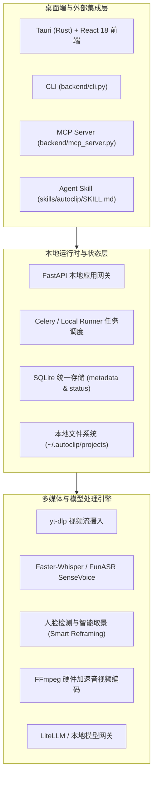
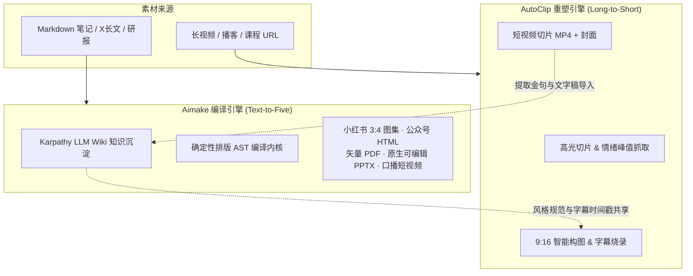

# AutoClip 深度调研与技术协同方案报告

> **调研对象**：[zhouxiaoka/autoclip](https://github.com/zhouxiaoka/autoclip)（AutoClip｜一个链接，一键出片）  
> **归属工程**：`products/aimake`（Aimake Studio）& `@aimake/engine`  
> **调研日期**：2026-11-24  
> **作者**：Aimake 架构实验室  
> **核心定位**：长视频智能高光切片、AI 包装与全平台内容重塑（Content Repurposing）桌面工坊与 MCP 服务

---

## 一、 项目全景与核心价值画像

`zhouxiaoka/autoclip` 是由个人开发者周小咖（Kris K）主导开发的开源本地优先（Local-First）AI 视频剪辑与重塑工具。

### 1. 核心业务主张（One-Link Production）
- **输入极简**：支持直接粘贴 YouTube / B 站公开视频链接、导入本地长视频（播客、访谈、演讲、网课录像）或直连 OBS WebSocket (4455) 抓取直播回放。
- **端到端一键出片（Produce to Package）**：单次处理产出四大标准化交付物：
  1. **平台适配成片**：抖音、小红书、TikTok、Instagram Reels、YouTube Shorts、Bilibili；
  2. **高吸引力封面**：自动截取情绪峰值人脸或生成 AI 视觉封面；
  3. **社交发布文案**：提炼争议性观点开场白与话题标签；
  4. **ZIP 发布套件包**：便于创作者或切片号矩阵批量归档分发。
- **本地优先算力闭环**：视频下载、语音转写、画面裁切与 FFmpeg 渲染 100% 运行在创作者本机；模型层既支持商业大模型 API（OpenAI / Gemini / 豆包 / 通义），又深度兼容纯本地端侧模型（Ollama / LM Studio + Faster-Whisper / SenseVoice）。

---

## 二、 系统架构与工程实现剖析

AutoClip 采用了经典的现代化桌面客户端 + 本地异步执行服务架构：

### 1. 核心技术栈构成
- **桌面壳体**：`Tauri (Rust)` 搭配 `React 18`，构建体积小（安装包约 30-50MB，远低于传统 Electron 方案），启动迅速且内存占用低。
- **后端执行引擎**：`FastAPI` + `Python 3.10+`，通过 `SimplePipelineAdapter` 实现了既能作为系统常驻服务运行，又能被 CLI 单进程直接加载调用的双工模式。
- **音视频处理**：
  - 摄入层：`yt-dlp` 处理远程公开视频流；
  - 语音识别：`faster-whisper`（基于 CTranslate2 高性能推理）与 `FunASR (SenseVoice)`（高精度中文与情绪识别）；
  - 视觉裁切：基于人脸识别与机位跳切检测，将 16:9 宽屏自适应重构为 9:16 竖屏（支持 `interview` 访谈双人分屏与 `podcast` 单人特写版式）；
  - 编码合成：`FFmpeg` 压制硬件编码（VideoToolbox / NVENC），字幕烧录与双行自适应换行。

### 2. 开发者协议与 Agent 开放能力
AutoClip 在工程开放性上表现亮眼，提供了完整的 **CLI + MCP + Agent Skill** 生态闭环：
- **MCP Server (`autoclip-mcp`)**：已发布至 PyPI，开发者通过 `uvx autoclip-mcp` 即可零安装启动。向 Claude Code、Cursor、OpenCode 与 Zed 暴露 5 大标准化工具：
  - `get_version`：获取运行时版本；
  - `start_quick_output`：提交视频处理异步任务，返回统一 `project_id`；
  - `get_quick_output_status`：轮询任务进度（包含 `progress`、`stage`、`eta`、`poll_after_sec`）；
  - `list_styles`：查询支持的排版视觉模板（`editorial` 杂志风、`street` 街头风、`news` 新闻风、`cinema` 电影风、`classic` 经典风）；
  - `cancel_job`：安全熔断后台 FFmpeg 进程与子任务。
- **Agent Skill 规范**：遵循 `agentskills.io` 开放标准，提供 [`skills/autoclip/SKILL.md`](https://github.com/zhouxiaoka/autoclip/blob/main/skills/autoclip/SKILL.md)，支持通过 `npx skills add zhouxiaoka/autoclip` 一键装配给任意 AI 编程助手。

---

## 三、 AutoClip 核心研究突破：「选对瞬间，而非堆砌特效」

在 AutoClip 的深度研究笔记《选对瞬间，而非堆特效：158 条短视频告诉我们什么在驱动播放》（2026-10）中，团队基于 158 条公开短视频进行了严格的**同账号同日对照实验（A/B Testing within Same Account）**，得出了颠覆常规认知的数据洞察。

### 1. 核心实证结论
- **特效与包装对播放量无统计学正向驱动**：
  - 切镜率、动态放大（Punch-in）、彩色花字、表情贴纸、音效频次与调色滤镜，在高播放量爆款与低播放量冷门视频中分布完全一致。
  - GQ 采用同一套设计模板，高播达到 282 万次，同号低播仅 6261 次（相差 450 倍）；HasanAbi 使用同一模板的 4 条视频播放相差 8-12 倍。
- **决定视频播放的决定性要素**：
  1. **前 1.5 秒进入视觉与情绪峰值**：第一秒必须出现有表情的人脸、实物道具演示或最具冲击力的第一句话；
  2. **具象化两行标题条（Specific Title Bar）**：结构固定为「设定/原话」+「具体人名 + 行为/数字反差」，抽象口号与宏大概念会导致完播率腰斩；
  3. **正反论断开场**：首句采用最可争论的观点句（如 *"Every seed investment is an option bet."*）；
  4. **严格的时长克制**：默认控制在 $\le 90$ 秒以内，只有具备连续争论或密集笑点时才允许延长；
  5. **技术底线规范**：音频响度严格归一至 `-14 LUFS ±1`，真实峰值 $\le -1\text{ dBTP}$，杜绝数字爆音与绝对静音。

---

## 四、 Aimake 与 AutoClip 的定位对比与互补协同

Aimake 与 AutoClip 位于数字内容创作价值链的不同关键环节，二者具备极高的天然互补性。

### 1. 核心能力与定位差异

| 维度 | AutoClip (`zhouxiaoka/autoclip`) | Aimake Studio (`products/aimake`) |
| :--- | :--- | :--- |
| **核心命题** | **长视频到高光切片（Long Video to Clips）** | **结构化文本到全介质交付（Text to Deliverables）** |
| **主要输入** | YouTube / B 站长视频、本地录屏、OBS 直播流 | Markdown 原稿、Karpathy LLM Wiki、推文、研报表格 |
| **主要交付物** | 单一介质短视频成片 + 封面 + 社媒发布词 | **5+1 维原生交付物**：小红书图文、微信富文本、PDF、PPTX、MP4、CapCut工程 |
| **排版逻辑** | 基于真实拍摄画面的裁切（Cropping & Framing）与字幕贴层 | 基于 CSS 像素级网格与 OOXML 文本框的确定性代码排版（Code-as-Layout） |
| **生态定位** | 视频内容重塑与矩阵化分发工具 | 超级个体思想沉淀、知识复利与全渠道品牌统一编译器 |

---

## 五、 Aimake 吸收与落地方案

针对 AutoClip 展现出的优秀工程实践与研究成果，Aimake 规划在以下四个维度展开深度吸收与工程协同：

### 1. 阶段一素材摄入联动（Intake via AutoClip MCP）
- **场景**：创作者丢入一个 1 小时的访谈或播客链接（如 Lex Fridman 对谈或 Sam Altman 演讲）。
- **流程**：
  1. Aimake `Stage 1 Intake` 通过 MCP 客户端调用 `autoclip-mcp` 的 `start_quick_output`；
  2. AutoClip 在本机后台提取高光切片，产出剪好的 MP4、时间戳字幕（SRT）及核心摘要；
  3. Aimake 摄入模块自动将生成的字幕与金句同步写入工作区 `sources/` 与 `wiki/` 知识库；
  4. 触发 Aimake 自动飞轮，一键生成配套的 **Bento 视觉解读图卡**、**微信公众号复盘深度文章** 与 **汇报演示 PPTX**，实现真正意义上的「一个链接，全渠道全媒介成套交付」。

### 2. 视频模板排版与听觉底线升级
- 吸收 AutoClip 关于短视频播放驱动因素的研究成果，优化 Aimake 视频模板矩阵（`video-podcast-wave`、`video-keynote-dark`、`video-kinetic-quote`）：
  - **前 1.2 秒入点法则**：标题展示即刻进入主题，消除缓慢的淡入等待动画；
  - **具象化双行标题条规范**：在视频顶部标准化预留「分类标签」+「主语 + 核心数据/反差结论」的双行视觉槽位；
  - **响度标准化（Loudness Normalization）**：在 `@aimake/engine` 的视频合成管道中强制加入 FFmpeg `loudnorm` 滤镜，确保导出音视频统一稳定在 `-14 LUFS ±1`，真实峰值锁死在 `-1 dBTP`。

### 3. CapCut / 剪映草稿工程协议互通（Issue #10 协同）
- AutoClip 目前以直接压制最终 MP4 为主。创作者若希望二次精修，重新导出非常耗时。
- Aimake 正在推进的 **#10（剪映 draft_content.json 原生导出）** 可作为剪辑资产的中间交换格式：
  - 将 AutoClip 提取出的片段切点、对齐字幕与分轨音频，直接组装为标准 CapCut 草稿工程；
  - 创作者可在剪映中直接微调转场与文字，进一步提升二创自由度。

### 4. 软件工程与质量门禁吸收
- 学习 AutoClip 的严格质量门禁（`AGENTS.md`、`TESTING_ACCEPTANCE.md` 与多端安装包校验流水线）：
  - 坚持每次发布必须通过全量测试套件与真实文件系统隔离检验；
  - 遵循统一的语义化版本控制与确定性依赖打包标准。

---

## 六、 结论与后续行动路线

AutoClip 是国内独立开发者在 AI 视频剪辑与 Local-First 工具领域的标杆项目。其**轻量 Tauri 架构**、**PyPI 一行调用的 MCP 体验**以及**基于 158 条视频真实数据的克制设计哲学**，为 Aimake 提供了极佳的技术参考。

**后续推进计划**：
1. **[协议接入]** 在 Aimake CLI 中增加 `--with-autoclip` 实验性参数，通过 MCP 协议快速调用本机 `autoclip-mcp` 提取音视频高光文稿；
2. **[视觉规范]** 将「具象双行标题条」与「-14 LUFS 响度门禁」固化进 Aimake 2.0 视频模板排版引擎；
3. **[看板跟踪]** 在 GitHub Project #3 中建立协同任务卡，推进长视频转全域分发的自动化工作流。
