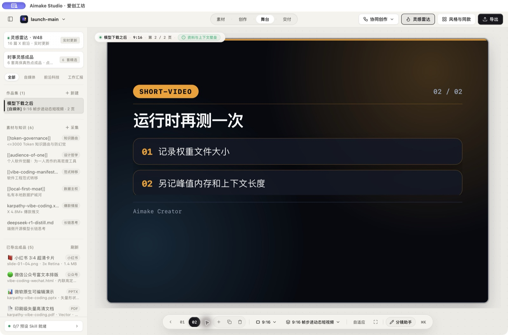
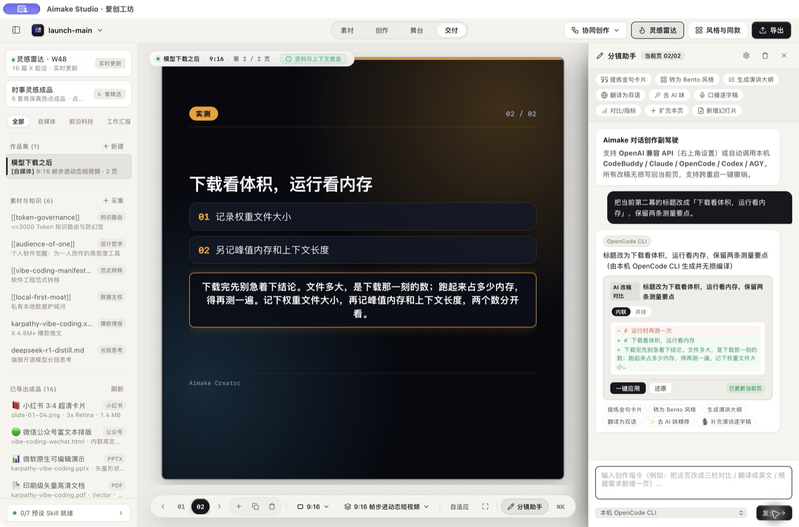

# Making a short technology video in Aimake

A creator needs to know what their audience will see, which copy an assistant changed, and what file is ready to post. In this session, Studio produced a playable portrait video. The editor showed it in landscape, the assistant rewrote the working copy before approval, and the public Playground lost the draft on reload. Those three moments deserve priority over a visual reskin.

## Three ways to open the work

| Entry | What we opened on November 28, 2026 | What worked |
| --- | --- | --- |
| Public macOS download | Fresh copy of the official v2.0.0 ZIP on macOS. The app opened to an empty window. Its packaged CLI failed to resolve `gray-matter`. | The source build below let us continue. The public ZIP still needs a release-level retest. [Release](https://github.com/chicogong/aimake-creator/releases/tag/v2.0.0) · [#36](https://github.com/chicogong/aimake-creator/issues/36) |
| Desktop Studio and its local browser URL | macOS app built from `eaa9c6e`. Opened the same running Studio from its loopback URL in a browser. | Both showed the same two-scene work and the newly exported file. The native window also played the MP4 and exposed the macOS menus. |
| Public Playground | Opened the default sample, pasted the same source in the advanced editor, and selected scene two. | The title and both bullets rendered. The delivery drawer offered WeChat rich text, PNG, print/PDF and source download. Its toolbar also advertised video and PPTX. Reload brought back the three-page sample. [Playground](https://aimake.cc/playground/) · [#66](https://github.com/chicogong/aimake-creator/issues/66) · [#90](https://github.com/chicogong/aimake-creator/issues/90) |

<details>
<summary>Two-scene manuscript used for the comparison</summary>

```markdown
---
title: 模型下载之后
template: video-kinetic-reel
aspect: "9:16"
locale: zh-CN
secondsPerSlide: 2
fps: 24
watermark: false
---
<!-- scene: cover | layout: cover -->
# 下载体积等于运行内存吗？
## 一次模型实测要记两个数

---

<!-- scene: evidence | layout: bullets -->
# 运行时再测一次
- 记录权重文件大小
- 另记峰值内存和上下文长度
```

</details>

## What the creator actually sees



*Native macOS window, scene two, before invoking the assistant.*

| Surface | Observation | Proposed change |
| --- | --- | --- |
| Framing | Studio displayed 9:16 in the status bar. Its local browser view measured 944 × 554 CSS pixels for the slide itself at a 1280 × 720 viewport. The export was 1080 × 1920. Pasting the same source into Playground carried over the previous sample’s 16:9 selector. | Resolve the manuscript aspect once. Scale the entire slide uniformly. Compare normalized title and bullet positions against the exported frame at three window sizes, including with the assistant open. [#88](https://github.com/chicogong/aimake-creator/issues/88) |
| Color and type | The public editor opened dark and local Studio opened light. Switching Playground to light matched the body background (`#eceae4`), body text (`#141413`) and primary export button colors. Both scene headings declared the same font stack starting with Plus Jakarta Sans and PingFang SC, 46 px, weight 800 and `#f8fafc`. The export controls measured 12 px and 12.5 px respectively. These are CSS measurements, including fallbacks. | Share shell roles for text, backgrounds, actions, type sizes and focus. Keep template palettes independent. Compare both shells in the same theme and viewport, then compare the actual exported artwork separately. Fixing canvas scale will make a larger difference to perceived type size than changing the heading font. |
| Classification | All displayed the technology video as 自媒体. Selecting 自媒体 or 前沿科技 hid it. The card label and filter each infer categories from different keywords in the name and path. | Store editable topics on the work. Show format and destination separately, e.g. Technology · Vertical video · YouTube Shorts. Use the same category identifier for the badge, filter and accessible selected state. [#89](https://github.com/chicogong/aimake-creator/issues/89) |
| Visual hierarchy | The fresh workspace showed five example deliverables before the first export. The assistant offered nine quick actions above the conversation and another set beside the result. Sample counts, tool-readiness pills and source labels compete with the next action. | Give each stage one primary action. Place real files under “Your exports” and samples behind “See an example”. Keep selected source and tool status beside the operation that needs them. Start the assistant with two actions such as “Shorten this headline” and “Draft a voiceover”. Put template changes and engine settings under “More”. [#34](https://github.com/chicogong/aimake-creator/issues/34) · [#74](https://github.com/chicogong/aimake-creator/issues/74) |

### A first screen someone can read

Use **Add a source** as the primary action in an empty workspace, with **Try an example** as a secondary link. Once a source is selected, show its title, publisher and date next to **Create a draft**. On the canvas, keep **Edit**, **Ask AI** and **Export** visible. Let selection supply context: selecting a headline can offer **Shorten headline**, while selecting a whole scene can offer **Draft voiceover**. Keep the nine-action palette available from an overflow menu.

The wording can change before the shell is redesigned. “资料与上下文壁垒” can read **来源与引用**. “沉淀到知识库” can read **保存到素材库** when that is the destination. “交付成品预览与闭环归档” can read **预览和下载** with the saved file location beneath it. Reserve a badge for a status that affects the user's next decision, such as **Draft**, **Exporting** or **Ready**. Display publisher, date and file format as ordinary text. This lets the artwork carry the visual style while the editor remains legible.

### Using AI on one scene

In the native assistant we chose the local OpenCode CLI and asked it to change the second headline to **下载看体积，运行看内存** and preserve the two measurement bullets. The new headline appeared and both bullets survived. The working manuscript also gained an eyebrow and a speech block. The file and canvas had already changed while the result still offered “一键应用”. Clicking “还原” restored the old headline. The restored source retained serialization changes in spacing and front matter order. In Playground, “去AI味” changed 赋能 to 驱动. A second phrase with no matching rule produced the same completion message even though the wording stayed identical. The public handler uses a list of Chinese replacements. [Desktop issue #41](https://github.com/chicogong/aimake-creator/issues/41) · [Playground implementation](../../src/site/playground-builder.ts)



A creator should be able to select a headline, request a shorter version, read the proposed text and accept or dismiss it. Present the changed fields in plain language and let the creator choose extra suggestions, such as added speech. Retain the source snapshot and revision until acceptance and offer one-step undo. Show the active engine when it affects what happens. Label local text replacement as a wording check and report the number of matches.

### What the video buttons delivered

| Desktop action | Verified output |
| --- | --- |
| Silent MP4 | Played inside Studio. File inspection found H.264, 1080 × 1920, 24 fps, 96 frames, four seconds and no audio track. The result card displayed 60 fps. [#43](https://github.com/chicogong/aimake-creator/issues/43) |
| Narrated MP4 | File inspection found 16 seconds of H.264 video, an AAC track and a timed subtitle track. The native action selected the offline test-tone provider. A creator asking for a voiceover needs a playable speech sample and the actual voice named before export. [#40](https://github.com/chicogong/aimake-creator/issues/40) |
| Export CapCut project directory | Generated a four-second, 24 fps timeline with two image segments, text segments, cover, and project JSON. The third-party CapCut editor was outside this run. |

## How to share the right logic

The macOS shell launches the Node Studio process and opens the local URL in WKWebView. The local browser connects to that same server. Studio parses the manuscript, compiles its HTML preview and delegates video encoding to the media exporter. Public Playground generates a static page with its own parser, slide renderer, fit logic and browser storage. Both surfaces reuse template styling. They can therefore match individual title colors and still disagree about frame geometry, draft recovery and export actions. [Native launcher](../../desktop/macos/AimakeApp.swift) · [Studio server](../../src/studio/studio-server.ts) · [Media exporter](../../src/renderer/exporter-media.ts) · [Playground](../../src/site/playground-builder.ts)

| Order | Engineering change | Acceptance from a creator’s point of view |
| --- | --- | --- |
| 1 | Give both renderers one aspect resolver, canonical slide dimensions and shared conformance fixtures. Derive export labels from the generated artifact. | A portrait work stays portrait while editing, opening the assistant and exporting. Its result card reports the measured frame rate. |
| 2 | Use one manuscript parser and template contract wherever feasible. Keep browser storage/download and desktop workspace/encoder operations in small separate adapters. Have each runtime declare available actions once for drawers, tooltips and result cards. | The same manuscript opens with the same scene count, wording and aspect on both surfaces. The website can offer “Download source to continue in Studio” for desktop-only formats. |
| 3 | Make edits revision-aware. Separate AI suggestions, committed edits and export jobs. Keep the edited draft independently of showcase sample selection. | Refresh restores a draft. Requesting a headline change leaves the original intact until accepted. Dismissing it preserves the current file. |
| 4 | Test the first session with a source link and an empty portfolio. Make “Add material → Generate draft → Review → Export” the visible path. Record where someone needs help and whether they can find their work again. | A first-time creator can finish a vertical video and find the saved file unaided. Use five new participants and a five-minute target for the first usability round. This target is proposed. |

The walkthrough covered one template, one computer and one live OpenCode edit. The suggested first-session test would establish how much these changes help people who have never used Studio.
