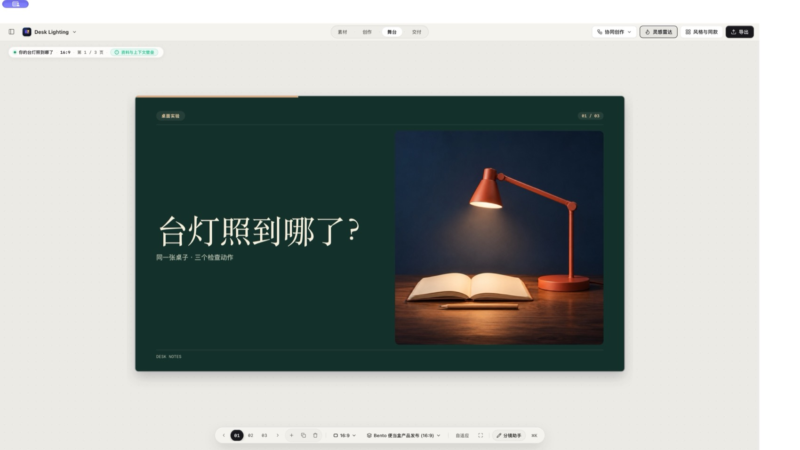

# 台灯照到哪了？

一份拍摄脚本，两张原创配图，一张带许可的实拍替换图。三套作品分别解决封面吸引点击、手机上快速读完、办公知识可回查这三个问题。换主题时，可以复用版式和阅读节奏，再替换照片、动作和出处。

| 作品 | 读者看到什么 | 公开参考 |
| --- | --- | --- |
| [小红书图文 · 3:4](./xiaohongshu.deck.md) | 主图先交代场景，短标题说明用途，最后一页留下可收藏的三步清单 | [小红书创作学院](https://www.xiaohongshu.com/user/profile/5c450b8a00000000050393d8) · [少数派桌搭精选](https://sspai.com/post/102125) |
| [B 站 / YouTube 封面与分镜 · 16:9](./video.deck.md) | 一件容易认出的主体，一个能在视频里回答的问题。随后用固定机位和对照镜头展示变化 | [影视飓风](https://space.bilibili.com/946974/) · [MKBHD 的桌面评测](https://www.youtube.com/watch?v=j2rszuZ-9PY) |
| [LinkedIn 文档 · 4:5](./linkedin.deck.md) | 标题交代问题，逐页讲清观察、调整、复查。附一张可以复用的对照卡 | [LinkedIn 创作格式](https://members.linkedin.com/create-tools) · [Justin Welsh 的一稿多用方法](https://justinwelsh.me/essays/how-1-piece-of-content-becomes-16-the-1-3-5-method) |

公开作品提供构图与写作参考。样稿中的镜头来自[原创拍摄清单](./sources/shot-list.md)，使用生成图时可保留「示意图」说明，评测结果可以换成自己的实拍和记录。

*从源码构建的 Aimake macOS App 实拍。*

## 用 Aimake 换封面

1. 把这个目录复制到工作区的 `decks/` 下，保留 `assets/`，再把 `sources/shot-list.md` 复制到工作区顶层的 `sources/`。打开任一 `.deck.md`。
2. 在图像工具里按[提示词](./assets/IMAGE_CREDITS.md)生成主体图或细节图，也可以使用带许可的[复古台灯实拍](./assets/commons-vintage-lamp.jpg)。
3. 在 Aimake 按 `⌘E` 打开源码，选中封面原图的 Markdown 行，再点「插入封面图」。App 会将 JPEG 或 PNG 复制到作品同目录的 `assets/`，并写出可随作品移动的相对引用。
4. 保存源码，检查舞台上主体裁切和标题可读性。小红书导出 PNG 图组，视频可导出首页 PNG 并按分镜补实拍，LinkedIn 导出 PDF 文档。图片、作者和许可说明可一起归档。

## 生图交互的迭代顺序

| 顺序 | 原生操作 | 验收 |
| --- | --- | --- |
| 1 | 从现成图完成封面，支持离线导入、替换和相对路径归档 | 移动工作区后仍能预览和导出。三种比例各能打开一套可编辑的示例 |
| 2 | 在封面上直接选图、拖图和调整焦点，预览本作品需要的比例 | 深浅底都能读清标题，换图后之前的版本可找回 |
| 3 | 在画布侧边准备图片简报，复制给 Codex 或其他图像工具，选回候选图 | 简报包含用途、画幅、主体安全区和版权来源。并排试两张，只把用户选中的图用于当前页 |
| 4 | 通过可选的图像服务接口运行生成任务，保留本机导入入口 | 用户选择要发送的提示词和参考文件。耗时、失败、费用及再次生成可以追踪 |

[素材授权与生成提示词](./assets/IMAGE_CREDITS.md) · [图像槽位与布局提案](https://github.com/chicogong/aimake-creator/issues/25)
