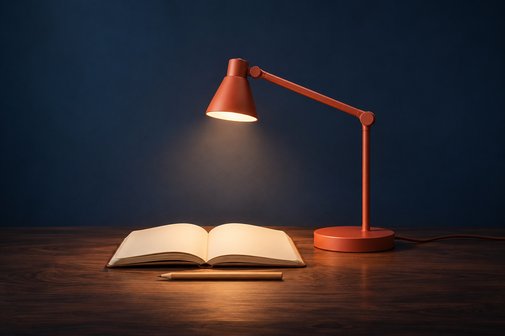

<!-- scene: cover | layout: cover | eyebrow: WORKSPACE FIELD GUIDE -->

# A desk lighting check

## A repeatable walk-through for reading and screen work

---

<!-- scene: observe | layout: bullets | eyebrow: OBSERVE | cite: sources/shot-list.md#L5-L11 -->

# Start in your usual seat

- Write one line. Notice whether your hand shadows the pen.
- Look at your screen. Check for a visible lamp reflection.

---

<!-- scene: change | layout: comparison | eyebrow: CHANGE ONE THING | cite: sources/shot-list.md#L9-L15 -->

# Move the light

| Keep fixed | Change |
|---|---|
| Your seat, page, screen and camera | Move or turn the lamp once |
| The same two observations | Repeat and record what changed |

---

<!-- scene: record | layout: bullets | eyebrow: RECORD | cite: sources/shot-list.md#L13-L15 -->

# Make the result repeatable

- Save two frames from the same angle.
- Write down the position that worked for that task.
- Rerun the check when your setup changes.
