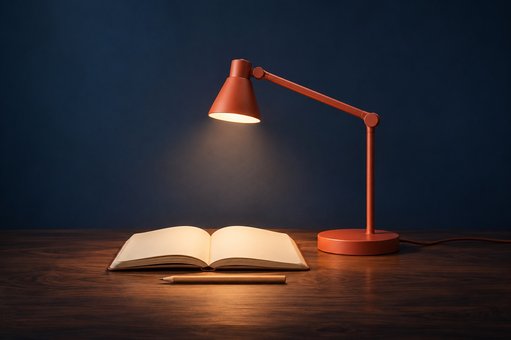
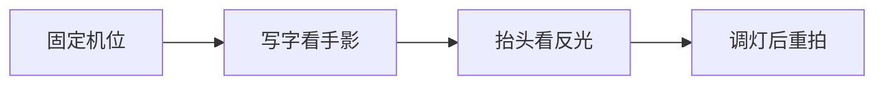

<!-- scene: cover | layout: cover | eyebrow: 桌面实验 -->

# 台灯照到哪了？

## 同一张桌子 · 三个检查动作

---

<!-- scene: demo | layout: diagram | eyebrow: 固定机位，做两次 | cite: sources/shot-list.md#L5-L13 -->

# 先拍坐姿，再移动灯头

---

<!-- scene: close | layout: bullets | eyebrow: 结尾实拍 | cite: sources/shot-list.md#L13-L15 -->

# 两个画面一起看

- 保持同一坐姿、机位和曝光。
- 把调整前后的实拍并排放。
- 一句话交代你改了什么。
