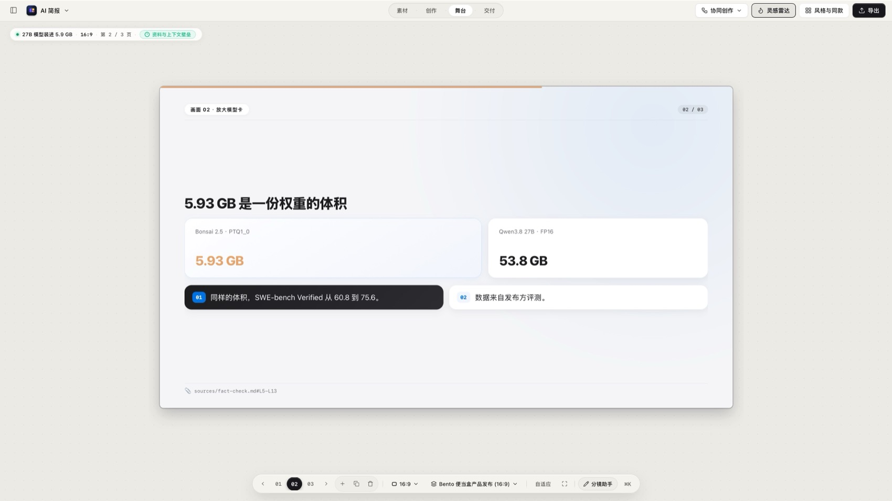

# 27B 只占 5.9 GB？从新闻到发布稿

用 2026-11-24 的 Bonsai 2.5 27B 发布练习截取一个值得点开的新闻角度。读者看到的数字反差是模型卡中的 **5.93 GB 对 53.8 GB**。看完能带走一个实用动作，下载前查格式、内存和具体任务。[发布原文](https://prismml.com/news/bonsai-2-5-27b) · [事实卡](./sources/fact-check.md)

| 交付 | 内容 |
| --- | --- |
| [公众号 / 知乎 / 掘金正文](./article.md) | 用标题、重点引用、三行表格和短问答解释，HTML 正文按文字排版，保留可核对的来源链接 |
| [小红书 3:4](./xiaohongshu.deck.md) | 四页图文，从文件体积讲到评测差别，末页是下载自查卡 |
| [B 站 / YouTube 16:9](./video.deck.md) | 一个问题、两组可核对的数据和一张实跑流程图 |
| [标题、口播和发布说明](./publishing.md) | 按读者动机改写开场。可用收藏、完播和点击数据选下一版 |



## 复用与导出

在工作区中保持 `decks/` 下的作品与 `assets/` 相对位置，另把 `fact-check.md` 放进工作区的 `sources/`。换题时更新日期、原始来源、对照口径和读者要做的下一步。

正文可用 Aimake 从 Markdown 生成带内联样式的 HTML 和各平台本地文件。桌面端打开两份 `.deck.md` 即可预览图文与分镜。

```bash
aimake publish ./examples/news-bonsai-27b/article.md --target wechat,zhihu,juejin,xiaohongshu --out ./exports/bonsai-news
aimake render ./examples/news-bonsai-27b/xiaohongshu.deck.md -f png -o ./exports/bonsai-news/cards
```

封面小图由 Codex 内置 imagegen 制作后压缩为 JPEG。提示词描述黑色台面上的钴蓝叠层玻璃和一道琥珀色高光。它用来表达压缩，标题、数字和图解由 Aimake 编辑。[小图素材](./assets/compression.jpg)
