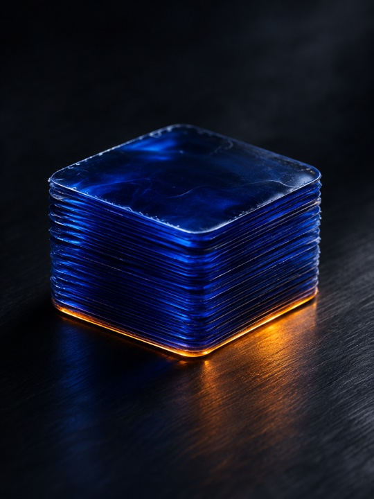

<!-- scene: cover | layout: cover | eyebrow: 11.24 AI 新模型 -->

# 27B，5.9 GB？

## 我的电脑能跑吗？



---

<!-- scene: evidence | layout: metrics | eyebrow: 画面 02 · 放大模型卡 | cite: sources/fact-check.md#L5-L13 -->

# 5.93 GB 是一份权重的体积

```metric
- Bonsai 2.5 · PTQ1_0: 5.93 GB
- Qwen3.8 27B · FP16: 53.8 GB
```

- 同样的体积，SWE-bench Verified 从 60.8 到 75.6。
- 数据来自发布方评测。

---

<!-- scene: check | layout: diagram | eyebrow: 画面 03 · 下载前 | cite: sources/fact-check.md#L15-L19 -->

# 一次小测试，比猜配置管用


- 短任务跑通后，再增加上下文。
