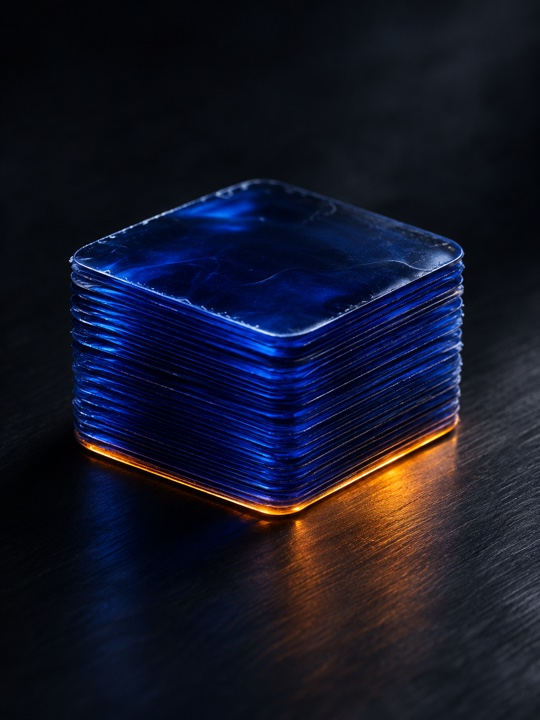

<!-- scene: cover | layout: cover | eyebrow: 11.24 AI 新模型 -->

# 27B 只占 5.9 GB？

## 我的电脑能跑吗？



---

<!-- scene: filesize | layout: metrics | eyebrow: 先看文件 | cite: sources/fact-check.md#L5-L8 -->

# 模型卡给了两组数字

```metric
- Bonsai 2.5 压缩权重: 5.93 GB
- Qwen3.8 FP16 对照: 53.8 GB
```

- 5.93 GB 对应 PTQ1_0 文件。
- 上一版也是 5.93 GB。新版的变化要看任务表现。

---

<!-- scene: benchmark | layout: metrics | eyebrow: 再看任务 | cite: sources/fact-check.md#L10-L13 -->

# 同一体积下，得分有变化

## SWE-bench Verified · 发布方评测

```metric
- Bonsai 2: 60.8
- Bonsai 2.5: 75.6
- FP16 对照: 80.6
```

---

<!-- scene: save | layout: bullets | eyebrow: 下载前建议收藏 | cite: sources/fact-check.md#L15-L19 -->

# 第一次试跑，查这三项

- 对格式。确认权重与引擎版本匹配。
- 看内存。给缓存和其他程序留余量。
- 跑短任务。记下峰值内存和用时，再逐步加长上下文。
