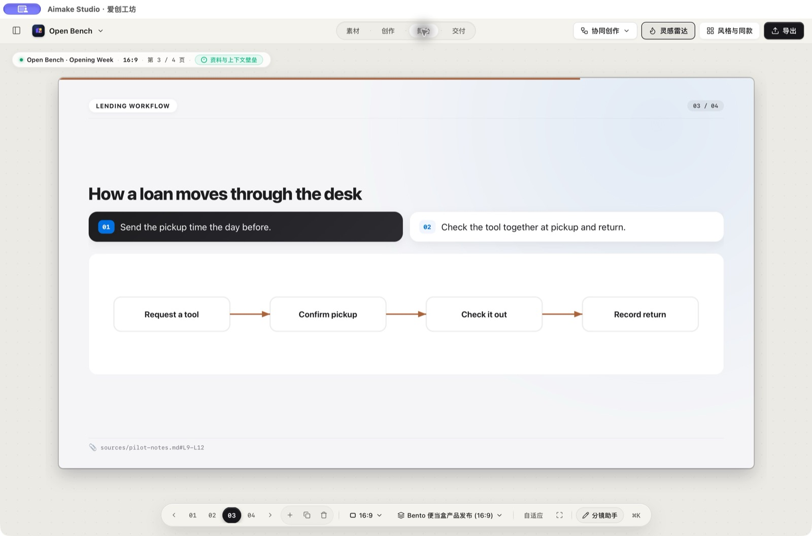

# Open Bench

A fictional neighborhood tool library reports on its first week. The example includes a four-page presentation, a portrait borrowing card, and short source notes. Use the source notes to check the figures and lending workflow shown in the deck.

- [Opening-week presentation](./open-bench.deck.md)
- [Portrait borrowing card](./borrowing-card.deck.md)
- [Source notes](./sources/pilot-notes.md)

## Open in the macOS app

From the repository root, build the native app with Node.js 22 or newer and pnpm. Copy the example into a writable workspace to keep renders separate from source.

```bash
pnpm install --frozen-lockfile
pnpm desktop:build
workspace=$(mktemp -d)
mkdir -p "$workspace/decks" "$workspace/exports"
cp -R ./examples/open-bench/. "$workspace/decks/"
node dist/cli.js desktop "$workspace/decks/open-bench.deck.md" --workspace "$workspace"
```

Open the borrowing card from the same workspace. To export the samples from the command line, use the built CLI.

```bash
node dist/cli.js render "$workspace/decks/open-bench.deck.md" -f pptx -o "$workspace/exports/open-bench.pptx"
node dist/cli.js render "$workspace/decks/borrowing-card.deck.md" -f png -o "$workspace/exports/borrowing-card"
```

PNG output uses Playwright and Chromium. Run `pnpm exec playwright install chromium` if Chromium is missing.



*The editable diagram page on the stage in the native macOS app.*

## Reuse the cover layout

To reuse the illustrated Bento cover, use `template: apple-bento-launch` and `layout: cover`, then add a Markdown image with a JPEG or PNG path relative to the deck. Keep the image in the deck folder or a subfolder. The 16:9 canvas lays out the title and image together. The desktop screenshot uses this example in a build that includes the cover layout.

The cover photograph is an original AI-generated still life created for this example with the built-in image generation tool. The prompt describes hand tools and an orange canvas glove on a dark green workshop bench, lit by warm late-afternoon light.
