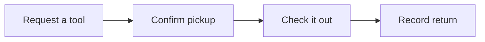

<!-- scene: cover | layout: cover | eyebrow: OPENING WEEK FIELD REPORT -->

# Open Bench

## A neighborhood tool library opens its doors.


---

<!-- scene: week-one | layout: metrics | eyebrow: OPENING WEEK RESULTS | cite: sources/pilot-notes.md#L3-L5 -->

# The first week in numbers

## Requests, pickups, and returns from the same seven-day pilot

```metric
- Borrow requests: 72 (All requests received)
- Tools collected: 49 (Confirmed desk pickups)
- Returns recorded: 32 (Checked in at the desk)
```

---

<!-- scene: lending | layout: diagram | eyebrow: LENDING WORKFLOW | cite: sources/pilot-notes.md#L9-L12 -->

# How a loan moves through the desk

- Send the pickup time the day before.
- Check the tool together at pickup and return.



---

<!-- scene: next-week | layout: bullets | eyebrow: NEXT WEEK | cite: sources/pilot-notes.md#L16-L17 -->

# Make pickups easier to plan

- Add a Saturday afternoon pickup window.
- Send a reminder the evening before.
